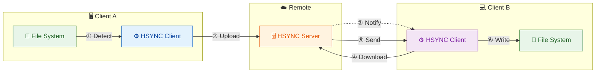
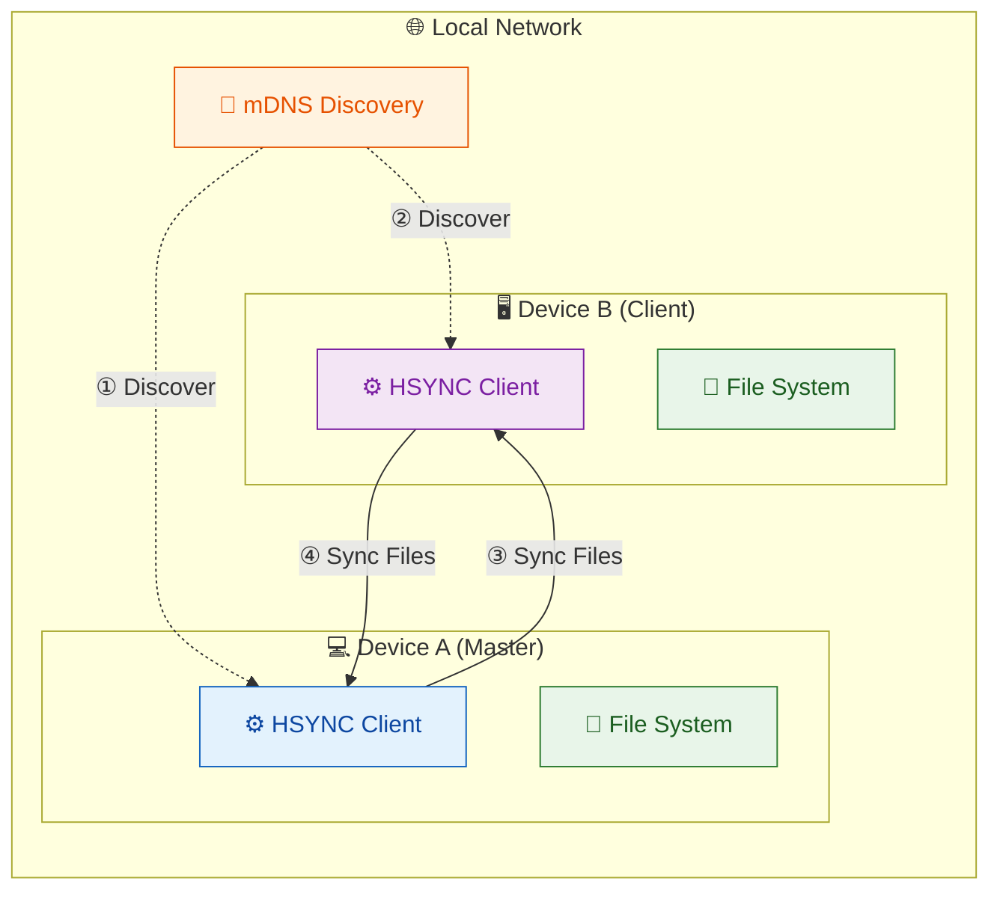

# HSYNC Client

> [!WARNING]
> **HSYNC manipulates files and directories** — it creates, overwrites, moves, and deletes data.
> Misconfiguration, software defects, or other unforeseen conditions may lead to **data loss or
> corruption**. **Use at your own risk and always keep verified, independent backups.**
> The software is provided "as is", without warranty of any kind — see the full
> [Disclaimer](#disclaimer) and [License](#license) below.

---

**HSYNC** - HTTP-based file synchronization client.

Synchronize files between a local directory and a remote **bucket**. A bucket is a shared directory hosted on a central HSYNC server or on another peer in LAN Mode.

- In **Server Mode**, clients connect to a centralized server.
- In **LAN Mode** (P2P), clients discover each other via mDNS and one automatically becomes the master—no central server required.

## Quick Overview



**Sync Flow (A → B):**
1. **① Detect** — Client A detects file change via watchdog
2. **② Upload** — Client A uploads file to server
3. **③ Notify** — Server broadcasts event to Client B via WebSocket
4. **④ Download** — Client B requests file from server
5. **⑤ Send** — Server sends file content to Client B
6. **⑥ Write** — Client B writes file to local disk

The same flow applies in reverse (B → A) for bidirectional sync.

## LAN Mode (P2P) Overview

In LAN Mode, clients synchronize directly with each other without a central server:



**LAN Mode Flow:**
1. **① Discover** — Clients discover each other via mDNS (Bonjour/Avahi)
2. **② Elect Master** — One device becomes the master (source of truth)
3. **③ Sync Files** — Client downloads from master via HTTPS
4. **④ Sync Files** — Master uploads changes to client

In LAN mode, the master is the source of truth and slaves sync from it. Both directions are supported for bidirectional sync peers.

## Why HSYNC?

HSYNC is designed to synchronize files using **only the HTTP/HTTPS protocol**. This makes it the ideal choice in environments where HTTP is the only protocol allowed through firewalls, proxies, or network policies — a common constraint in corporate networks, cloud environments, and restricted infrastructures.

Most traditional file synchronization tools rely on protocols that are often blocked or unavailable in these scenarios:

| Tool | Required Protocol | Default Port(s) | Works over HTTP only? |
|------|-------------------|------------------|-----------------------|
| **HSYNC** | HTTP / HTTPS | 80 / 443 | ✅ **Yes** |
| **rsync** | SSH or rsync daemon | 22 / 873 | ❌ No |
| **scp / sftp** | SSH | 22 | ❌ No |
| **Unison** | SSH or direct socket | 22 / custom | ❌ No |
| **Syncthing** | BEP (custom protocol) | 22000 | ❌ No |
| **FTP / FTPS** | FTP | 20–21 / 990 | ❌ No |
| **Rclone** | Varies (S3, SFTP, etc.) | Varies | ⚠️ Partial (backend-dependent) |

**When to choose HSYNC:**

- 🏢 **Corporate networks** — only ports 80/443 are open through the firewall
- ☁️ **Cloud environments** — services behind load balancers or reverse proxies that only expose HTTP endpoints
- 🔒 **Restricted infrastructures** — SSH is disabled, VPNs are unavailable, or custom protocols are blocked
- 🌐 **Web-friendly setups** — your infrastructure already routes HTTP traffic through CDNs, WAFs, or API gateways

Since HSYNC uses standard HTTP/HTTPS, it works seamlessly through corporate proxies, reverse proxies, load balancers, and CDNs without any special configuration.

## Features

### Core
- 🔄 Bidirectional file synchronization
- ⬆️ Upload-only and ⬇️ download-only sync directions
- ⚡ Parallel file transfers (configurable concurrency)
- 👁️ Real-time file system monitoring (watchdog)
- ✅ SHA-256-based file integrity verification
- 🗜️ Zstandard (zstd) transfer compression
- 🔗 Symbolic link synchronization support
- 🙈 `.hsyncignore` (gitignore-style) filtering
- 📦 Compilable to standalone binary (PyInstaller)

### Server Mode
- 📡 WebSocket connection for remote events
- 🔐 API Key authentication (secure first-message auth)
- 🔒 SSL/TLS support
- 💓 WebSocket heartbeat for reliable connections
- � Event queue with exponential backoff retry

### LAN Mode (P2P)
- 🌐 **No server required** - peers discover each other via mDNS (Bonjour/Avahi)
- 👑 **Automatic master election** - peers with bidirectional sync are preferred as master
- � **HTTPS by default** - self-signed certificate per session with fingerprint verification
- 🔑 **Shared secret authentication** - optional `HSYNC_LAN_KEY` for trusted networks
- �️ **Group filtering** - isolate sync groups on the same LAN with `--lan-group`


## Quick Start

```bash
# Build
poetry install
./compile.sh
# Binary output: dist/<os>-<arch>/hsync  (e.g. dist/linux-amd64/hsync)

# Run  (replace <platform> with your os-arch, e.g. linux-amd64)
./dist/<platform>/hsync -s http://localhost:8765 -b mybucket -p /path/to/dir -w
```

See [Getting Started](docs/getting-started.md) for detailed instructions.

## Documentation

- [Getting Started](docs/getting-started.md) - Build and run
- [Configuration](docs/configuration.md) - Environment variables and CLI options (complete reference)
- [Sync Modes](docs/sync-modes.md) - Single, Watch, LAN modes
- [LAN Mode](docs/lan-mode.md) - P2P synchronization details
- [Architecture](docs/architecture.md) - Internal design
- [Architecture Decision Records](https://github.com/albertobasso/hsync-common/blob/main/docs/adr/README.md) - Why the stable, cross-project decisions were made
- [Usage](docs/usage.md) - CLI overview, log labels, error handling
- [Examples](docs/examples.md) - Practical scenarios (server-based and LAN P2P)
- [WD-OS5 Packaging](packaging/wd-os5/README.md) - Western Digital My Cloud (OS5) app package and web UI
- [Contributing](CONTRIBUTING.md) - Development setup and contribution guidelines
- [Security Policy](SECURITY.md) - Supported versions and how to report vulnerabilities

### Related projects

- [HSYNC Common](https://github.com/albertobasso/hsync-common/blob/main/README.md) - Shared models, constants, and utilities used by the client
- [HSYNC Server](https://github.com/albertobasso/hsync-server/blob/main/README.md) - Central synchronization server (Server Mode)

## Version

1.0.0

## License

[Mozilla Public License 2.0](LICENSE)

## Disclaimer

THE SOFTWARE IS PROVIDED "AS IS", WITHOUT WARRANTY OF ANY KIND, EXPRESS OR IMPLIED, INCLUDING BUT NOT LIMITED TO THE WARRANTIES OF MERCHANTABILITY, FITNESS FOR A PARTICULAR PURPOSE, AND NONINFRINGEMENT. Although the author has implemented reasonable safety measures, IN NO EVENT SHALL THE AUTHOR OR COPYRIGHT HOLDERS BE LIABLE FOR ANY CLAIM, DAMAGES, OR OTHER LIABILITY — including, without limitation, any direct, indirect, incidental, special, exemplary, or consequential damages, loss of data, or business interruption — WHETHER IN AN ACTION OF CONTRACT, TORT, OR OTHERWISE, ARISING FROM, OUT OF, OR IN CONNECTION WITH THE SOFTWARE OR THE USE OR OTHER DEALINGS IN THE SOFTWARE.

This disclaimer supplements, and does not replace, Sections 6 ("Disclaimer of Warranty") and 7 ("Limitation of Liability") of the [Mozilla Public License 2.0](LICENSE), which govern this software.
