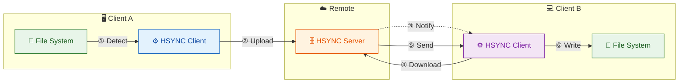

# HSYNC Client

**HSYNC** - HTTP-based file synchronization client.

Synchronize files between a local directory and a remote **bucket**. A bucket is a shared directory hosted on a central HSYNC server or on another peer in LAN Mode.

- In **Server Mode**, clients connect to a centralized server.
- In **LAN Mode** (P2P), clients discover each other via mDNS and one automatically becomes the master—no central server required.

## Quick Overview



<details>
<summary>📷 View as image</summary>


</details>

**Sync Flow (A → B):**
1. **① Detect** — Client A detects file change via watchdog
2. **② Upload** — Client A uploads file to server
3. **③ Notify** — Server broadcasts event to Client B via WebSocket
4. **④ Download** — Client B requests file from server
5. **⑤ Send** — Server sends file content to Client B
6. **⑥ Write** — Client B writes file to local disk

## Why HSYNC?

HSYNC uses **only HTTP/HTTPS** — ideal for corporate networks where only ports 80/443 are allowed through firewalls.

| Tool | Protocol | Works over HTTP? |
|------|----------|-----------------|
| **HSYNC** | HTTP/HTTPS | ✅ Yes |
| rsync | SSH | ❌ No |
| scp/sftp | SSH | ❌ No |
| Syncthing | BEP (custom) | ❌ No |

## Features

- 🔄 Bidirectional file synchronization
- ⬆️ Upload-only / ⬇️ Download-only modes
- ⚡ Parallel file transfers
- 👁️ Real-time file watching
- 🔒 SSL/TLS support
- 📦 Standalone binary (PyInstaller)

### Server Mode
- WebSocket for real-time events
- API Key authentication
- Event queue with retry

### LAN Mode (P2P)
- No server required (mDNS discovery)
- Automatic master election
- HTTPS by default

## Quick Start

```bash
# Build
poetry install
./compile.sh

# Run
./dist/hsync -s http://localhost:8765 -b mybucket -p /path/to/dir -w
```

See [Getting Started](docs/getting-started.md) for detailed instructions.

## Documentation

- [Getting Started](docs/getting-started.md) - Build and run
- [Configuration](docs/configuration.md) - Environment variables and CLI options
- [Sync Modes](docs/sync-modes.md) - Single, Watch, LAN modes
- [LAN Mode](docs/lan-mode.md) - P2P synchronization details
- [Architecture](docs/architecture.md) - Internal design
- [Usage](docs/usage.md) - Advanced examples

## Version

1.0.0

## License

[Mozilla Public License 2.0](LICENSE)
