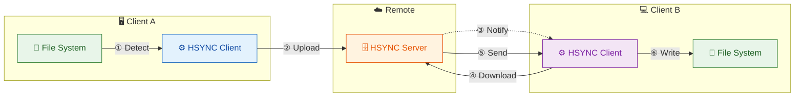
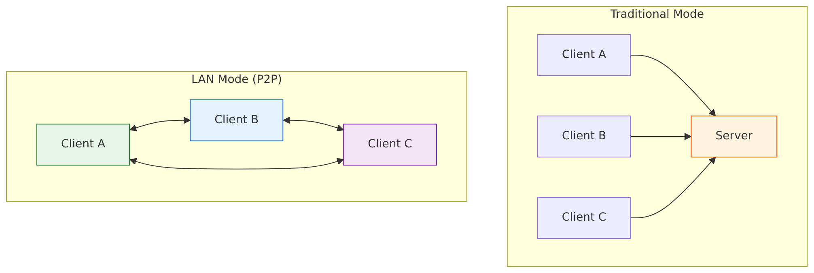

# HSYNC Client

**HSYNC** - HTTP-based file synchronization client.

Synchronize files between a local directory and a remote **bucket**. A bucket is a shared directory hosted on a central HSYNC server or on another peer in LAN Mode.

- In **Server Mode**, clients connect to a centralized server.
- In **LAN Mode** (P2P), clients discover each other via mDNS and one automatically becomes the master—no central server required.

## Synchronization Overview



<details>
<summary>📷 View as image (if Mermaid is not rendered)</summary>


</details>

**Sync Flow (A → B):**
1. **① Detect** — Client A detects file change via watchdog
2. **② Upload** — Client A uploads file to server
3. **③ Notify** — Server broadcasts event to Client B via WebSocket
4. **④ Download** — Client B requests file from server
5. **⑤ Send** — Server sends file content to Client B
6. **⑥ Write** — Client B writes file to local disk

The same flow applies in reverse (B → A) for bidirectional sync.

## LAN Mode (P2P) Overview

In LAN Mode, clients synchronize directly with each other without a central server:


<details>
<summary>📷 View as image (if Mermaid is not rendered)</summary>



</details>

**LAN Mode Flow:**
1. **① Discover** — Clients discover each other via mDNS (Bonjour/Avahi)
2. **② Elect Master** — One device becomes the master (source of truth)
3. **③ Sync Files** — Slave downloads from master via HTTPS
4. **④ Sync Files** — Master uploads changes to slave

In LAN mode, the master is the source of truth and slaves sync from it. Both directions are supported for bidirectional sync peers.

## Why HSYNC?

HSYNC is designed to synchronize files using **only the HTTP/HTTPS protocol**. This makes it the ideal choice in environments where HTTP is the only protocol allowed through firewalls, proxies, or network policies — a common constraint in corporate networks, cloud environments, and restricted infrastructures.

Most traditional file synchronization tools rely on protocols that are often blocked or unavailable in these scenarios:

| Tool | Required Protocol | Default Port(s) | Works over HTTP only? |
|------|-------------------|------------------|-----------------------|
| **HSYNC** | HTTP / HTTPS | 80 / 443 | ✅ **Yes** |
| **rsync** | SSH or rsync daemon | 22 / 873 | ❌ No |
| **scp / sftp** | SSH | 22 | ❌ No |
| **Unison** | SSH or direct socket | 22 / custom | ❌ No |
| **Syncthing** | BEP (custom protocol) | 22000 | ❌ No |
| **FTP / FTPS** | FTP | 20–21 / 990 | ❌ No |
| **Rclone** | Varies (S3, SFTP, etc.) | Varies | ⚠️ Partial (backend-dependent) |

**When to choose HSYNC:**

- 🏢 **Corporate networks** — only ports 80/443 are open through the firewall
- ☁️ **Cloud environments** — services behind load balancers or reverse proxies that only expose HTTP endpoints
- 🔒 **Restricted infrastructures** — SSH is disabled, VPNs are unavailable, or custom protocols are blocked
- 🌐 **Web-friendly setups** — your infrastructure already routes HTTP traffic through CDNs, WAFs, or API gateways

Since HSYNC uses standard HTTP/HTTPS, it works seamlessly through corporate proxies, reverse proxies, load balancers, and CDNs without any special configuration.

## Features

### Core
- 🔄 Bidirectional file synchronization
- ⬆️ Upload-only and ⬇️ download-only sync directions
- ⚡ Parallel file transfers (configurable concurrency)
- 👁️ Real-time file system monitoring (watchdog)
- ✅ MD5-based file integrity verification
- 🔗 Symbolic link synchronization support
- 📦 Compilable to standalone binary (PyInstaller)

### Server Mode
- 📡 WebSocket connection for remote events
- 🔐 API Key authentication (secure first-message auth)
- 🔒 SSL/TLS support
- 💓 WebSocket heartbeat for reliable connections
- � Event queue with exponential backoff retry

### LAN Mode (P2P)
- 🌐 **No server required** - peers discover each other via mDNS (Bonjour/Avahi)
- 👑 **Automatic master election** - peers with bidirectional sync are preferred as master
- � **HTTPS by default** - self-signed certificate per session with fingerprint verification
- 🔑 **Shared secret authentication** - optional `HSYNC_LAN_KEY` for trusted networks
- �️ **Group filtering** - isolate sync groups on the same LAN with `--lan-group`

## Requirements

For building:
- Python ≥3.12, <3.14
- Poetry (for dependency management)

For running:
- The compiled binary (no Python required)

## Build

The client must be compiled before use. The resulting binary is standalone and doesn't require Python.

```bash
cd hsync-client

# Install dependencies (first time only)
poetry install

# Compile the binary
./compile.sh

# The binary will be in dist/hsync
```

### Build Options

```bash
./compile.sh           # Build the binary
./compile.sh --clean   # Clean artifacts and rebuild
./compile.sh --help    # Show help
```

## Configuration

### Environment Files

The client provides environment file templates for easy configuration:

```bash
# Development (HTTP, localhost)
source dev.env
./dist/hsync -b mybucket -w

# Production (HTTPS, remote server)
source prod.env
./dist/hsync -b mybucket -w
```

### Environment Variables

| Variable | Description | Default |
|----------|-------------|---------|
| `HSYNC_SERVER` | Server URL | (required or use `-s`) |
| `HSYNC_API_KEY` | API key for authentication | (required) |
| `HSYNC_MAX_CONCURRENT_TRANSFERS` | Max parallel file transfers | `5` |
| `HSYNC_IGNORE_DELETE` | Do not propagate file deletions (backup mode) | `false` |

## Usage

### Basic Syntax

```bash
./dist/hsync -s <server_url> -b <bucket_name> [options]
```

> ⚠️ **Note**: Do not run the client directly with Python. Always use the compiled binary.

### CLI Options

| Option | Description |
|--------|-------------|
| `-s, --server` | Server URL |
| `-b, --bucket` | Bucket name (required) |
| `-p, --path` | Local directory path (default: cwd) |
| `-w, --watch` | Watch for changes and sync continuously |
| `-i, --interval` | Force full sync every N seconds (requires `-w`) |
| `--retry-delay` | Retry connection after N seconds (default: 5) |
| `-n, --dry-run` | Show what would be done without making changes |
| `--ignore-delete` | Do not propagate file deletions (useful for backup scenarios) |
| `--sync-direction` | Sync direction: `bidirectional`, `upload-only`, `download-only` (default: `bidirectional`) |
| `-v, --verbose` | Enable verbose output |
| `-q, --quiet` | Suppress all output |
| `-o, --output` | Write output to file |
| `--ca-cert` | Path to CA certificate for self-signed server certs |
| `--insecure` | Skip SSL certificate verification |
| `--no-color` | Disable colored output |
| `--help-symbols` | Show output symbols legend |
| `-y, --yes` | Skip interactive confirmation prompts (still shows warnings) |
| `-V, --version` | Show version |
| `--lan-mode` | Enable LAN P2P mode (no server required) |
| `--lan-port` | Port for LAN HTTP server (0 = random) |
| `HSYNC_LAN_KEY` | Shared secret for LAN authentication (env var only) |
| `--lan-group` | Group name for peer filtering |
| `--no-lan-https` | Disable HTTPS (enabled by default) |
| `--discovery-timeout` | Peer discovery timeout in seconds |

### Examples

**Single synchronization:**
```bash
export HSYNC_API_KEY="your-api-key"
./dist/hsync -s http://localhost:8765 -b mybucket -p /path/to/local/dir
```

**Continuous synchronization (watch mode):**
```bash
./dist/hsync -s http://localhost:8765 -b mybucket -p /path/to/dir -w
```

**With automatic re-sync every 5 minutes:**
```bash
./dist/hsync -s http://localhost:8765 -b mybucket -w -i 300
```

**Dry-run (preview operations):**
```bash
./dist/hsync -s http://localhost:8765 -b mybucket -n
```

**With file logging:**
```bash
./dist/hsync -s http://localhost:8765 -b mybucket -w -o /var/log/hsync.log
```

**Backup mode (do not propagate deletions):**
```bash
# File deletions are not propagated - useful for backup scenarios
./dist/hsync -s http://localhost:8765 -b mybucket -w --ignore-delete
```

**Upload-only (local → remote):**
```bash
# Only upload local changes to the server, ignore remote changes
./dist/hsync -s http://localhost:8765 -b mybucket -w --sync-direction upload-only
```

**Download-only (remote → local):**
```bash
# Only download from server, never upload local changes (read-only client)
./dist/hsync -s http://localhost:8765 -b mybucket -w --sync-direction download-only
```

**Skip deletion risk confirmation (e.g. in scripts):**
```bash
# Automatically confirm deletion risk warning (still shows the warning)
./dist/hsync -b photos --lan-mode -y
```

## File Deletion Risk Warning

When sync settings could cause local files to be deleted, the client warns the user before starting:

- **LAN mode without `--force-master`**: the master peer is the source of truth — local-only files will be deleted during sync
- **`--sync-direction download-only`**: remote deletions are applied locally and local-only files may be removed

If the shared directory is **non-empty**, the client shows a warning and asks for confirmation (`[y/N]`). Use `-y` / `--yes` to skip the interactive prompt (the warning is still logged).

> **Note**: `--sync-direction upload-only` and LAN mode with `--force-master` are considered safe — no warning is shown. Bidirectional server mode is also considered normal behavior and does not trigger a warning.

## SSL/TLS (HTTPS/WSS)

The client supports encrypted communication via HTTPS and WSS (WebSocket Secure).

### Connecting to a Server with Valid SSL Certificate

```bash
# Standard HTTPS connection (certificate verified against system CA store)
./dist/hsync -s https://server.example.com:8765 -b mybucket
```

### Connecting to a Server with Self-Signed Certificate

When the server uses a self-signed certificate, you have two options:

**Option 1: Trust the server certificate (recommended)**

```bash
# Copy the server's certificate to the client machine
scp server:/path/to/certs/server.crt ./server.crt

# Connect using the CA certificate
./dist/hsync -s https://server:8765 -b mybucket --ca-cert server.crt
```

**Option 2: Disable SSL verification (not recommended for production)**

```bash
# Skip certificate verification (insecure!)
./dist/hsync -s https://server:8765 -b mybucket --insecure
```

> ⚠️ **Warning**: Using `--insecure` disables all SSL certificate verification, making the connection vulnerable to man-in-the-middle attacks. Only use this for testing.

### SSL Examples

**Watch mode with self-signed certificate:**
```bash
./dist/hsync -s https://server:8765 -b mybucket -w --ca-cert server.crt
```

**Dry-run with HTTPS:**
```bash
./dist/hsync -s https://server:8765 -b mybucket -n --ca-cert server.crt
```

## File Compression

HSYNC supports automatic file compression to optimize transfers using **Zstandard (zstd)**.

### How It Works

- Files are compressed before transfer and decompressed on receipt
- Compression is enabled by default and can be disabled via `--no-compression`
- Server informs client about compression support during WebSocket handshake
- In LAN mode, peers advertise compression capability via mDNS

### Compression Thresholds

Different thresholds are used based on network characteristics:

| Context | Threshold | Rationale |
|---------|-----------|-----------|
| **Download** (Server→Client) | 10 KB | Server CPU is acceptable, clear benefit above this size |
| **Upload** (Client→Server) | 32 KB | Client CPU is more precious, typical production threshold |
| **LAN mode** | 100 KB | Local network is fast (1Gbps+), only compress large files |

### Skipped Files

Compression is automatically skipped for:
- Files below the threshold (depends on context)
- Pre-compressed formats: `.jpg`, `.png`, `.mp4`, `.zip`, `.gz`, `.pdf`, `.docx`, etc.

### Configuration

| Option | Description |
|--------|-------------|
| `--no-compression` | Disable compression for this session |
| `HSYNC_COMPRESSION_ENABLED` | Environment variable to disable compression (default: `true`) |

## Log Legend

Use `--help-symbols` to display this legend in the terminal.

### Sync Operations

| Label | Meaning |
|-------|---------|
| `[IN SYNC   ]` | File already in sync (no action required) |
| `[SKIP      ]` | File skipped |
| `[DOWNLOAD  ]` | Download file from server / master |
| `[UPLOAD    ]` | Upload file to server / master |
| `[RESUME    ]` | Resume partial upload or download |
| `[MOVE      ]` | Move / rename file or directory |
| `[REMOVE    ]` | Remove file or directory |
| `[CREATE    ]` | Create directory |
| `[DELETE    ]` | Delete local file not present on master (LAN mode) |
| `[PERMISSION]` | Set file / directory permissions |
| `[SYMLINK   ]` | Create symbolic link |
| `[IGNORE DEL]` | Deletion ignored (backup / ignore-delete mode) |

### LAN Slave Operations

| Label | Meaning |
|-------|---------|
| `[SLAVE UP  ]` | Slave uploads file to master |
| `[SLAVE DEL ]` | Slave deletes file on master |
| `[SLAVE REN ]` | Slave renames file on master |
| `[SLAVE DIR ]` | Slave creates directory on master |
| `[SLAVE KEEP]` | Slave creates sentinel file (`.hsynckeep`) |
| `[SLAVE IGN ]` | Slave ignores deletion (ignore-delete mode) |

Log levels (ERROR, WARNING, INFO, DEBUG) are shown by the logging system.

## Synchronization Modes

### Single (default)
Performs a synchronization and exits.

### Watch (`-w`)
- Maintains WebSocket connection with the server
- Receives remote events (add/modify/delete/rename)
- Monitors local directory with watchdog
- Propagates changes in real-time

### Sync Direction (`--sync-direction`)

Controls the direction of file synchronization. Three modes are available:

| Direction | Uploads | Downloads | Use Case |
|-----------|---------|-----------|----------|
| `bidirectional` (default) | ✅ | ✅ | Full two-way sync between peers |
| `upload-only` | ✅ | ❌ | Push local files to remote, ignore remote changes |
| `download-only` | ❌ | ✅ | Pull remote files to local, never upload local changes |

**How it works:**
- In **single sync mode**, `get_sync_actions()` filters out actions that don't match the direction
- In **watch mode**, local and remote events are filtered inline at runtime — no restart needed
- The direction is a **client-side decision** — the server doesn't need to know about it

**Examples:**

```bash
# Upload-only: push local files to server (e.g., backup source)
./dist/hsync -s http://server:8765 -b backup -w --sync-direction upload-only

# Download-only: mirror remote content locally (e.g., read-only client)
./dist/hsync -s http://server:8765 -b shared -w --sync-direction download-only

# LAN mode: slave only downloads from master, never uploads
./dist/hsync -b photos -p ~/Pictures --lan-mode --sync-direction download-only
```

> ⚠️ **Note**: In LAN mode, `--force-master` is **incompatible** with `--sync-direction upload-only` or `download-only` — the client will refuse to start with an error. During automatic master election, peers with bidirectional sync are preferred. If a non-bidirectional peer is elected as master (because no bidirectional peer is available), a WARNING is logged.

### LAN Mode (`--lan-mode`)

Peer-to-peer synchronization without a centralized server:

```bash
# On all devices (HTTPS enabled by default)
./dist/hsync -b photos -p ~/Pictures --lan-mode

# With authentication (recommended for maximum security)
HSYNC_LAN_KEY="mySecretKey" ./dist/hsync -b photos -p ~/Pictures --lan-mode

# Disable HTTPS (use plain HTTP)
./dist/hsync -b photos -p ~/Pictures --lan-mode --no-lan-https
```

**How it works:**
1. Peers discover each other via mDNS (Bonjour/Avahi)
2. A master is elected (priority: `force_master` > bidirectional preference > earliest startup > lowest CID)
3. Other peers sync files with the master via HTTPS (default) or HTTP

See [LAN Mode documentation](docs/lan-mode.md) for details.

## Documentation

- [Architecture](docs/architecture.md) - Client architecture and component overview
- [Usage Guide](docs/usage.md) - Detailed usage instructions with examples
- [LAN Mode](docs/lan-mode.md) - P2P synchronization without server

## Project Structure

```
hsync-client/
├── hsync_client/           # Main Python package (source code)
│   ├── __init__.py
│   ├── __main__.py         # Module entry point
│   ├── main.py             # Main entry point
│   ├── main_logic.py       # Core sync orchestration
│   ├── cli.py              # CLI argument parsing (Typer)
│   ├── config.py           # Configuration management (pydantic-settings)
│   ├── constants.py        # Application constants
│   ├── sync.py             # Sync engine with parallel transfers
│   ├── transfer.py         # File upload/download operations
│   ├── websocket_handler.py # WebSocket event handling
│   ├── event_queue.py      # Event queue with retry logic
│   ├── lan.py              # LAN mode discovery (mDNS/Zeroconf)
│   ├── lan_server.py       # LAN mode HTTP server (master node)
│   ├── logger.py           # Logging configuration (loguru)
│   ├── retry.py            # Retry logic (tenacity)
│   ├── ssl_utils.py        # SSL/TLS utilities
│   ├── exceptions.py       # Custom exceptions
│   ├── utils.py            # Utility functions
│   ├── validators.py       # Input validators
│   └── models/             # Data models
│       ├── __init__.py
│       ├── dir.py          # Directory model
│       ├── event.py        # Event model
│       ├── file.py         # File model
│       ├── symlink.py      # Symbolic link model
│       └── sync_action.py  # Sync action model
├── docs/                   # Documentation
│   ├── architecture.md     # Architecture overview
│   ├── usage.md            # Usage guide
│   └── lan-mode.md         # LAN mode (P2P) documentation
├── tests/                  # Test files
├── dist/                   # Compiled binary (created by compile.sh)
│   └── hsync               # Standalone executable
├── dev.env                 # Development environment template
├── prod.env                # Production environment template
├── compile.sh              # Build script (PyInstaller)
├── pyproject.toml          # Poetry configuration
├── poetry.lock             # Locked dependencies
└── README.md
```

## Version

1.0.0

## License

This project is licensed under the [Mozilla Public License 2.0](LICENSE).
