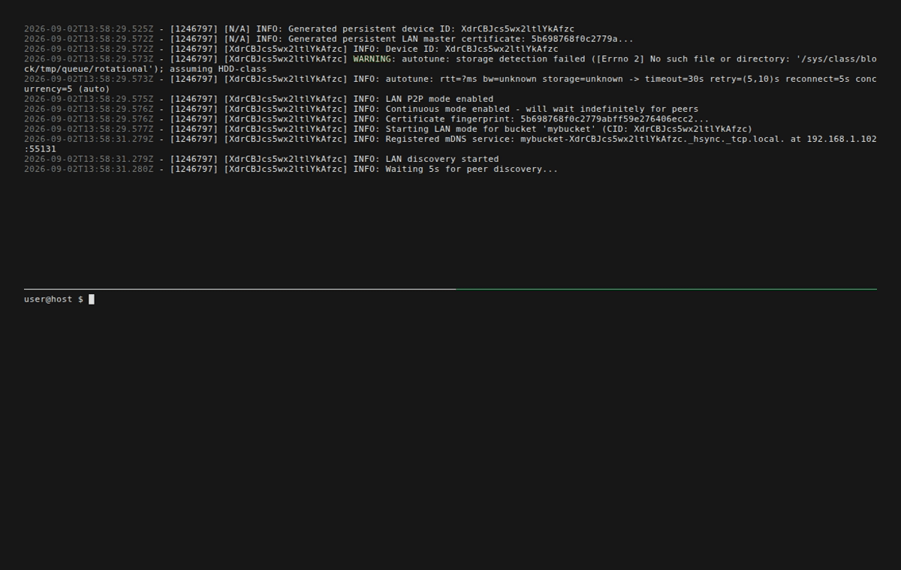

<p align="center">
  
</p>

# HSYNC Client: Endpoint Synchronization Agent

The **HSYNC Client** is the endpoint software agent deployed on individual devices (workstations, servers, or remote hardware) to manage **real-time**, **enterprise-grade** file synchronization across distributed environments using exclusively the standard **HTTP/HTTPS protocol**.

It is engineered to operate in two distinct network topologies:

* **Centralized (Server Mode):** The agent authenticates and connects to a centralized hub ([HSYNC Server](https://github.com/albertosdk/hsync-server/blob/main/README.md)).
* **Decentralized (LAN/P2P Mode):** Agents autonomously discover peers via mDNS within the same network segment and dynamically elect a transport coordinator, operating entirely without central infrastructure.

> 👉 **Operational Advisory:** As with any automated filesystem mutation utility, administrators are strongly advised to maintain validated, independent backups prior to initial deployment in production environments.

---

[](LICENSE)
[](https://github.com/albertosdk/hsync-client/actions/workflows/ci.yml)
[](https://github.com/albertosdk/hsync-client/releases/latest)
[](https://www.python.org/)
[](docs/installation.md)

**Quick navigation:**

* **[Why HSYNC?](#why-hsync)**
* **[Getting Started](docs/getting-started.md)**
* **[Deployment Guidelines](docs/installation.md)** — Prebuilt binaries, `.deb` packages, OS5 firmware, and source compilation.
* **[Technical Documentation](docs/README.md)** — Comprehensive parameter reference and internal architecture.
* **[Contribution Standards](CONTRIBUTING.md)** — Engineering workflow and coding guidelines.

## Why HSYNC?

HSYNC is designed to synchronize files **in real-time** using **only the HTTP/HTTPS protocol**.<br><br>
The table below compares HSYNC with common alternatives on five dimensions.<br>
**Native Storage** means the tool stores your files in their original format,
directly browsable on disk — no proprietary containers, block stores, or
opaque internal formats.

| Tool | Protocol | HTTP-Native | Real-Time Sync | Native Storage | Architecture |
|------|----------|:---:|:---:|:---:|------|
| **HSYNC** | HTTP / HTTPS | ✅ | ✅ | ✅ | Hub-Spoke & P2P |
| rsync | SSH / Daemon | ❌ | ❌ | ✅ | Client-Server |
| Syncthing | BEP (Custom) | ❌ | ✅ | ✅ | P2P |
| Nextcloud | WebDAV (HTTP) | ✅ | ⚠️ ¹ | ✅ | Client-Server |
| Seafile | HTTP / HTTPS | ✅ | ⚠️ ¹ | ❌ ² | Client-Server |
| scp / sftp | SSH | ❌ | ❌ | ✅ | Client-Server |
| Unison | SSH / Socket | ❌ | ❌ | ✅ | P2P |
| Rclone | S3, SFTP, etc. | ⚠️ ⁴ | ❌ | ⚠️ ³ | Client-Server |

> **¹** Relies on local filesystem monitoring via a desktop client; lacks native event-driven push notifications (WebSocket) at the protocol level.<br>
> **²** Utilizes a proprietary block-based internal storage format, rendering files inaccessible from the filesystem without the server software.<br>
> **³** When utilizing the `crypt` backend, files are stored in an opaque encrypted format.<br>
> **⁴** Rclone's HTTP backend is restricted to read-only operations. Core synchronization requires non-HTTP protocols.

**When to choose HSYNC:**

- 🏢 **Corporate networks** — only ports 80/443 are open through the firewall
- ☁️ **Cloud environments** — services behind load balancers or reverse proxies that only expose HTTP endpoints
- 🔒 **Restricted infrastructures** — SSH is disabled, VPNs are unavailable, or custom protocols are blocked
- 🌐 **Web-friendly setups** — your infrastructure already routes HTTP traffic through CDNs, WAFs, or API gateways
- ⚡ **Real-time reactivity** — Unlike traditional HTTP-based tools that rely on periodic polling, HSYNC reacts instantly to file changes using local watchdogs and event-driven WebSockets. After the system closes the file, the upload starts in a fraction of a second — not after a 5–10s quiet window (the default in tools like Syncthing). Already-idle files (full resync, atomic moves) skip the wait.

## Technical Capabilities

The HSYNC Client provides robust, enterprise-grade capabilities tailored for resilient data transfer.

**⚙️ Core Engine**

* **Bidirectional & Directional Sync:** Supports full two-way synchronization, as well as constrained Upload-Only or Download-Only pipelines.
* **Zero-Delay Event Triggering:** Utilizing local filesystem watchdogs, file transfers initiate instantly upon file closure, bypassing legacy debounce delays.
* **Block-Level Delta Transfer:** Implements rsync-style chunking for large files, transmitting only modified byte ranges to conserve bandwidth.
* **Cryptographic Verification:** Enforces SHA-256 integrity checks post-transfer to prevent data corruption.
* **Zstandard (zstd) Compression:** High-performance data compression applied automatically to outbound streams.
* **Rule-Based Exclusion:** Native support for `.hsyncignore` pattern matching to exclude transient or sensitive files.
* **Adaptive Resiliency:** Features intelligent retry backoffs, adaptive timeouts, and configurable parallel transfer concurrency.

**🛰️ Centralized Connectivity (Server Mode)**

* **Persistent Telemetry:** Maintains WebSocket connections for sub-second remote event notifications and heartbeat monitoring.
* **Secure Authentication:** Validates endpoints via API Key (Bearer token for REST operations, first-frame verification for WebSockets).
* **TLS Enforcement:** Requires SSL/TLS encryption for all payload transmissions.

**🔗 Decentralized Connectivity (LAN/P2P Mode)**

* **Zero-Config Discovery:** Utilizes mDNS (Bonjour/Avahi) for automatic peer detection within broadcast domains.
* **Dynamic Master Election:** Automatically nominates a transport coordinator based on sync capabilities and endpoint availability.
* **Trust on First Use (TOFU):** Employs self-signed identity generation with connection-level certificate fingerprint pinning.
* **Network Isolation:** Supports `HSYNC_LAN_KEY` authentication and `--group` partitioning to isolate distinct sync clusters on the same physical network.

## Quick Start

**LAN/P2P Mode in action**: Device A (on top) is running and detect new file `hello.txt` in his bucket and Device B (on bottom) receives `hello.txt` automatically. See [Option A](#option-a--lan-p2p-mode-no-server-needed) steps for details.
<p align="center">
  
</p>

### Step 1 — Agent Installation

Deploy the latest stable release across Linux or macOS infrastructure via the automated deployment script:

```bash
curl -fsSL https://github.com/albertosdk/hsync-client/releases/latest/download/install.sh | bash
```

> Prefer to verify checksums before running, or need a different format
> (`.deb`, `.bin`, build from source)? See the
> [full installation guide](docs/installation.md).

### Step 2 — Choose Your Sync Mode

HSYNC supports two sync topologies — pick the one that fits your environment:

- **Option A — LAN Mode**: Peer-to-peer, no server needed. Peers discover each other via mDNS on the same local network. Fastest to try: zero infrastructure, works with two terminals on the same machine.
- **Option B — Server Mode**: Centralized hub. Requires a running [HSYNC Server](https://github.com/albertosdk/hsync-server). Best for multi-site sync over firewalled networks (HTTP/HTTPS only).

Both options produce the same result: bidirectional file sync in real time. Choose one and follow the steps below.

If you prefer the centralized approach, jump to [Option B](#option-b--server-mode-centralized).

#### Option A — LAN P2P Mode (no server needed)

Initialize direct peer-to-peer synchronization without central infrastructure or pre-shared keys. Peers discover each other via mDNS. You can
test it locally with two terminals on the same machine:

```mermaid
flowchart TB
    subgraph DeviceA["💻 Device A (Master)"]
        direction LR
        FSA["📂 File System"]<-->|"read / write"| CA["⚙️ HSYNC Client"]
    end

    subgraph DeviceB["🖥️ Device B (Client)"]
        direction LR
        CB["⚙️ HSYNC Client"]<-->|"read / write"| FSB["📂 File System"]
    end

    CA <-.->|"① Discover (mDNS)"| CB
    CB <-->|"② Upload / Download"| CA

    style DeviceA fill:#333333
    style DeviceB fill:#333333

    style FSA fill:#e8f5e9,stroke:#2e7d32,color:#1b5e20
    style CA fill:#e3f2fd,stroke:#1565c0,color:#0d47a1
    style FSB fill:#e8f5e9,stroke:#2e7d32,color:#1b5e20
    style CB fill:#f3e5f5,stroke:#7b1fa2,color:#7b1fa2
```



**LAN Mode Flow:**
1. **① Discover** — Clients discover each other via mDNS (Bonjour/Avahi)
2. **② Elect Master** — One device becomes the master (a transport hub that
   coordinates sync without ever deciding conflicts by role)
3. **③ Upload / Download** — Clients upload files to the master and fetch
   files from the master or directly from a peer that holds the exact content;
   the master relays metadata to all connected peers

```bash
# 1. Create two folders to share files between them and simulate two distinct devices
mkdir -p /tmp/hsync-a /tmp/hsync-b
echo "hello hsync" > /tmp/hsync-a/hello.txt

# 2. Terminal 1 — Initialize Node A (Authoritative Data Source)
#    Utilizing --force-master prevents initial data reconciliation conflicts
HSYNC_DEVICE_DIR=/tmp/hsync-a-device \
  hsync lan -b mybucket -p /tmp/hsync-a --force-master

# 3. Terminal 2 — Initialize Node B (Receiver)
# Automatically discovers Node A via mDNS and downloads hello.txt automatically
HSYNC_DEVICE_DIR=/tmp/hsync-b-device \
  hsync lan -b mybucket -p /tmp/hsync-b

# 4. Verify the file arrived
cat /tmp/hsync-b/hello.txt   # → hello hsync
```

Watch above animation to see what happens.

**Implementation Note (Device Identity):** The `HSYNC_DEVICE_DIR` variable is used here exclusively to simulate two distinct hardware instances on the same host. In standard multi-device deployments, this variable is omitted, and the agent utilizes the default identity path (`~/.local/state/hsync/device/`). See [LAN Mode → Device Identity](docs/lan-mode.md#device-identity).

**Architectural Note (Conflict Resolution):** The `--force-master` flag establishes the initial file ledger. The master acts merely as a transport hub; logical conflicts are resolved deterministically across all nodes using vector clocks. Always assign the initial master role to the endpoint housing the authoritative data.

> **Note:** For the full P2P setup (master election, pairing, pre-shared secret key `HSYNC_LAN_KEY`, group filtering with `--group`), see [LAN Mode](docs/lan-mode.md).

#### Option B — Server Mode (centralized)

Connect two clients on the same machine to a local server. You'll need
[Docker](https://docs.docker.com/get-docker/) to run the server, but the
clients run natively just like in Option A. The server enforces TLS — a
self-signed certificate is generated on first start; `--insecure` accepts it
for this local demo.


**Server Mode Flow (A → B):**
1. **① Detect** — Client A detects file change via watchdog
2. **② Upload** — Client A uploads file to server
3. **③ Notify** — Server broadcasts event to Client B via WebSocket
4. **④ Download** — Client B requests file from server
5. **⑤ Send** — Server sends file content to Client B
6. **⑥ Write** — Client B writes file to local disk

The same flow applies in reverse (B → A) for bidirectional sync.

```bash
# 1. Start the server (keep it running in the background)
docker run -d --name hsync-server --rm \
  -p 127.0.0.1:9753:9753 \
  -e HSYNC_ADMIN_KEY=0000000000000000000000000000000000000000000000000000000000000001 \
  -e HSYNC_SSL_ENABLED=true \
  -e HSYNC_SSL_KEYFILE_PASSWORD=local-demo-password \
  -e HSYNC_SSL_CERT_DIR=/certs \
  -v hsync-certs:/certs \
  ghcr.io/albertosdk/hsync-server
sleep 3

# 2. Create two folders to share files between them and simulate two distinct devices
mkdir -p /tmp/hsync-a /tmp/hsync-b
echo "hello hsync" > /tmp/hsync-a/hello.txt

# 3. Terminal 1 — Initialize Client A (uploads hello.txt to the server)
#    The bootstrap admin token provides full access for this demo
HSYNC_API_KEY="hs_HsyncAdminBootstrap01_0000000000000000000000000000000000000000000000000000000000000001" \
  HSYNC_DEVICE_DIR=/tmp/hsync-a-device \
  hsync server localhost --insecure -b mybucket -p /tmp/hsync-a

# 4. Terminal 2 — Initialize Client B
#    Receives events via WebSocket and downloads hello.txt automatically
HSYNC_API_KEY="hs_HsyncAdminBootstrap01_0000000000000000000000000000000000000000000000000000000000000001" \
  HSYNC_DEVICE_DIR=/tmp/hsync-b-device \
  hsync server localhost --insecure -b mybucket -p /tmp/hsync-b

# 5. Verify the file arrived
cat /tmp/hsync-b/hello.txt   # → hello hsync
```

**Implementation Note (Device Identity):** The `HSYNC_DEVICE_DIR` variable is used here exclusively to simulate two distinct hardware instances on the same host. In standard multi-device deployments, this variable is omitted, and the agent utilizes the default identity path (`~/.local/state/hsync/device/`).

**Quick-Start Note (Bootstrap Admin):** This demo uses the bootstrap admin account, which the server creates automatically on first start with the secret in `HSYNC_ADMIN_KEY`. For production, create a dedicated client account per device (see [Server Mode](docs/server-mode.md)).

**Security Note:** `--insecure` skips certificate verification. Use it **only** for local testing against `localhost`. In production, export the server certificate and pass it with `--ca-cert` (see [Server → Connect your clients](https://github.com/albertosdk/hsync-server/blob/main/docs/getting-started-docker.md#connect-your-clients)).

> **Note:** For the full Server Mode walkthrough (dedicated accounts, bucket setup, production deployment), see [Server Mode](docs/server-mode.md) and the [Server Getting Started guide](https://github.com/albertosdk/hsync-server/blob/main/docs/getting-started.md).

If you prefer to go serverless, use [Option A](#option-a--lan-p2p-mode-no-server-needed) instead.

## Documentation

- [Getting Started](docs/getting-started.md) - Build and run
- [Configuration](docs/configuration.md) - Environment variables and CLI options (complete reference)
- [Sync Modes](docs/sync-modes.md) - Single, Watch, LAN modes
- [Server Mode](docs/server-mode.md) - Client-Server synchronization details
- [LAN Mode](docs/lan-mode.md) - P2P synchronization details
- [Architecture](docs/internal/architecture.md) - Internal design
- [Architecture Decision Records](https://github.com/albertosdk/hsync-common/blob/main/docs/internal/adr/README.md) - Why the stable, cross-project decisions were made
- [Usage](docs/usage.md) - CLI overview, log labels, error handling
- [Examples](docs/examples.md) - Practical scenarios (server-based and LAN P2P)
- [WD-OS5 Packaging](packaging/wd-os5/README.md) - Western Digital My Cloud (OS5) app package and web UI
- [Contributing](CONTRIBUTING.md) - Development setup and contribution guidelines
- [Changelog](CHANGELOG.md) - Release notes and version history
- [Roadmap](ROADMAP.md) - Planned features and project direction
- [Security Policy](SECURITY.md) - Supported versions and how to report vulnerabilities

### Associated Ecosystem Components

- [HSYNC Common](https://github.com/albertosdk/hsync-common/blob/main/README.md) - Shared models, constants, and utilities used by the client
- [HSYNC Server](https://github.com/albertosdk/hsync-server/blob/main/README.md) - Central synchronization server (Server Mode)
- [HSYNC Desktop](https://github.com/albertosdk/hsync-desktop/blob/main/docs/README.md) — Desktop client GUI front-end *(in development)*.
- [HSYNC Android](https://github.com/albertosdk/hsync-android/blob/main/docs/README.md) — Android client app *(in development)*.

> **Note:** The desktop GUI (`HSYNC Desktop`) and the Android app (`HSYNC Android`)
> are still under active development and are not yet ready for production use.

## Security & Vulnerability Reporting

Security is a primary design pillar. To report potential security vulnerabilities or bypasses, utilize the private reporting channel:

👉 **[Submit a Security Advisory](https://github.com/albertosdk/hsync-client/security/advisories/new)**

Review the [Security Policy](SECURITY.md) for compliance details and infrastructure hardening recommendations.

## Disclaimer

> [!WARNING]
> **HSYNC manipulates files and directories** — it creates, overwrites, moves, and deletes data.
> Misconfiguration, software defects, or other unforeseen conditions may lead to **data loss or
> corruption**. **Use at your own risk and always keep verified, independent backups.**

THE SOFTWARE IS PROVIDED "AS IS", WITHOUT WARRANTY OF ANY KIND, EXPRESS OR IMPLIED, INCLUDING BUT NOT LIMITED TO THE WARRANTIES OF MERCHANTABILITY, FITNESS FOR A PARTICULAR PURPOSE, AND NONINFRINGEMENT. Although the author has implemented reasonable safety measures, IN NO EVENT SHALL THE AUTHOR OR COPYRIGHT HOLDERS BE LIABLE FOR ANY CLAIM, DAMAGES, OR OTHER LIABILITY — including, without limitation, any direct, indirect, incidental, special, exemplary, or consequential damages, loss of data, or business interruption — WHETHER IN AN ACTION OF CONTRACT, TORT, OR OTHERWISE, ARISING FROM, OUT OF, OR IN CONNECTION WITH THE SOFTWARE OR THE USE OR OTHER DEALINGS IN THE SOFTWARE.

This disclaimer supplements, and does not replace, Sections 6 ("Disclaimer of Warranty") and 7 ("Limitation of Liability") of the [Mozilla Public License 2.0](LICENSE), which govern this software.

## License

Distributed under the [Mozilla Public License 2.0](LICENSE).
