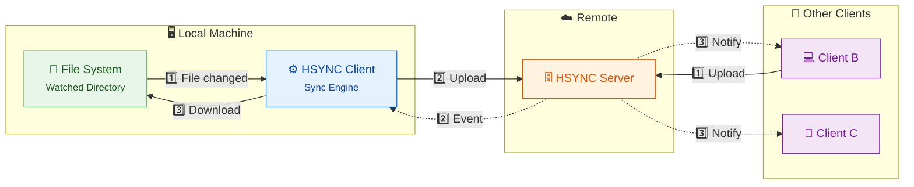
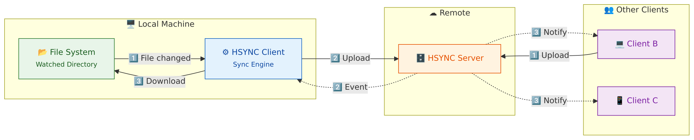

# HSYNC Client

CLI client for HTTP-based file synchronization with WebSocket support for real-time events.

## Synchronization Overview



<details>
<summary>📷 View as image (if Mermaid is not rendered)</summary>



</details>

**Scenarios:**
- **Local → Remote**: File changes detected → Upload to server → Other clients notified
- **Remote → Local**: Other client uploads → Server sends event → Download and apply locally

## Features

- 🔄 Bidirectional file synchronization
- 👁️ Real-time file system monitoring (watchdog)
- 📡 WebSocket connection for remote events
- ✅ MD5-based file integrity verification
- 🔐 API Key authentication (secure first-message auth)
- 🔒 SSL/TLS support
- 📦 Compilable to standalone binary (PyInstaller)
- 💓 WebSocket heartbeat for reliable connections
- 🔗 Symbolic link synchronization support
- 📦 Event queue with exponential backoff retry

## Requirements

For building:
- Python ≥3.12, <3.14
- Poetry (for dependency management)

For running:
- The compiled binary (no Python required)

## Build

The client must be compiled before use. The resulting binary is standalone and doesn't require Python.

```bash
cd hsync-client

# Install dependencies (first time only)
poetry install

# Compile the binary
./compile.sh

# The binary will be in dist/hsync
```

### Build Options

```bash
./compile.sh           # Build the binary
./compile.sh --clean   # Clean artifacts and rebuild
./compile.sh --help    # Show help
```

## Configuration

The client uses environment variables:

| Variable | Description | Required |
|----------|-------------|----------|
| `HSYNC_SERVER_URL` | Server URL | No (use `-s`) |
| `HSYNC_API_KEY` | API key for authentication | Yes |

## Usage

### Basic Syntax

```bash
./dist/hsync -s <server_url> -b <bucket_name> [options]
```

> ⚠️ **Note**: Do not run the client directly with Python. Always use the compiled binary.

### CLI Options

| Option | Description |
|--------|-------------|
| `-s, --server` | Server URL |
| `-b, --bucket` | Bucket name (required) |
| `-p, --path` | Local directory path (default: cwd) |
| `-w, --watch` | Watch for changes and sync continuously |
| `--order-by` | Compare files by: `mtime` or `ctime` (default: mtime) |
| `-i, --interval` | Force full sync every N seconds (requires `-w`) |
| `--retry-delay` | Retry connection after N seconds (default: 5) |
| `-n, --dry-run` | Show what would be done without making changes |
| `-v, --verbose` | Enable verbose output |
| `-q, --quiet` | Suppress all output |
| `-o, --output` | Write output to file |
| `--insecure` | Skip SSL certificate verification |
| `--no-color` | Disable colored output |
| `--help-symbols` | Show output symbols legend |
| `-V, --version` | Show version |

### Examples

**Single synchronization:**
```bash
export HSYNC_API_KEY="your-api-key"
./dist/hsync -s http://localhost:8765 -b mybucket -p /path/to/local/dir
```

**Continuous synchronization (watch mode):**
```bash
./dist/hsync -s http://localhost:8765 -b mybucket -p /path/to/dir -w
```

**With automatic re-sync every 5 minutes:**
```bash
./dist/hsync -s http://localhost:8765 -b mybucket -w -i 300
```

**Dry-run (preview operations):**
```bash
./dist/hsync -s http://localhost:8765 -b mybucket -n
```

**With file logging:**
```bash
./dist/hsync -s http://localhost:8765 -b mybucket -w -o /var/log/hsync.log
```

## Log Legend

| Symbol | Meaning |
|--------|---------|
| `·` | File unchanged (skipped) |
| `↓` | Download file |
| `↑` | Upload file |
| `→` | Move/Rename file/dir |
| `✕` | Remove file/dir |
| `+` | Create directory |
| `⚙` | Set permissions |
| `L` | Create/update symlink |

Log levels (ERROR, WARNING, INFO, DEBUG) are shown by the logging system.

## Synchronization Modes

### Single (default)
Performs a synchronization and exits.

### Watch (`-w`)
- Maintains WebSocket connection with the server
- Receives remote events (add/modify/delete/rename)
- Monitors local directory with watchdog
- Propagates changes in real-time

## Documentation

- [Architecture](docs/architecture.md) - Client architecture and component overview
- [Usage Guide](docs/usage.md) - Detailed usage instructions with examples

## Project Structure

```
hsync-client/
├── hsync_client/           # Main Python package (source code)
│   ├── __init__.py
│   ├── __main__.py         # Module entry point
│   ├── main.py             # Main CLI logic
│   ├── logger.py           # Logging configuration
│   ├── event_queue.py      # Event queue with retry logic
│   └── models/             # Data models
│       ├── __init__.py
│       ├── dir.py
│       ├── event.py
│       ├── file.py
│       ├── symlink.py      # Symbolic link model
│       └── sync_action.py
├── docs/                   # Documentation
│   ├── architecture.md
│   └── usage.md
├── tests/                  # Test files
├── dist/                   # Compiled binary (created by compile.sh)
│   └── hsync               # Standalone executable
├── build/                  # Build artifacts (created by compile.sh)
├── compile.sh              # Build script
├── hsync.spec              # PyInstaller spec file (auto-generated)
├── pyproject.toml
├── poetry.lock
└── README.md
```

## Version

0.1.0
