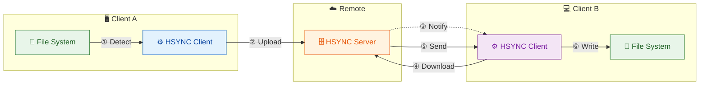
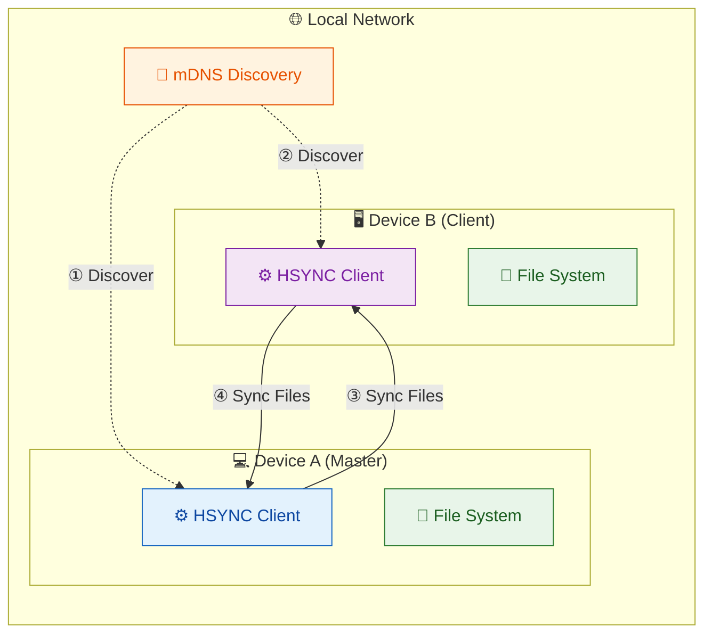

# HSYNC Client

> [!WARNING]
> **HSYNC manipulates files and directories** — it creates, overwrites, moves, and deletes data.
> Misconfiguration, software defects, or other unforeseen conditions may lead to **data loss or
> corruption**. **Use at your own risk and always keep verified, independent backups.**
> The software is provided "as is", without warranty of any kind — see the full
> [Disclaimer](#disclaimer) and [License](#license) below.


**HSYNC Client** is the tool you run on each device to keep a local folder in sync.
It works in two ways: connect to a central HSYNC Server (ideal for syncing across
the internet), or go peer-to-peer with nearby devices on the same local network —
no server needed.

---

**Quick navigation:**
- **New to HSync?** Start with [Why HSYNC?](#why-hsync) and [Getting Started](docs/getting-started.md)
- **Looking for installation options?** Jump to [Installation](docs/installation.md) (prebuilt binaries, .deb, WD OS5 .bin, build from source)
- **Want to contribute?** See [Contributing](CONTRIBUTING.md)
- **Looking for detailed documentation?** Navigate to [docs/README.md](docs/README.md)

## Table of Contents

- [Why HSYNC?](#why-hsync)
- [Features](#features)
- [Quick Start](#quick-start)
- [Quick Overview](#quick-overview)
- [LAN Mode (P2P) Overview](#lan-mode-p2p-overview)
- [Documentation](#documentation)
- [Version](#version)
- [License](#license)
- [Disclaimer](#disclaimer)

---

## Why HSYNC?

HSYNC is designed to synchronize files using **only the HTTP/HTTPS protocol**. This makes it the ideal choice in environments where HTTP is the only protocol allowed through firewalls, proxies, or network policies — a common constraint in corporate networks, cloud environments, and restricted infrastructures.

Most traditional file synchronization tools rely on protocols that are often blocked or unavailable in these scenarios:

| Tool | Required Protocol | Default Port(s) | Works over HTTP only? |
|------|-------------------|------------------|-----------------------|
| **HSYNC** | HTTP / HTTPS | 9753 / custom | ✅ **Yes** |
| **rsync** | SSH or rsync daemon | 22 / 873 | ❌ No |
| **scp / sftp** | SSH | 22 | ❌ No |
| **Unison** | SSH or direct socket | 22 / custom | ❌ No |
| **Syncthing** | BEP (custom protocol) | 22000 | ❌ No |
| **FTP / FTPS** | FTP | 20–21 / 990 | ❌ No |
| **Rclone** | Varies (S3, SFTP, etc.) | Varies | ⚠️ Partial (backend-dependent) |

> **Note on ports:** HSYNC's default server port is **9753** (configurable via
> the server URL, e.g. `-s https://host:9753`). Ports **80** (HTTP) and **443**
> (HTTPS) are not used by default but are fully supported by placing a reverse
> proxy / load balancer in front of the server — a common setup in corporate and
> cloud environments where only standard web ports are exposed.

**When to choose HSYNC:**

- 🏢 **Corporate networks** — only ports 80/443 are open through the firewall
- ☁️ **Cloud environments** — services behind load balancers or reverse proxies that only expose HTTP endpoints
- 🔒 **Restricted infrastructures** — SSH is disabled, VPNs are unavailable, or custom protocols are blocked
- 🌐 **Web-friendly setups** — your infrastructure already routes HTTP traffic through CDNs, WAFs, or API gateways

Since HSYNC uses standard HTTP/HTTPS, it works seamlessly through corporate proxies, reverse proxies, load balancers, and CDNs without any special configuration.

## Features

### Core
- 🔄 Bidirectional file synchronization
- ⬆️ Upload-only and ⬇️ download-only sync directions
- ⚡ Parallel file transfers (configurable concurrency)
- 👁️ Real-time file system monitoring (watchdog)
- ✅ SHA-256-based file integrity verification
- 🗜️ Zstandard (zstd) transfer compression
- 🧩 Delta transfer (rsync-style block sync for large files)
- 🔗 Symbolic link synchronization support
- 🙈 `.hsyncignore` (gitignore-style) filtering
- 📦 Compilable to standalone binary (PyInstaller)

### Server Mode
- 📡 WebSocket connection for remote events
- 🔐 API Key authentication (secure first-message auth)
- 🔒 SSL/TLS support
- 💓 WebSocket heartbeat for reliable connections
- � Event queue with exponential backoff retry

### LAN Mode (P2P)
- 🌐 **No server required** - peers discover each other via mDNS (Bonjour/Avahi)
- 👑 **Automatic master election** - peers with bidirectional sync are preferred as master
- 🔒 **HTTPS/WSS only** - persistent self-signed identity with connection-level fingerprint pinning (TOFU)
- 🔑 **Shared secret authentication** - optional `HSYNC_LAN_KEY` for trusted networks
- �️ **Group filtering** - isolate sync groups on the same LAN with `--lan-group`


## Quick Start

Install the client in one command (Linux and macOS):

```bash
curl -fsSL https://github.com/albertobasso/hsync-client/releases/download/v1.0.0/install.sh | bash
```

Or, if you prefer to verify the download before running it:

```bash
VERSION=v1.0.0
curl -fLO "https://github.com/albertobasso/hsync-client/releases/download/${VERSION}/install.sh"
curl -fLO "https://github.com/albertobasso/hsync-client/releases/download/${VERSION}/SHA256SUMS"
sha256sum -c SHA256SUMS --ignore-missing
chmod 700 install.sh
./install.sh
hsync --help
```

Connect to an HSYNC server (the client refuses to send the API key over plain
HTTP — use `https://`; add `--insecure` only for local development with a
self-signed certificate):

```bash
hsync -s https://localhost:9753 -b mybucket -p /path/to/dir -w
```

Or go peer-to-peer on the LAN — no server, no API key: peers discover each
other via mDNS (run the same command on each device):

```bash
hsync -b mybucket -p /path/to/dir --lan-mode
```

See [Installation](docs/installation.md) for all platforms and formats, and
[Getting Started](docs/getting-started.md) for the first-run walkthrough. For
the peer-to-peer setup (master election, pairing, `HSYNC_LAN_KEY`), see
[LAN Mode](docs/lan-mode.md). To build from source instead, see
[Installation → Build from source](docs/installation.md#build-from-source).

## Quick Overview



**Sync Flow (A → B):**
1. **① Detect** — Client A detects file change via watchdog
2. **② Upload** — Client A uploads file to server
3. **③ Notify** — Server broadcasts event to Client B via WebSocket
4. **④ Download** — Client B requests file from server
5. **⑤ Send** — Server sends file content to Client B
6. **⑥ Write** — Client B writes file to local disk

The same flow applies in reverse (B → A) for bidirectional sync.

## LAN Mode (P2P) Overview

In LAN Mode, clients synchronize directly with each other without a central server:



**LAN Mode Flow:**
1. **① Discover** — Clients discover each other via mDNS (Bonjour/Avahi)
2. **② Elect Master** — One device becomes the master (source of truth)
3. **③ Sync Files** — Client downloads from master via HTTPS
4. **④ Sync Files** — Master uploads changes to client

In LAN mode, the master is the source of truth and slaves sync from it. Both directions are supported for bidirectional sync peers.

## Documentation

- [Getting Started](docs/getting-started.md) - Build and run
- [Configuration](docs/configuration.md) - Environment variables and CLI options (complete reference)
- [Sync Modes](docs/sync-modes.md) - Single, Watch, LAN modes
- [LAN Mode](docs/lan-mode.md) - P2P synchronization details
- [Architecture](docs/architecture.md) - Internal design
- [Architecture Decision Records](https://github.com/albertobasso/hsync-common/blob/main/docs/adr/README.md) - Why the stable, cross-project decisions were made
- [Usage](docs/usage.md) - CLI overview, log labels, error handling
- [Examples](docs/examples.md) - Practical scenarios (server-based and LAN P2P)
- [WD-OS5 Packaging](packaging/wd-os5/README.md) - Western Digital My Cloud (OS5) app package and web UI
- [Contributing](CONTRIBUTING.md) - Development setup and contribution guidelines
- [Security Policy](SECURITY.md) - Supported versions and how to report vulnerabilities

### Related projects

- [HSYNC Common](https://github.com/albertobasso/hsync-common/blob/main/README.md) - Shared models, constants, and utilities used by the client
- [HSYNC Server](https://github.com/albertobasso/hsync-server/blob/main/README.md) - Central synchronization server (Server Mode)

## Version

1.0.0

## License

[Mozilla Public License 2.0](LICENSE)

## Disclaimer

THE SOFTWARE IS PROVIDED "AS IS", WITHOUT WARRANTY OF ANY KIND, EXPRESS OR IMPLIED, INCLUDING BUT NOT LIMITED TO THE WARRANTIES OF MERCHANTABILITY, FITNESS FOR A PARTICULAR PURPOSE, AND NONINFRINGEMENT. Although the author has implemented reasonable safety measures, IN NO EVENT SHALL THE AUTHOR OR COPYRIGHT HOLDERS BE LIABLE FOR ANY CLAIM, DAMAGES, OR OTHER LIABILITY — including, without limitation, any direct, indirect, incidental, special, exemplary, or consequential damages, loss of data, or business interruption — WHETHER IN AN ACTION OF CONTRACT, TORT, OR OTHERWISE, ARISING FROM, OUT OF, OR IN CONNECTION WITH THE SOFTWARE OR THE USE OR OTHER DEALINGS IN THE SOFTWARE.

This disclaimer supplements, and does not replace, Sections 6 ("Disclaimer of Warranty") and 7 ("Limitation of Liability") of the [Mozilla Public License 2.0](LICENSE), which govern this software.
