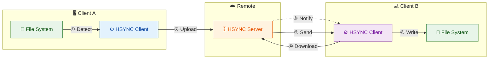
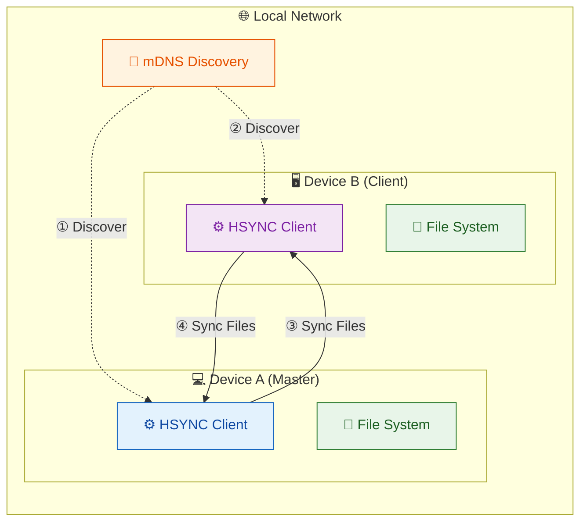

<p align="center">
  
</p>

# HSYNC Client

**HSYNC Client** is the tool you run on each device to keep a local folder in sync in real-time.
It works in two ways:

- In **Server Mode**, clients connect to a centralized server ([HSYNC Server](https://github.com/albertobasso/hsync-server/blob/main/README.md) required).
- In **LAN Mode** (P2P), clients discover each other via mDNS and one automatically becomes the master—no central server required (NO server required).


> [!NOTE]
>  👉 **Remember:**  keep verified backups of your data when trying new synchronization tools. 😉

---

[](LICENSE)
[](https://www.python.org/)
[]()

**Quick navigation:**
- **New to HSYNC?** Start with [Why HSYNC?](#why-hsync) and [Getting Started](docs/getting-started.md)
- **Looking for installation options?** Jump to [Installation](docs/installation.md) (prebuilt binaries, .deb, WD OS5 .bin, build from source)
- **Want to contribute?** See [Contributing](CONTRIBUTING.md)
- **Looking for detailed documentation?** Navigate to [docs/README.md](docs/README.md)

---

## Why HSYNC?

HSYNC is designed to synchronize files **in real-time** using **only the HTTP/HTTPS protocol**. This makes it the ideal choice in environments where HTTP is the only protocol allowed through firewalls, proxies, or network policies — a common constraint in corporate networks, cloud environments, and restricted infrastructures.

Most traditional file synchronization tools rely on protocols that are often blocked or unavailable in these scenarios:

| Tool | Required Protocol | Default Port(s) | Works over HTTP only? |
|------|-------------------|------------------|-----------------------|
| **HSYNC** | HTTP / HTTPS | 9753 / custom | ✅ **Yes** |
| **rsync** | SSH or rsync daemon | 22 / 873 | ❌ No |
| **scp / sftp** | SSH | 22 | ❌ No |
| **Unison** | SSH or direct socket | 22 / custom | ❌ No |
| **Syncthing** | BEP (custom protocol) | 22000 | ❌ No |
| **FTP / FTPS** | FTP | 20–21 / 990 | ❌ No |
| **Rclone** | Varies (S3, SFTP, etc.) | Varies | ⚠️ Partial (backend-dependent) |

> **Note on ports:** HSYNC's default server port is **9753** (configurable via
> the server URL, e.g. `-s https://host:9753`). Ports **80** (HTTP) and **443**
> (HTTPS) are not used by default but are fully supported by placing a reverse
> proxy / load balancer in front of the server — a common setup in corporate and
> cloud environments where only standard web ports are exposed.

**When to choose HSYNC:**

- 🏢 **Corporate networks** — only ports 80/443 are open through the firewall
- ☁️ **Cloud environments** — services behind load balancers or reverse proxies that only expose HTTP endpoints
- 🔒 **Restricted infrastructures** — SSH is disabled, VPNs are unavailable, or custom protocols are blocked
- 🌐 **Web-friendly setups** — your infrastructure already routes HTTP traffic through CDNs, WAFs, or API gateways
- ⚡ **Real-time reactivity** — Unlike traditional HTTP-based tools that rely on periodic polling, HSYNC reacts instantly to file changes using local watchdogs and event-driven WebSockets.

Since HSYNC uses standard HTTP/HTTPS, it works seamlessly through corporate proxies, reverse proxies, load balancers, and CDNs without any special configuration.

## Features

### Core
- 🔄 Bidirectional file synchronization
- ⬆️ Upload-only and ⬇️ download-only sync directions
- ⚡ Parallel file transfers (configurable concurrency)
- 👁️ Real-time file system monitoring (watchdog)
- ✅ SHA-256-based file integrity verification
- 🗜️ Zstandard (zstd) transfer compression
- 🧩 Delta transfer (rsync-style block sync for large files)
- 🔗 Symbolic link synchronization support (preserves links as-is)
- 🙈 `.hsyncignore` (gitignore-style) filtering
- 🎛️ Adaptive timeouts, retry backoff and transfer concurrency
- 📦 Compilable to standalone binary (PyInstaller)

### Server Mode
- 📡 WebSocket connection for remote events
- 🔐 API Key authentication (secure first-message auth)
- 🔒 SSL/TLS support
- 💓 WebSocket heartbeat for reliable connections
- � Event queue with exponential backoff retry

### LAN Mode (P2P)
- 🌐 **No server required** - peers discover each other via mDNS (Bonjour/Avahi)
- 👑 **Automatic master election** - peers with bidirectional sync are preferred as master
- 🔒 **HTTPS/WSS only** - persistent self-signed identity with connection-level fingerprint pinning (TOFU)
- 🔑 **Shared secret authentication** - optional `HSYNC_LAN_KEY` for trusted networks
- �️ **Group filtering** - isolate sync groups on the same LAN with `--lan-group`


## Quick Start

### Step 1 — Install

Install the client in one command (Linux and macOS, latest stable release):

```bash
curl -fsSL https://github.com/albertobasso/hsync-client/releases/latest/download/install.sh | bash
```

> Prefer to verify checksums before running, or need a different format
> (`.deb`, `.bin`, build from source)? See the
> [full installation guide](docs/installation.md).

### Step 2 — Your First Sync (LAN Mode, no server needed)

Go peer-to-peer on the LAN — no server, no API key, no configuration. Peers
discover each other via mDNS and a master is elected automatically. You can
test it locally with two terminals on the same machine:

```bash
# 1. Create two folders and a test file
mkdir -p /tmp/hsync-a /tmp/hsync-b
echo "hello hsync" > /tmp/hsync-a/hello.txt

# 2. Terminal 1 — start the first peer (force it as master since it holds
#    the canonical data, avoiding the deletion-risk warning)
hsync -b mybucket -p /tmp/hsync-a --lan-mode --force-master

# 3. Terminal 2 — start a second peer; it discovers the master via mDNS
#    and downloads hello.txt automatically
hsync -b mybucket -p /tmp/hsync-b --lan-mode

# 4. Verify the file arrived
cat /tmp/hsync-b/hello.txt   # → hello hsync
```

Watch mode is implicit in LAN Mode: edit or create a file in either folder
and the change propagates to the other peer in real time.

> [!TIP]
> **Why `--force-master`?** The first peer already holds the test file, so
> forcing it as master avoids the deletion-risk warning on a non-empty
> directory. On a real LAN with multiple devices, omit `--force-master` and
> let the election happen automatically.

> [!CAUTION]
> **First run logic:** The node started with `--force-master` becomes the
> absolute Source of Truth. Any conflicting files on the second node will be
> **overwritten or deleted**. Always start the master on the machine holding
> your canonical data.

> For the full P2P setup (master election, pairing, `HSYNC_LAN_KEY`, group
> filtering with `--lan-group`), see [LAN Mode](docs/lan-mode.md).

### Step 3 — Connect to a Server (optional)

> [!IMPORTANT]
> You need a running [HSYNC Server](https://github.com/albertobasso/hsync-server)
> to use Server Mode. Deploy one in seconds with Docker:
>
> ```bash
> docker run -p 9753:9753 -e HSYNC_API_KEY=your-secret-key ghcr.io/albertobasso/hsync-server
> ```
>
> If you prefer to go serverless, jump back to
> [Step 2](#step-2--your-first-sync-lan-mode-no-server-needed) — LAN Mode works
> immediately without any infrastructure.

Connect to your HSYNC server (the client refuses to send the API key over plain
HTTP — use `https://`; add `--insecure` only for local development with a
self-signed certificate):

```bash
hsync -s https://your-server:9753 -b mybucket -p /path/to/dir -w
```

> For the complete Server Mode walkthrough, see [Server Mode](docs/server-mode.md)
> and [Getting Started](docs/getting-started.md).

## Server Mode Overview



**Server Mode Flow (A → B):**
1. **① Detect** — Client A detects file change via watchdog
2. **② Upload** — Client A uploads file to server
3. **③ Notify** — Server broadcasts event to Client B via WebSocket
4. **④ Download** — Client B requests file from server
5. **⑤ Send** — Server sends file content to Client B
6. **⑥ Write** — Client B writes file to local disk

The same flow applies in reverse (B → A) for bidirectional sync.

## LAN Mode (P2P) Overview

In LAN Mode, clients synchronize directly with each other without a central server:



**LAN Mode Flow:**
1. **① Discover** — Clients discover each other via mDNS (Bonjour/Avahi)
2. **② Elect Master** — One device becomes the master (source of truth)
3. **③ Sync Files** — Client downloads from master via HTTPS
4. **④ Sync Files** — Master uploads changes to client

In LAN mode, the master is the source of truth and slaves sync from it. Both directions are supported for bidirectional sync peers.

## Documentation

- [Getting Started](docs/getting-started.md) - Build and run
- [Configuration](docs/configuration.md) - Environment variables and CLI options (complete reference)
- [Sync Modes](docs/sync-modes.md) - Single, Watch, LAN modes
- [Server Mode](docs/server-mode.md) - Client-Server synchronization details
- [LAN Mode](docs/lan-mode.md) - P2P synchronization details
- [Architecture](docs/internal/architecture.md) - Internal design
- [Architecture Decision Records](https://github.com/albertobasso/hsync-common/blob/main/docs/internal/adr/README.md) - Why the stable, cross-project decisions were made
- [Usage](docs/usage.md) - CLI overview, log labels, error handling
- [Examples](docs/examples.md) - Practical scenarios (server-based and LAN P2P)
- [WD-OS5 Packaging](packaging/wd-os5/README.md) - Western Digital My Cloud (OS5) app package and web UI
- [Contributing](CONTRIBUTING.md) - Development setup and contribution guidelines
- [Security Policy](SECURITY.md) - Supported versions and how to report vulnerabilities

### Related projects

- [HSYNC Common](https://github.com/albertobasso/hsync-common/blob/main/README.md) - Shared models, constants, and utilities used by the client
- [HSYNC Server](https://github.com/albertobasso/hsync-server/blob/main/README.md) - Central synchronization server (Server Mode)
- [HSYNC Desktop](https://github.com/albertobasso/hsync-desktop/blob/main/docs/README.md) — Desktop client GUI front-end *(in development)*.
- [HSYNC Android](https://github.com/albertobasso/hsync-android/blob/main/docs/README.md) — Android client app *(in development)*.

> **Note:** The desktop GUI (`HSYNC Desktop`) and the Android app (`HSYNC Android`)
> are still under active development and are not yet ready for production use.

## Disclaimer

> [!WARNING]
> **HSYNC manipulates files and directories** — it creates, overwrites, moves, and deletes data.
> Misconfiguration, software defects, or other unforeseen conditions may lead to **data loss or
> corruption**. **Use at your own risk and always keep verified, independent backups.**

THE SOFTWARE IS PROVIDED "AS IS", WITHOUT WARRANTY OF ANY KIND, EXPRESS OR IMPLIED, INCLUDING BUT NOT LIMITED TO THE WARRANTIES OF MERCHANTABILITY, FITNESS FOR A PARTICULAR PURPOSE, AND NONINFRINGEMENT. Although the author has implemented reasonable safety measures, IN NO EVENT SHALL THE AUTHOR OR COPYRIGHT HOLDERS BE LIABLE FOR ANY CLAIM, DAMAGES, OR OTHER LIABILITY — including, without limitation, any direct, indirect, incidental, special, exemplary, or consequential damages, loss of data, or business interruption — WHETHER IN AN ACTION OF CONTRACT, TORT, OR OTHERWISE, ARISING FROM, OUT OF, OR IN CONNECTION WITH THE SOFTWARE OR THE USE OR OTHER DEALINGS IN THE SOFTWARE.

This disclaimer supplements, and does not replace, Sections 6 ("Disclaimer of Warranty") and 7 ("Limitation of Liability") of the [Mozilla Public License 2.0](LICENSE), which govern this software.
