  

# HSYNC Client

**HSYNC Client is the synchronization agent of HSYNC**: you install it on each device and it keeps a folder identical with the same folder on your other devices, in real-time, over standard HTTPS. It ships as a single self-contained binary: no Python (or any other) runtime is required on the machine.

> New to HSYNC? Start with the [HSYNC Ecosystem](https://github.com/albertsdk/hsync/blob/main/README.md) for an overview of the platform before using the client.

Point it at a folder and choose how the devices meet:

* **Server Mode** — every device syncs through your own [HSYNC Server](https://github.com/albertsdk/hsync-server), which keeps a central copy. Best when devices live on different networks, or when you want a hub that is always reachable.
* **p2p Mode** — devices sync directly, peer-to-peer: on the same network they find each other automatically (mDNS); across networks an optional self-hosted bootnode introduces them. No server, no central copy.

Files stay in their original format, directly browsable on disk, and there is no third-party account or service in the data path. The same client covers simple setups — one folder on two laptops — and advanced ones: one-way backups, read-only mirrors, scheduled one-shot runs, isolated groups with shared keys, bandwidth limits.

> 👉 **Operational Advisory:** As with any automated filesystem mutation utility, administrators are strongly advised to maintain validated, independent backups prior to initial deployment in production environments.

---

---

## What you can do with HSYNC Client

* **Sync a folder between your devices** — keep the same folder on laptop, desktop and server, updated in real time in both directions.
* **Back up a folder** — push it one-way to your own server or NAS, optionally without propagating deletions, so the destination never loses data just because a source file was removed.
* **Publish a read-only mirror** — other devices download the folder and never write back.
* **Share files with a team** — a synced folder works as a drop box: drop a file in and it lands on the other machines.

## Two ways to run it

HSYNC Client runs in one of two mutually exclusive modes; pick the one that fits each sync group.

### Server Mode — sync through your own hub

```mermaid
flowchart LR
    subgraph DeviceA["🖥️ Device A"]
        FSA["📂 File System"]
        CA["⚙️ HSYNC Client"]
    end

    subgraph Remote["☁️ Remote"]
        SERVER["🗄️ HSYNC Server"]
    end

    subgraph DeviceB["💻 Device B"]
        CB["⚙️ HSYNC Client"]
        FSB["📂 File System"]
    end

    FSA -->|"① Detect"| CA
    CA -->|"② Upload"| SERVER
    SERVER -.->|"③ Notify"| CB
    CB -->|"④ Download"| SERVER
    SERVER -->|"⑤ Send"| CB
    CB -->|"⑥ Write"| FSB

    style DeviceA fill:#333333
    style DeviceB fill:#333333
    style FSA fill:#e8f5e9,stroke:#2e7d32,color:#1b5e20
    style CA fill:#e3f2fd,stroke:#1565c0,color:#0d47a1
    style SERVER fill:#fff3e0,stroke:#e65100,color:#e65100
    style FSB fill:#e8f5e9,stroke:#2e7d32,color:#1b5e20
    style CB fill:#f3e5f5,stroke:#7b1fa2,color:#7b1fa2
```

**Server Mode Flow (A → B):**
1. **① Detect** — Client A detects file change via watchdog
2. **② Upload** — Client A uploads file to server
3. **③ Notify** — Server broadcasts event to Client B via WebSocket
4. **④ Download** — Client B requests file from server
5. **⑤ Send** — Server sends file content to Client B
6. **⑥ Write** — Client B writes file to local disk

The same flow applies in reverse (B → A) for bidirectional sync.

A [HSYNC Server](https://github.com/albertsdk/hsync-server) stores the shared folders (**buckets**) and relays changes between all connected devices: they do not need to be online at the same time, they can live on different networks, and the server always holds a complete copy of the data.

**Choose it when:** you sync across networks or over the Internet, you want a central copy on hardware you own, or you need a hub that is always reachable. Concepts and setup: [Server Mode](docs/server-mode.md).

### p2p Mode — sync directly, no server

```mermaid
flowchart TB
    subgraph DeviceA["💻 Device A (Master)"]
        direction LR
        FSA["📂 File System"]<-->|"read / write"| CA["⚙️ HSYNC Client"]
    end

    subgraph DeviceB["🖥️ Device B (Client)"]
        direction LR
        CB["⚙️ HSYNC Client"]<-->|"read / write"| FSB["📂 File System"]
    end

    CA <-.->|"①② Discover + elect master (mDNS)"| CB
    CB <-->|"③ Upload / Download"| CA

    style DeviceA fill:#333333
    style DeviceB fill:#333333

    style FSA fill:#e8f5e9,stroke:#2e7d32,color:#1b5e20
    style CA fill:#e3f2fd,stroke:#1565c0,color:#0d47a1
    style FSB fill:#e8f5e9,stroke:#2e7d32,color:#1b5e20
    style CB fill:#f3e5f5,stroke:#7b1fa2,color:#7b1fa2
```

**p2p Mode Flow:**
1. **① Discover** — Clients discover each other via mDNS (Bonjour/Avahi)
2. **② Elect Master** — One device becomes the master (a transport hub that
   coordinates sync without ever deciding conflicts by role)
3. **③ Upload / Download** — Clients upload files to the master and fetch
   files from the master or directly from a peer that holds the exact content;
   the master relays metadata to all connected peers

Devices find each other automatically on the same network (mDNS) and sync directly, peer-to-peer: nothing passes through another machine. Across networks, an optional self-hosted bootnode introduces peers — discovery only, never your files (details in **Internet P2P** below).

**Choose it when:** a handful of devices share one network, or you prefer zero infrastructure. Concepts and setup: [p2p Mode](docs/p2p-mode.md) · [Across networks with a bootnode](docs/p2p-bootnode.md).

Continuous mode is the default in both topologies: the client keeps running and reacts to changes immediately. Pass `--once` to run a single sync cycle and exit — ideal for cron, systemd timers and CI, with a documented exit code. See [Sync Modes](docs/sync-modes.md).

## Getting started

1. **Install the client** — pick a method in the [Getting Started](docs/getting-started.md) chooser (installer script, standalone binary, Windows installer, `.deb`, `.rpm`, WD My Cloud OS5, or from source); verified downloads and asset names are in [Installation](docs/installation.md).

2. **Choose a mode and run your first sync** — each mode has a complete, copy-paste walkthrough:

   - [Getting Started — p2p Mode](docs/getting-started-p2p.md) — two devices, no server
   - [Getting Started — Server Mode](docs/getting-started-server.md) — through your own hub

**p2p Mode in action** — Device B discovers Device A via mDNS and receives `hello.txt` automatically:

  

3. **Explore more** — [Examples](docs/examples.md) for backups, mirrors, multi-device setups, NAS and photos; [Scheduling & Automation](docs/scheduling.md) for cron, systemd timers and alerts.

## Why HSYNC?

HSYNC is designed to synchronize files **in real-time** using **only the HTTP/HTTPS protocol**.  
The table below compares HSYNC with common alternatives on five dimensions. 
**Native Storage** means the tool stores your files in their original format,
directly browsable on disk — no proprietary containers, block stores, or
opaque internal formats.

| Tool | Protocol | HTTP-Native | Real-Time Sync | Native Storage | Architecture |
|------|----------|:---:|:---:|:---:|------|
| **HSYNC** | HTTP / HTTPS | ✅ | ✅ | ✅ | Hub-Spoke & P2P |
| rsync | SSH / Daemon | ❌ | ❌ | ✅ | Client-Server |
| Syncthing | BEP (Custom) | ❌ | ✅ | ✅ | P2P |
| Nextcloud | WebDAV (HTTP) | ✅ | ⚠️ ¹ | ✅ | Client-Server |
| Seafile | HTTP / HTTPS | ✅ | ⚠️ ¹ | ❌ ² | Client-Server |
| scp / sftp | SSH | ❌ | ❌ | ✅ | Client-Server |
| Unison | SSH / Socket | ❌ | ❌ | ✅ | P2P |
| Rclone | S3, SFTP, etc. | ⚠️ ⁴ | ❌ | ⚠️ ³ | Client-Server |

> **¹** Relies on local filesystem monitoring via a desktop client; lacks native event-driven push notifications (WebSocket) at the protocol level. 
> **²** Utilizes a proprietary block-based internal storage format, rendering files inaccessible from the filesystem without the server software. 
> **³** When utilizing the `crypt` backend, files are stored in an opaque encrypted format. 
> **⁴** Rclone's HTTP backend is restricted to read-only operations. Core synchronization requires non-HTTP protocols.

## Privacy, security & openness

- 🔐 **Private** — no vendor account and no third-party service in the data path: `hsync p2p` transfers directly between your devices, and Server Mode stores your data only on the hub you run yourself.
- 🪪 **Authenticated** — every installation has a stable **device ID** with its own ECDSA P-256 keypair; peers are trusted on first use and pinned by certificate fingerprint, so a changed identity is refused. See [p2p Mode → Device Identity](docs/p2p-mode.md#device-identity).
- 🧾 **Encrypted** — TLS on every transport (REST/WebSocket in Server Mode, HTTPS/WSS in p2p Mode), with no plaintext payload path.
- 📖 **Open** — the wire protocol and file model are an open, versioned specification with shared schemas and fixtures (see the [protocol](https://github.com/albertsdk/hsync-common/blob/main/docs/protocol.md) and [p2p protocol](https://github.com/albertsdk/hsync-common/blob/main/docs/p2p-protocol.md) references).
- 📡 **No telemetry** — HSYNC sends no usage data or analytics anywhere.

## Key capabilities

HSYNC Client focuses on reliable, fast transfers.

**⚙️ Core sync**

* **Two-way or one-way sync:** full bidirectional, or upload-only / download-only.
* **Starts when you save:** a local filesystem watcher begins the transfer as soon as a file is closed, with no debounce delay — the upload starts in a fraction of a second, not after the 5–10 s quiet window used by tools like Syncthing; already-idle files (full resync, atomic moves) skip the wait.
* **Block-level delta transfer:** for large files, only the changed byte ranges are sent (rsync-style).
* **SHA-256 verification:** integrity is checked after every transfer.
* **Zstandard (zstd) compression:** applied automatically to outbound data.
* **Rule-based exclusions:** `.hsyncignore` patterns skip transient or sensitive files.
* **Automatic retries:** smart backoff, adaptive timeouts, and configurable transfer concurrency.

**🛰️ Server mode (through a hub)**

* **Live updates:** a WebSocket connection delivers remote changes in under a second, with heartbeats.
* **API-key authentication:** a Bearer token for REST, first-frame verification for WebSockets.
* **TLS enforced:** all traffic is encrypted.

**🔗 P2P mode (direct, no server)**

* **Zero-config discovery:** mDNS (Bonjour/Avahi) finds peers on the same network automatically.
* **Automatic coordinator:** the client picks the master based on capabilities and reachability.
* **Trust on first use (TOFU):** a self-signed identity pinned by certificate fingerprint.
* **Network isolation:** a shared password (`HSYNC_P2P_PASSPHRASE`) or raw key (`HSYNC_P2P_KEY`), plus `--group`, keep distinct clusters apart on one network.
* **NAT traversal:** optional UPnP port mapping and the bootnode's STUN-style echo for cross-network reachability — no manual port forwarding in the common case.
* **Stable device identity:** a persistent device ID and keypair keep pins across restarts; a rotated key shows up as a changed fingerprint.

> **Internet P2P.** An optional, self-hostable discovery node ([HSYNC Bootnode](https://github.com/albertsdk/hsync-bootnode)) extends the peer-to-peer topology beyond a single LAN segment over `boot/1` (QUIC/UDP 443, no-log, RAM-only). Pass a bootnode hostname to `hsync p2p` (positional argument or `HSYNC_BOOTNODE`) to sync devices that are **not** on the same local network — same mode, same election, same data plane; only discovery differs. Writes are authorized by a shared key, so a keyless LAN is read-only. The bootnode is a **stable v1** (Python).

## Documentation

- [Documentation Index](docs/README.md) - The complete documentation map
- [Getting Started](docs/getting-started.md) - Choose an install method and an operating mode
- [Installation](docs/installation.md) - Verified downloads, asset names and platform notes
- [Getting Started — p2p Mode](docs/getting-started-p2p.md) - Two devices, no server
- [Getting Started — Server Mode](docs/getting-started-server.md) - Through your own hub
- [Configuration](docs/configuration.md) - Environment variables and CLI options (complete reference)
- [Sync Modes](docs/sync-modes.md) - Server and p2p modes (continuous / one-shot)
- [Server Mode](docs/server-mode.md) - Client-Server synchronization details
- [p2p Mode](docs/p2p-mode.md) - P2P synchronization details
- [p2p across networks (bootnode)](docs/p2p-bootnode.md) - Cross-network discovery through a `boot/1` bootstrap node
- [Scheduling & Automation](docs/scheduling.md) - Cron, systemd timers and alerts
- [Architecture](docs/internal/architecture.md) - Internal design
- [Architecture Decision Records](https://github.com/albertsdk/hsync-common/blob/main/docs/internal/adr/README.md) - Why the stable, cross-project decisions were made
- [Protocol specification](https://github.com/albertsdk/hsync-common/blob/main/docs/protocol.md) - Shared, versioned wire protocol (schemas and fixtures)
- [Usage](docs/usage.md) - CLI overview, log labels, error handling
- [Examples](docs/examples.md) - Practical scenarios (server-based and p2p)
- [WD-OS5 Packaging](packaging/wd-os5/README.md) - Western Digital My Cloud (OS5) app package and web UI
- [Contributing](CONTRIBUTING.md) - Development setup and contribution guidelines
- [Report an issue](https://github.com/albertsdk/hsync-client/issues) - Open development and bug tracking
- [Changelog](CHANGELOG.md) - Release notes and version history
- [Roadmap](ROADMAP.md) - Planned features and project direction
- [Security Policy](SECURITY.md) - Supported versions and how to report vulnerabilities

## Associated Ecosystem Components

The other components of the HSYNC ecosystem:

- [HSYNC Main](https://github.com/albertsdk/hsync/blob/main/README.md) — Umbrella repository and project overview.
- [HSYNC Common](https://github.com/albertsdk/hsync-common/blob/main/README.md) — Shared library: data models, protocol, delta transfer, hashing.
- [HSYNC Server](https://github.com/albertsdk/hsync-server/blob/main/README.md) — Central sync hub: REST API, WebSocket relay, file storage.
- [HSYNC Desktop](https://github.com/albertsdk/hsync-desktop/blob/main/README.md) — Desktop GUI front-end. *(in development)*
- [HSYNC Android](https://github.com/albertsdk/hsync-android/blob/main/README.md) — Android client app. *(in development)*
- [HSYNC Bootnode](https://github.com/albertsdk/hsync-bootnode/blob/main/README.md) — Optional Internet discovery node for P2P (`boot/1`, no-log, RAM-only).

## Security & Vulnerability Reporting

Security is a primary design pillar. To report potential security vulnerabilities or bypasses, utilize the private reporting channel:

👉 **[Report a vulnerability](https://github.com/albertsdk/hsync-client/security/advisories/new)**

## 🙋‍♂️ A note from the maintainer

This project was born out of the need for a system capable of replicating the contents of a folder from a PC or Android device to a NAS, primarily for backup purposes. Several solutions were already available, but I couldn't find one that met all my requirements. This led to the somewhat questionable decision to develop one from scratch, while also providing an opportunity to gain a deeper understanding of programming languages, algorithms, frameworks, and related technologies.

Originally conceived as a hobby project, HSYNC has been under continuous development ever since. I believe it has now evolved to the point where its capabilities are comparable to those of commercial solutions, while also offering some distinctive features. As a result, it may also be suitable for deployment in certain production environments.

HSYNC is a passion project that I primarily develop and maintain in my spare time. Please keep this in mind when interacting with the project: we're all doing our best to build something great together, but this is not a paid, full-time job for any of us.

## Disclaimer

> [!WARNING]
> **HSYNC manipulates files and directories** — it creates, overwrites, moves, and deletes data.
> Misconfiguration, software defects, or other unforeseen conditions may lead to **data loss or
> corruption**. **Use at your own risk and always keep verified, independent backups.**

THE SOFTWARE IS PROVIDED "AS IS", WITHOUT WARRANTY OF ANY KIND, EXPRESS OR IMPLIED, INCLUDING BUT NOT LIMITED TO THE WARRANTIES OF MERCHANTABILITY, FITNESS FOR A PARTICULAR PURPOSE, AND NONINFRINGEMENT. Although the author has implemented reasonable safety measures, IN NO EVENT SHALL THE AUTHOR OR COPYRIGHT HOLDERS BE LIABLE FOR ANY CLAIM, DAMAGES, OR OTHER LIABILITY — including, without limitation, any direct, indirect, incidental, special, exemplary, or consequential damages, loss of data, or business interruption — WHETHER IN AN ACTION OF CONTRACT, TORT, OR OTHERWISE, ARISING FROM, OUT OF, OR IN CONNECTION WITH THE SOFTWARE OR THE USE OR OTHER DEALINGS IN THE SOFTWARE.

This disclaimer supplements, and does not replace, the warranty disclaimer and limitation of liability provisions of the [BSD 3-Clause License](LICENSE), which govern this software.

## License

Distributed under the [BSD 3-Clause License](LICENSE).
