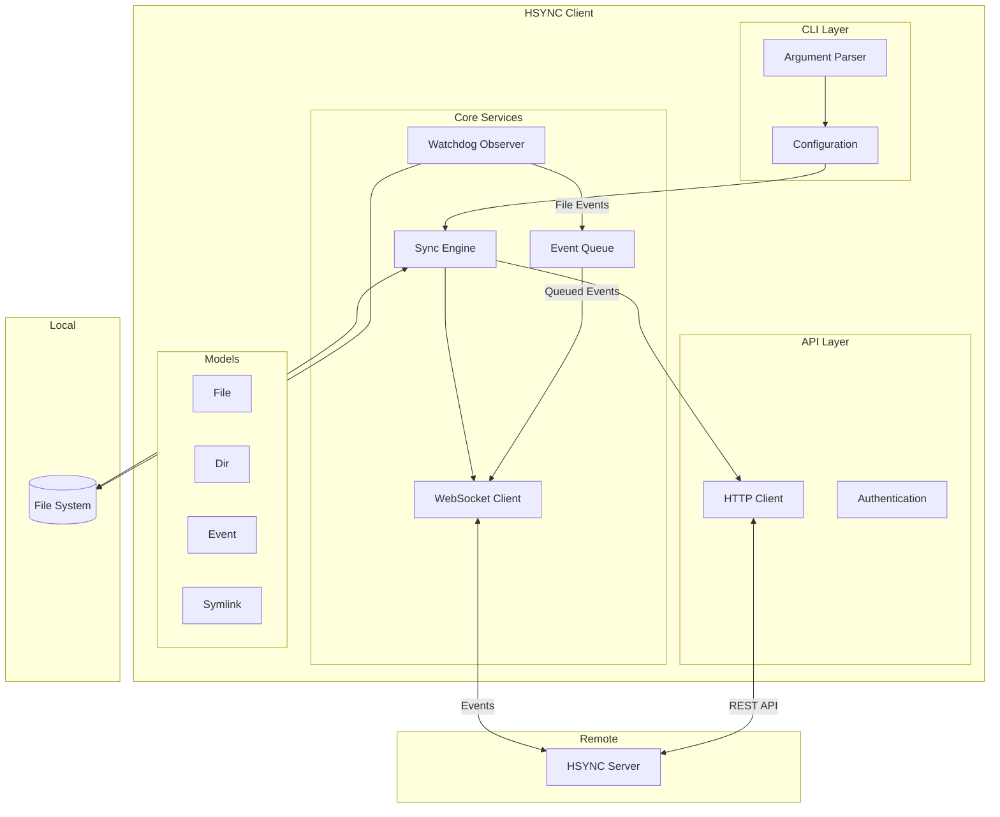
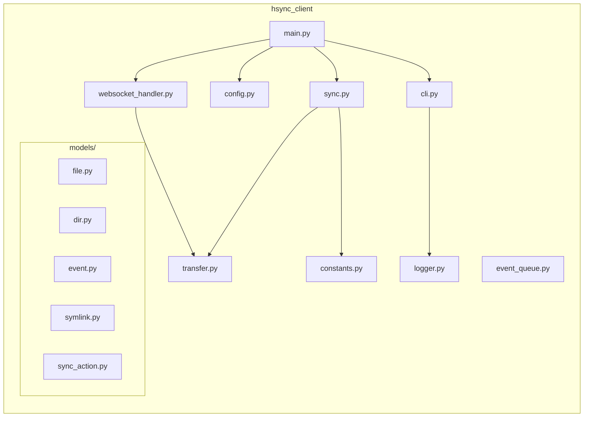
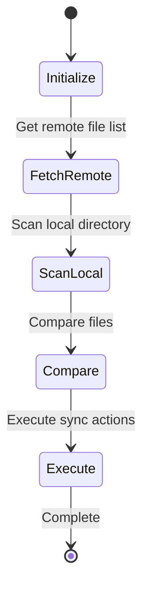
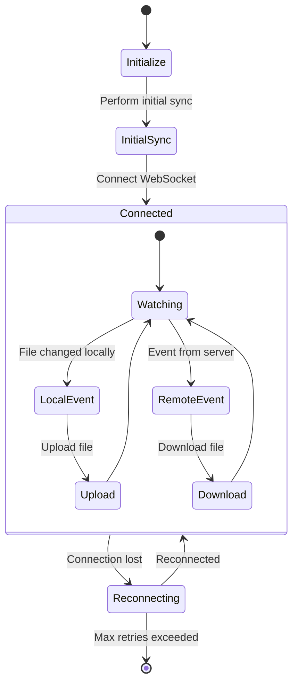
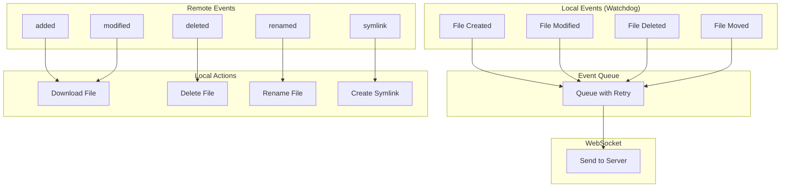
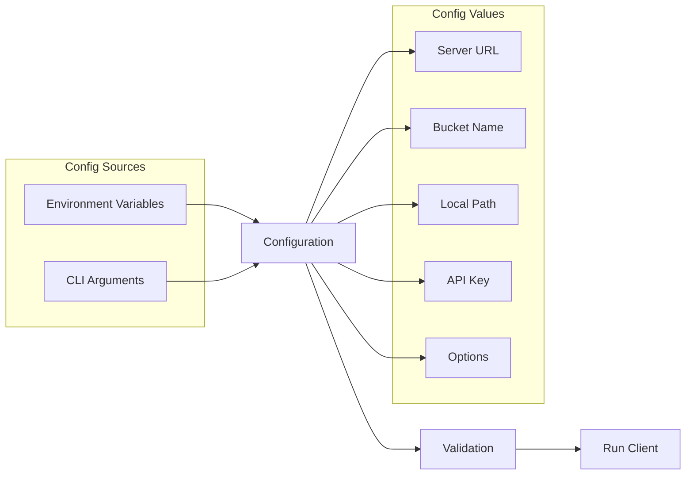
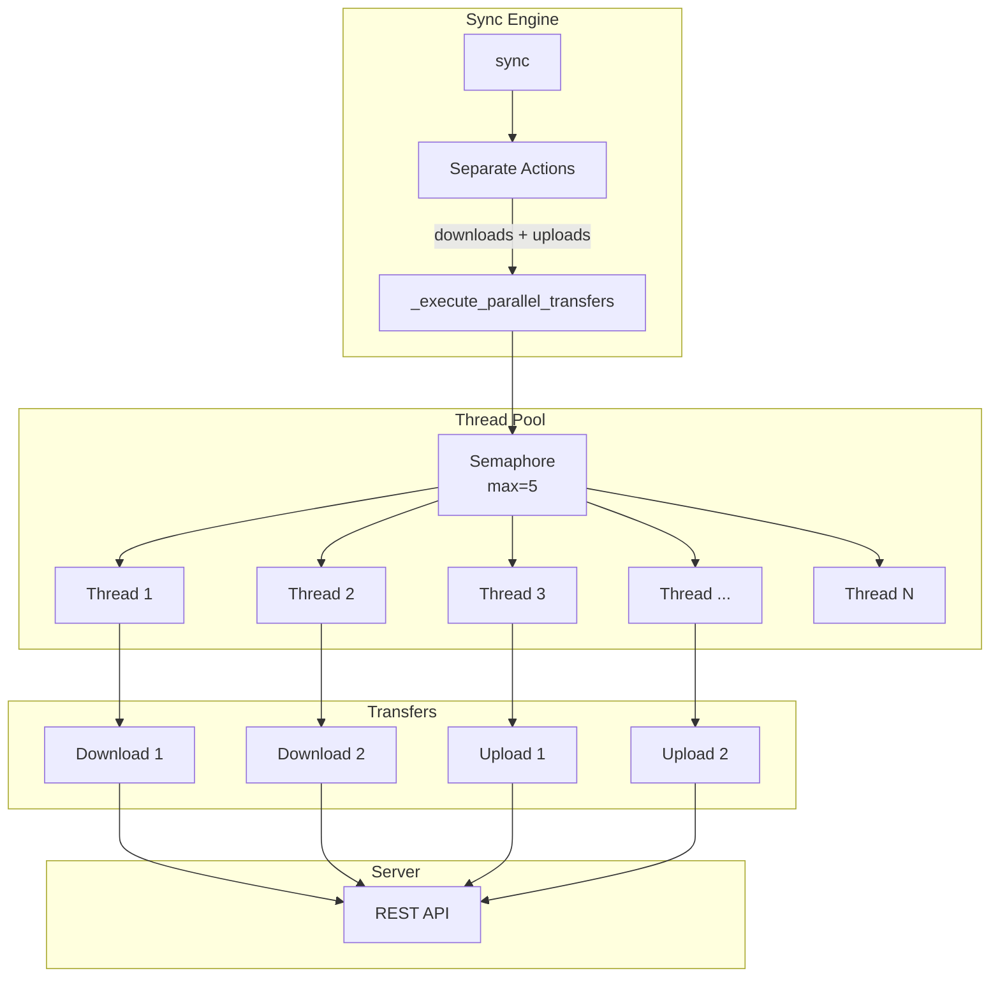

# HSYNC Client Architecture

This document describes the architecture of the HSYNC Client.

> **Note**: Diagrams are written in Mermaid. If they don't render, run `./generate-diagrams.sh` to generate PNG images in the `images/` directory.

## System Overview

## Component Description

| Component | Description |
|-----------|-------------|
| **CLI Layer** | Parses command-line arguments and configures the client |
| **Sync Engine** | Orchestrates file synchronization logic |
| **Watchdog Observer** | Monitors local file system for changes |
| **Event Queue** | Queues events with retry and exponential backoff |
| **WebSocket Client** | Maintains real-time connection with server |
| **HTTP Client** | Handles REST API requests (upload/download) |
| **Models** | Data structures for files, directories, events |

## Module Structure

## Synchronization Modes

### Single Sync Mode

### Watch Mode (Continuous)

## Event Processing

## Configuration Flow

## Parallel File Transfers

The sync engine uses a thread pool with semaphore-based concurrency control:

**Configuration:**
- `HSYNC_MAX_CONCURRENT_TRANSFERS`: Controls maximum parallel transfers (default: 5)
- Uses `asyncio.Semaphore` to limit concurrent operations
- Uses `ThreadPoolExecutor` for I/O-bound operations
