# HSYNC Client Architecture

This document describes the architecture of the HSYNC Client.

> **Note**: Diagrams are written in Mermaid. If they don't render, run `./generate-diagrams.sh` to generate PNG images in the `images/` directory.

## System Overview

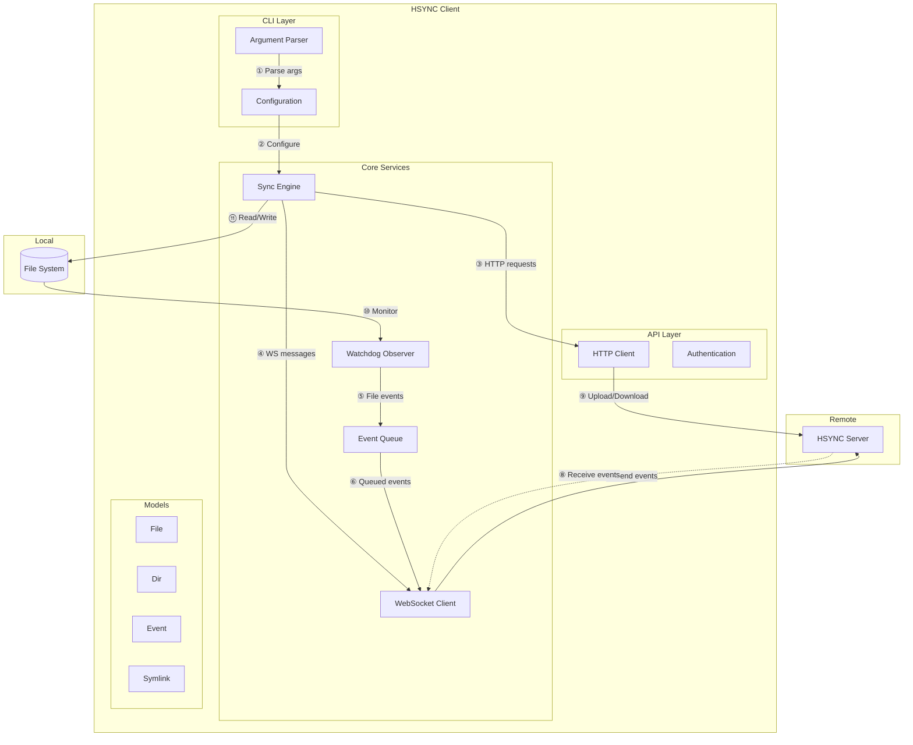

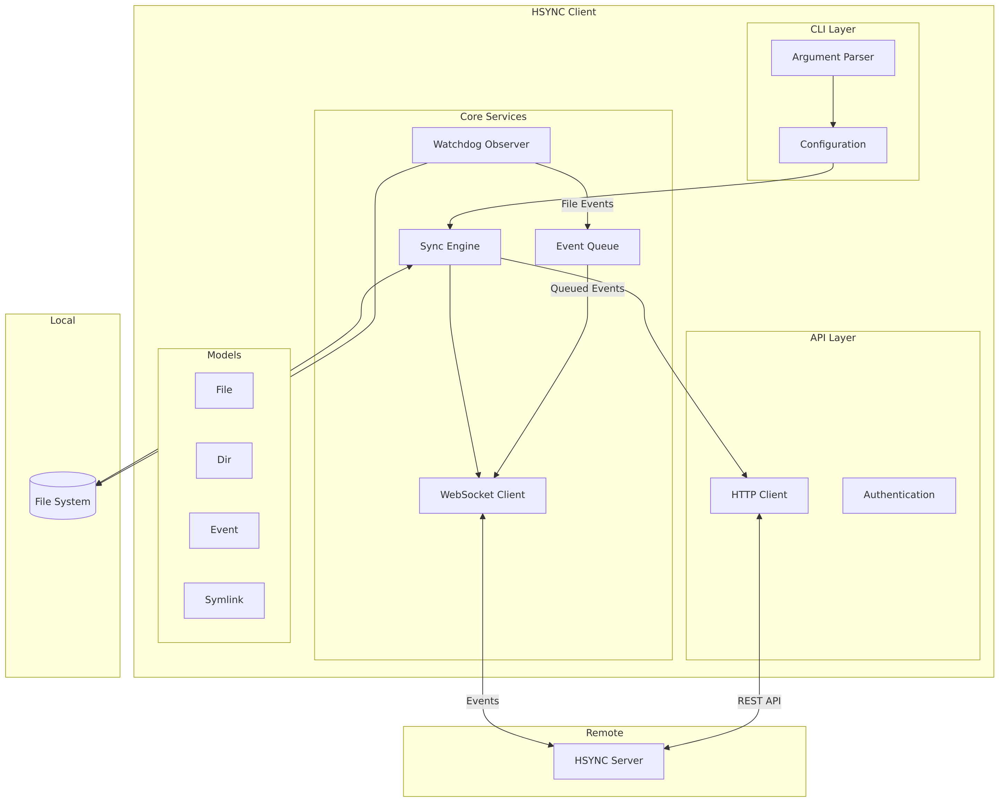

## Component Description

| Component | Description |
|-----------|-------------|
| **CLI Layer** | Parses command-line arguments and configures the client |
| **Sync Engine** | Orchestrates file synchronization logic |
| **Watchdog Observer** | Monitors local file system for changes |
| **Event Queue** | Queues events with retry and exponential backoff |
| **WebSocket Client** | Maintains real-time connection with server |
| **HTTP Client** | Handles REST API requests (upload/download) |
| **Models** | Data structures for files, directories, events |

## Module Structure

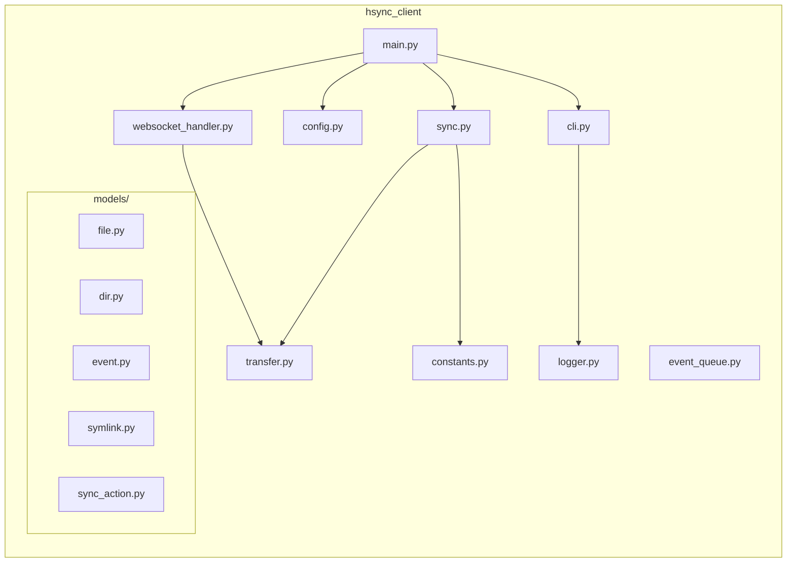

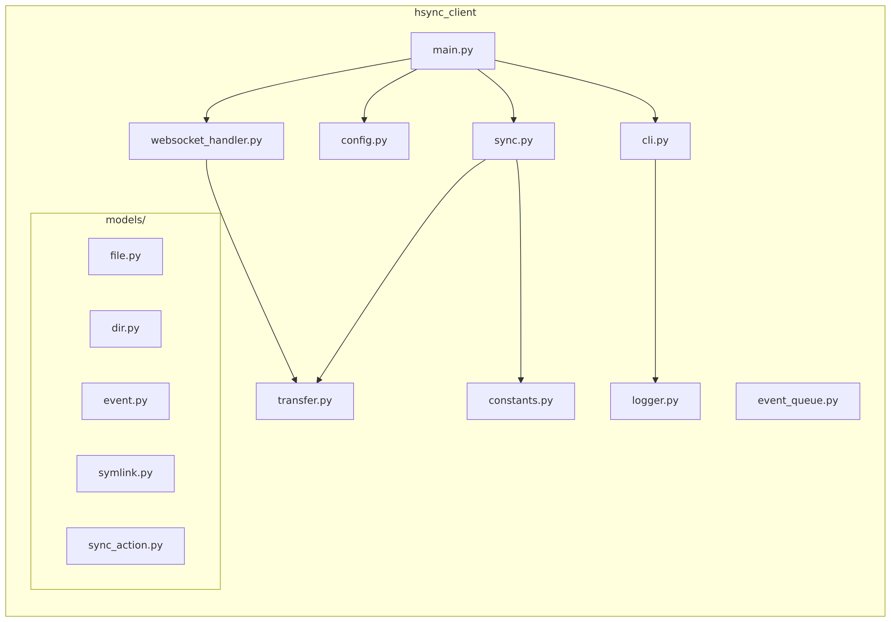

## Synchronization Modes

### Single Sync Mode

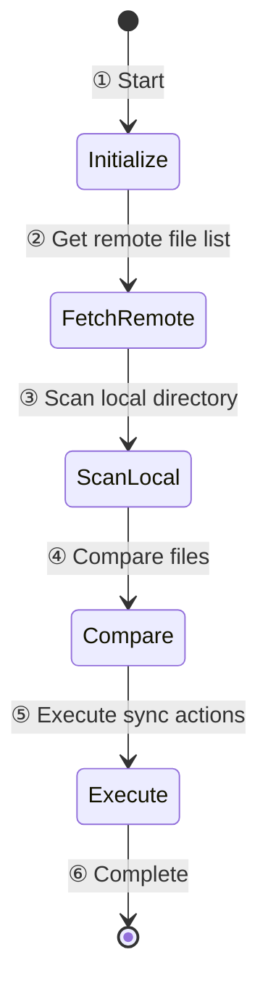

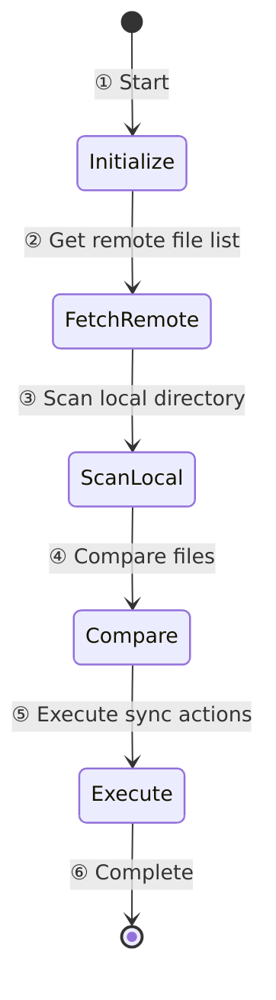

### Watch Mode (Continuous)

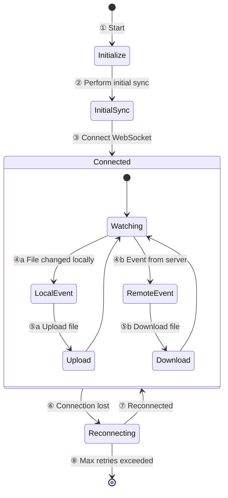

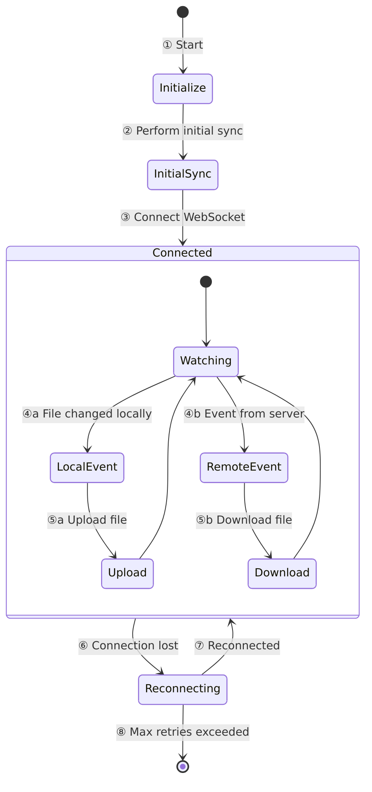

### Sync Direction Filtering

The `--sync-direction` option controls which operations are executed. Filtering is applied at two levels:

1. **Initial sync** — `get_sync_actions()` removes actions that don't match the direction before execution
2. **Watch mode** — Inline runtime checks skip events that don't match the direction

```
┌─────────────────────────────────────────────────────────┐
│                  Sync Direction Filter                    │
├─────────────────┬───────────────┬───────────────────────┤
│  Direction      │  Allowed      │  Blocked              │
├─────────────────┼───────────────┼───────────────────────┤
│  bidirectional  │  all actions  │  (none)               │
│  upload-only    │  upload       │  download, delete(*)  │
│  download-only  │  download,    │  upload               │
│                 │  delete       │                       │
└─────────────────┴───────────────┴───────────────────────┘
(*) Remote-triggered deletes are blocked in upload-only mode
```

The Observer (watchdog) continues running in all modes — events are filtered inline rather than stopping the Observer. This allows the sync direction to be changed dynamically at runtime via stdin command without restarting the process.

> **LAN Mode note**: In LAN mode, the `sync_direction` is also published via mDNS TXT records and used during master election — peers with **bidirectional** sync are preferred as master. Using `--force-master` with a non-bidirectional direction is an error. See [LAN Mode > Master Election](lan-mode.md#master-election) for details.

## Event Processing

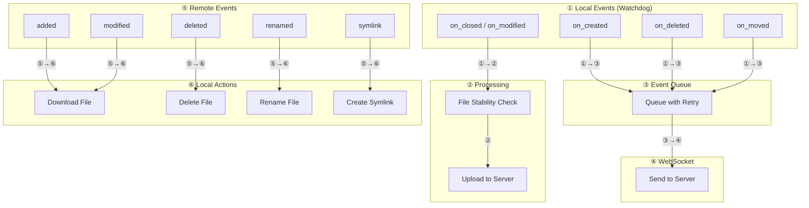

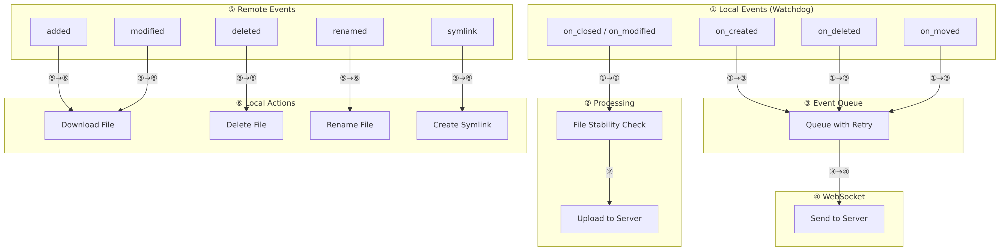

**Sync direction filtering in watch mode:**

- When `upload-only`: remote events (⑤) are **skipped** — only local events (①) are processed and uploaded
- When `download-only`: local events (①) are **skipped** — only remote events (⑤) are processed and downloaded
- When `bidirectional` (default): all events are processed normally

## File Change Detection

The client uses the **watchdog** library to monitor the local file system. The detection mechanism varies by platform:

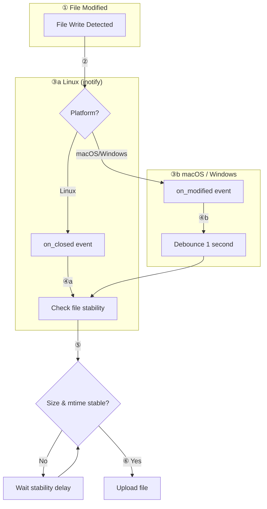

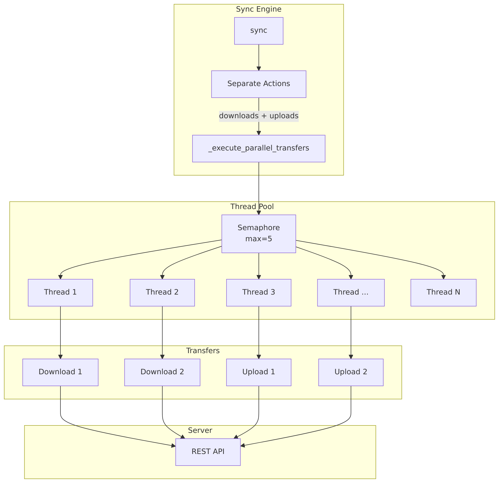

**Platform-specific behavior:**

| Platform | Event Used | Reason |
|----------|------------|--------|
| **Linux** | `on_closed` | Triggered when file is closed after writing, avoiding multiple events during write |
| **macOS** | `on_modified` + debounce | FSEvents doesn't support `on_closed`, uses 1-second debounce |
| **Windows** | `on_modified` + debounce | ReadDirectoryChangesW doesn't support `on_closed`, uses 1-second debounce |

**File stability check:**

Before uploading, the client verifies the file has stopped being written by checking:
1. **File size** - must remain constant over the stability delay period
2. **Modification time (mtime)** - must remain constant over the stability delay period

The stability delay defaults to **5 seconds** (inspired by Syncthing's default of 10 seconds) and can be configured via:
- CLI: `--stability-delay SEC`
- Environment variable: `HSYNC_STABILITY_DELAY`

**When to increase the stability delay:**
- Large files on slow storage (network filesystems, HDDs)
- Applications that write in bursts with pauses between writes
- When experiencing premature uploads of incomplete files

This prevents uploading incomplete files during long write operations.

## Configuration Flow

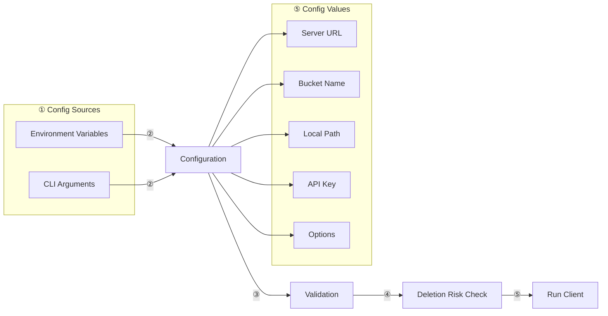

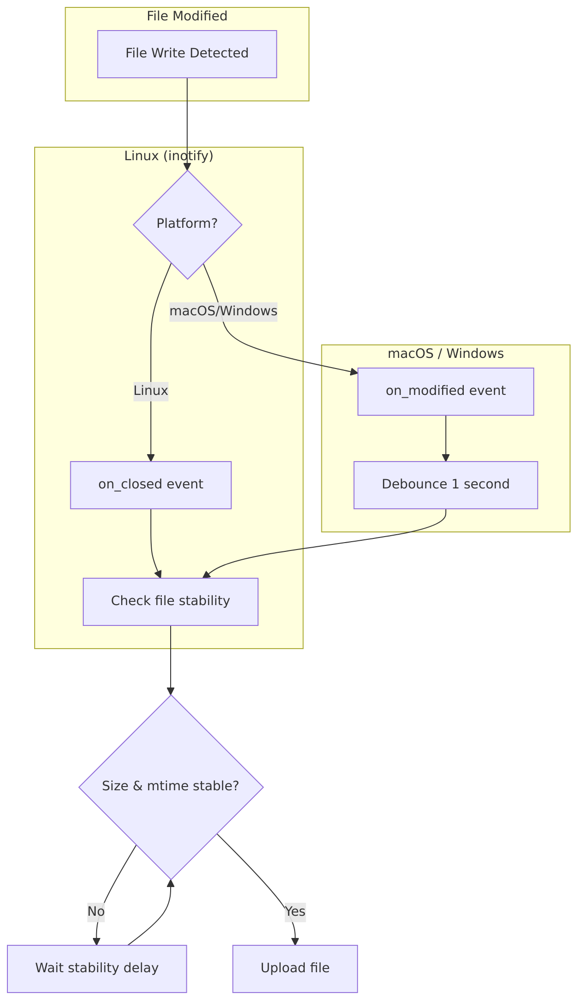

### Pre-Sync Safety Check (Deletion Risk)

Before starting synchronization, the client runs a **deletion risk check** (`_check_deletion_risk()` in `main_logic.py`). If the local directory is non-empty and the sync settings could cause file deletions, the user is warned and asked for confirmation:

| Condition | Risk Level | Behavior |
|-----------|------------|----------|
| `--sync-direction upload-only` | ✅ Safe | No warning |
| LAN mode + `--force-master` | ✅ Safe | No warning |
| Bidirectional server mode | ✅ Safe | No warning (normal behavior) |
| LAN mode without `--force-master` | ⚠️ Risky | Warning + confirmation prompt |
| `--sync-direction download-only` | ⚠️ Risky | Warning + confirmation prompt |
| Empty directory | ✅ Safe | No warning (nothing to delete) |

When `-y` / `--yes` is passed, the warning is still logged but the interactive prompt is skipped. The desktop client (`hsync-desktop`) shows its own confirmation dialog and always passes `--yes` to the CLI process.

## Parallel File Transfers

The sync engine uses a thread pool with semaphore-based concurrency control:

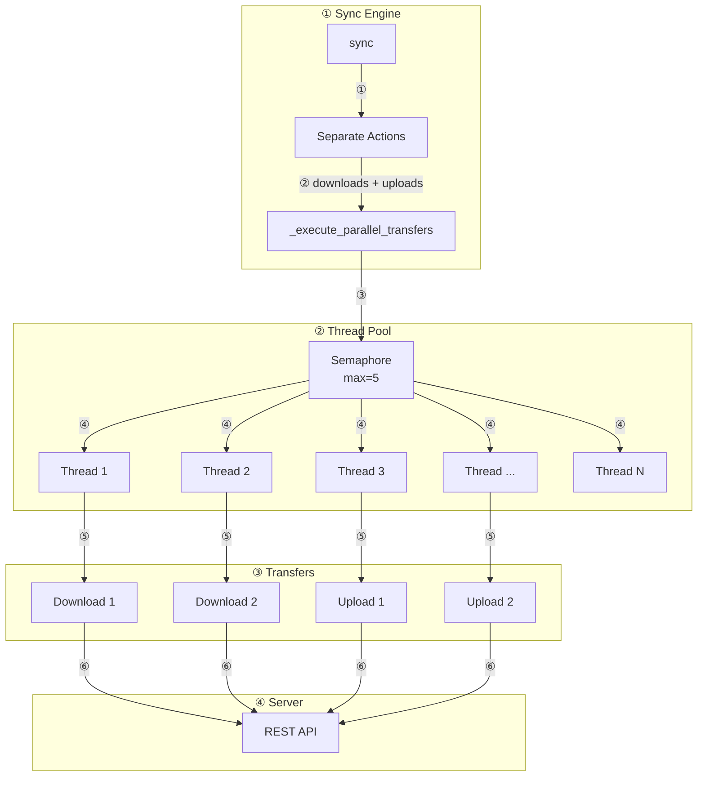


**Configuration:**
- `HSYNC_MAX_CONCURRENT_TRANSFERS`: Controls maximum parallel transfers (default: 5)
- Uses `asyncio.Semaphore` to limit concurrent operations
- Uses `ThreadPoolExecutor` for I/O-bound operations

## Performance Optimizations

### MD5 Cache with mtime Validation

To avoid redundant MD5 computations during a single sync operation, the client maintains an in-memory cache that maps file paths to `(md5sum, mtime)` tuples. On each `File.get()` call, the cached MD5 is returned only if the file's modification time hasn't changed — otherwise the entry is automatically invalidated and recomputed.

- Cache is cleared at the start of each sync cycle (`sync()`, `_run_preview()`)
- Individual entries are invalidated after downloads/uploads and before watchdog `File.get()` calls
- mtime validation provides automatic staleness detection even if manual invalidation is missed

### Adaptive Chunk Size for MD5 Computation

MD5 hashing uses different I/O chunk sizes based on file size for optimal throughput:

| File Size | Chunk Size |
|-----------|------------|
| < 1 MB | 8 KB |
| < 100 MB | 64 KB |
| ≥ 100 MB | 256 KB |

### Configurable Parallelization for File Scanning

Local file scanning uses `ThreadPoolExecutor` with an adaptive worker count:

| File Count | Workers |
|------------|---------|
| < 10 | min(2, files) |
| < 100 | min(4, files, CPU cores) |
| ≥ 100 | min(8, files, CPU cores) |

Override with `HSYNC_MAX_FILE_WORKERS` environment variable.

### Bandwidth Limiting

Upload and download bandwidth can be limited via `--max-bandwidth-upload` and `--max-bandwidth-download` CLI options. The implementation uses a **token bucket** algorithm for smooth rate control:

- **Uploads**: `_ThrottledFileReader` wraps file handles and injects delays after each `read()` call
- **Downloads**: Throttle delay is applied after each downloaded chunk in the streaming loop
- Throttle state is reset between sync sessions via `reset_bandwidth_throttle()`

See [Configuration > Bandwidth Limiting](configuration.md#bandwidth-limiting) for usage details.

## Project Structure

```
hsync-client/
├── hsync_client/           # Main Python package (source code)
│   ├── __init__.py
│   ├── __main__.py         # Module entry point
│   ├── main.py             # Main entry point
│   ├── main_logic.py       # Core sync orchestration
│   ├── cli.py              # CLI argument parsing (Typer)
│   ├── config.py           # Configuration management (pydantic-settings)
│   ├── constants.py        # Application constants
│   ├── sync.py             # Sync engine with parallel transfers
│   ├── transfer.py         # File upload/download operations
│   ├── websocket_handler.py # WebSocket event handling
│   ├── event_queue.py      # Event queue with retry logic
│   ├── lan.py              # LAN mode discovery (mDNS/Zeroconf)
│   ├── lan_server.py       # LAN mode HTTP server (master node)
│   ├── logger.py           # Logging configuration (loguru)
│   ├── retry.py            # Retry logic (tenacity)
│   ├── ssl_utils.py        # SSL/TLS utilities
│   ├── exceptions.py       # Custom exceptions
│   ├── utils.py            # Utility functions
│   ├── validators.py       # Input validators
│   └── models/             # Data models
│       ├── __init__.py
│       ├── dir.py          # Directory model
│       ├── event.py        # Event model
│       ├── file.py         # File model
│       ├── symlink.py      # Symbolic link model
│       └── sync_action.py  # Sync action model
├── docs/                   # Documentation
│   ├── architecture.md     # Architecture overview
│   ├── configuration.md    # Configuration guide
│   ├── getting-started.md  # Getting started guide
│   ├── lan-mode.md         # LAN mode (P2P) documentation
│   ├── sync-modes.md       # Synchronization modes
│   └── usage.md            # Usage guide
├── tests/                  # Test files
├── dist/                   # Compiled binary (created by compile.sh)
│   └── hsync               # Standalone executable
├── dev.env                 # Development environment template
├── prod.env                # Production environment template
├── compile.sh              # Build script (PyInstaller)
├── pyproject.toml          # Poetry configuration
├── poetry.lock             # Locked dependencies
└── README.md
```
