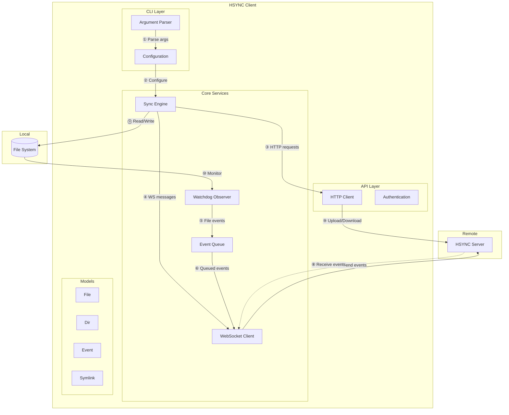
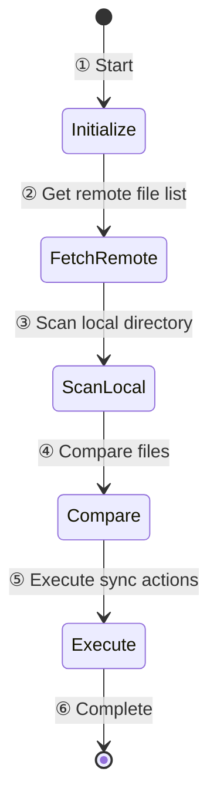
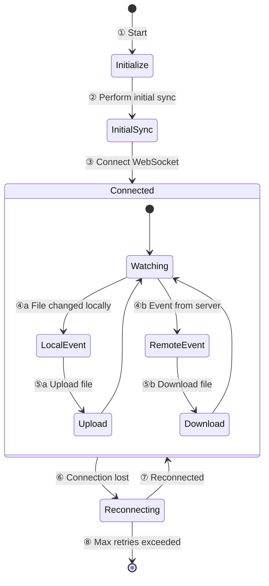
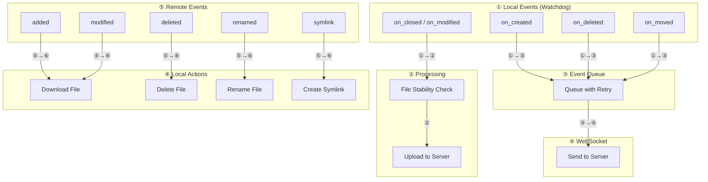
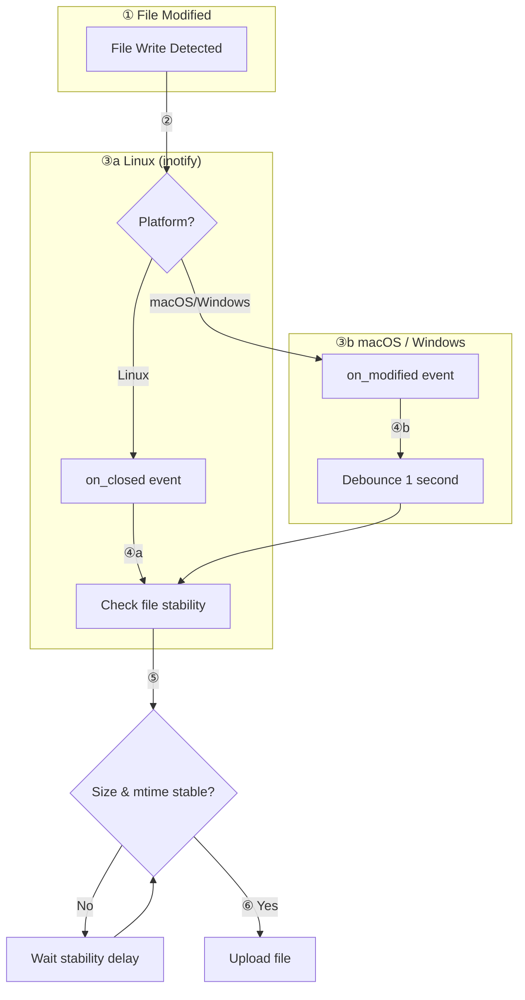
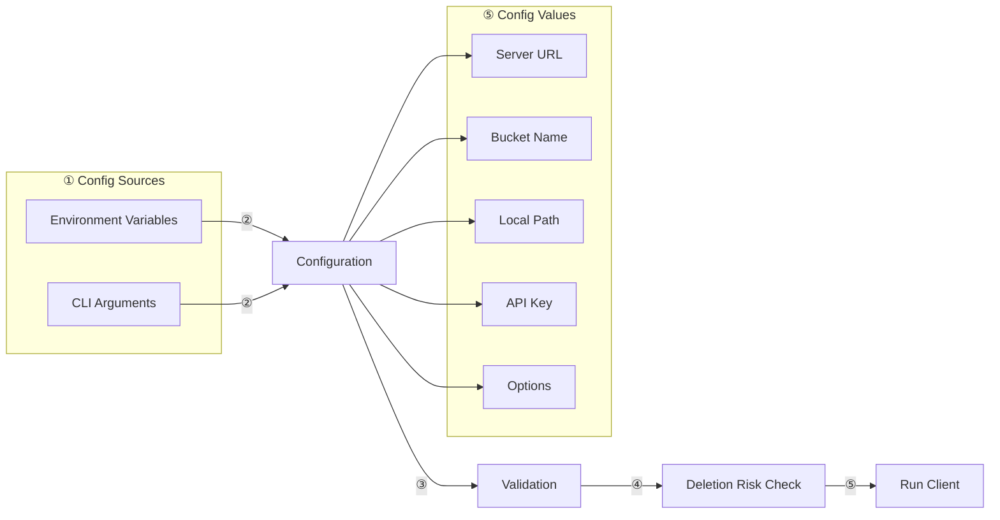
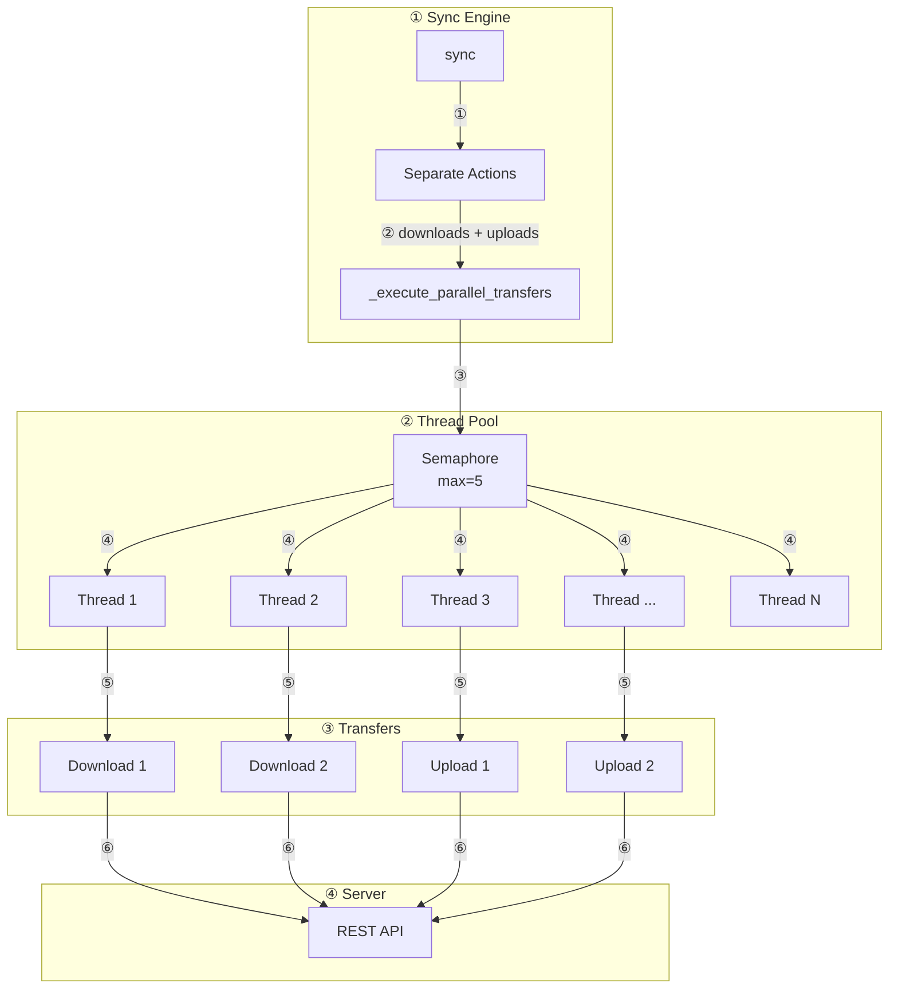

# HSYNC Client Architecture

This document describes the architecture of the HSYNC Client.

> The client builds on the shared models, constants, and utilities provided by
> `hsync-common`. See [HSYNC Common Architecture](https://github.com/albertobasso/hsync-common/blob/main/docs/architecture.md)
> for the foundation it depends on, and the
> [Architecture Decision Records](https://github.com/albertobasso/hsync-common/blob/main/docs/adr/README.md) for the
> *why* behind the ecosystem's stable decisions.

## System Overview



## Component Description

| Component | Description |
|-----------|-------------|
| **CLI Layer** | Parses command-line arguments and configures the client |
| **Sync Engine** | Orchestrates file synchronization logic |
| **Watchdog Observer** | Monitors local file system for changes |
| **Event Queue** | Queues events with retry and exponential backoff |
| **WebSocket Client** | Maintains real-time connection with server |
| **HTTP Client** | Handles REST API requests (upload/download) |
| **Models** | Data structures for files, directories, events |

## Synchronization Modes

### Single Sync Mode



### Watch Mode (Continuous)



### Sync Direction Filtering

The `--sync-direction` option controls which operations are executed. Filtering is applied at two levels:

1. **Initial sync** — `get_sync_actions()` removes actions that don't match the direction before execution
2. **Watch mode** — Inline runtime checks skip events that don't match the direction

```
┌─────────────────────────────────────────────────────────┐
│                  Sync Direction Filter                  │
├─────────────────┬───────────────┬───────────────────────┤
│  Direction      │  Allowed      │  Blocked              │
├─────────────────┼───────────────┼───────────────────────┤
│  bidirectional  │  all actions  │  (none)               │
│  upload-only    │  upload       │  download, delete(*)  │
│  download-only  │  download,    │  upload               │
│                 │  delete       │                       │
└─────────────────┴───────────────┴───────────────────────┘
(*) Remote-triggered deletes are blocked in upload-only mode
```

The Observer (watchdog) continues running in all modes — events are filtered inline rather than stopping the Observer. This allows the sync direction to be changed dynamically at runtime via stdin command without restarting the process.

> **LAN Mode note**: In LAN mode, the `sync_direction` is also published via mDNS TXT records and used during master election — peers with **bidirectional** sync are preferred as master. Using `--force-master` with a non-bidirectional direction is an error. See [LAN Mode > Master Election](lan-mode.md#master-election) for details.

## Event Processing



**Sync direction filtering in watch mode:**

- When `upload-only`: remote events (⑤) are **skipped** — only local events (①) are processed and uploaded
- When `download-only`: local events (①) are **skipped** — only remote events (⑤) are processed and downloaded
- When `bidirectional` (default): all events are processed normally

## File Change Detection

The client uses the **watchdog** library to monitor the local file system. The detection mechanism varies by platform:



**Platform-specific behavior:**

| Platform | Event Used | Reason |
|----------|------------|--------|
| **Linux** | `on_closed` | Triggered when file is closed after writing, avoiding multiple events during write |
| **macOS** | `on_modified` + debounce | FSEvents doesn't support `on_closed`, uses 1-second debounce |
| **Windows** | `on_modified` + debounce | ReadDirectoryChangesW doesn't support `on_closed`, uses 1-second debounce |

**File stability check:**

Before uploading, the client verifies the file has stopped being written by checking:
1. **File size** - must remain constant over the stability delay period
2. **Modification time (mtime)** - must remain constant over the stability delay period

The stability delay defaults to **5 seconds** (inspired by Syncthing's default of 10 seconds) and can be configured via:
- CLI: `--stability-delay SEC`
- Environment variable: `HSYNC_STABILITY_DELAY`

**When to increase the stability delay:**
- Large files on slow storage (network filesystems, HDDs)
- Applications that write in bursts with pauses between writes
- When experiencing premature uploads of incomplete files

This prevents uploading incomplete files during long write operations.

## Configuration Flow



### Pre-Sync Safety Check (Deletion Risk)

Before starting synchronization, the client runs a **deletion risk check** (`_check_deletion_risk()` in `main_logic.py`). If the local directory is non-empty and the sync settings could cause file deletions, the user is warned and asked for confirmation:

| Condition | Risk Level | Behavior |
|-----------|------------|----------|
| `--sync-direction upload-only` | ✅ Safe | No warning |
| LAN mode + `--force-master` | ✅ Safe | No warning |
| Bidirectional server mode | ✅ Safe | No warning (normal behavior) |
| LAN mode without `--force-master` | ⚠️ Risky | Warning + confirmation prompt |
| `--sync-direction download-only` | ⚠️ Risky | Warning + confirmation prompt |
| Empty directory | ✅ Safe | No warning (nothing to delete) |

When `-y` / `--yes` is passed, the warning is still logged but the interactive prompt is skipped. The desktop client (`hsync-desktop`) shows its own confirmation dialog and always passes `--yes` to the CLI process.

## Parallel File Transfers

The sync engine uses a thread pool with semaphore-based concurrency control:



**Configuration:**
- `HSYNC_MAX_CONCURRENT_TRANSFERS`: Controls maximum parallel transfers (default: 5)
- Uses `asyncio.Semaphore` to limit concurrent operations
- Uses `ThreadPoolExecutor` for I/O-bound operations


> For module structure, performance optimizations, error handling internals, and
> the full project layout, see the [Developer Guide](developer.md).
