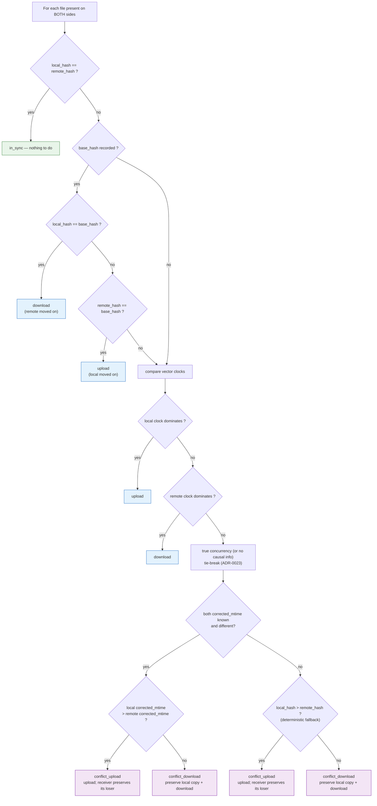
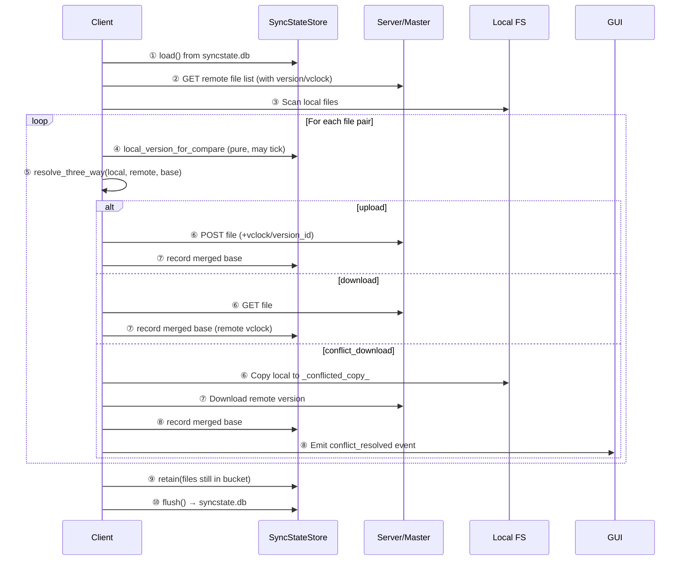
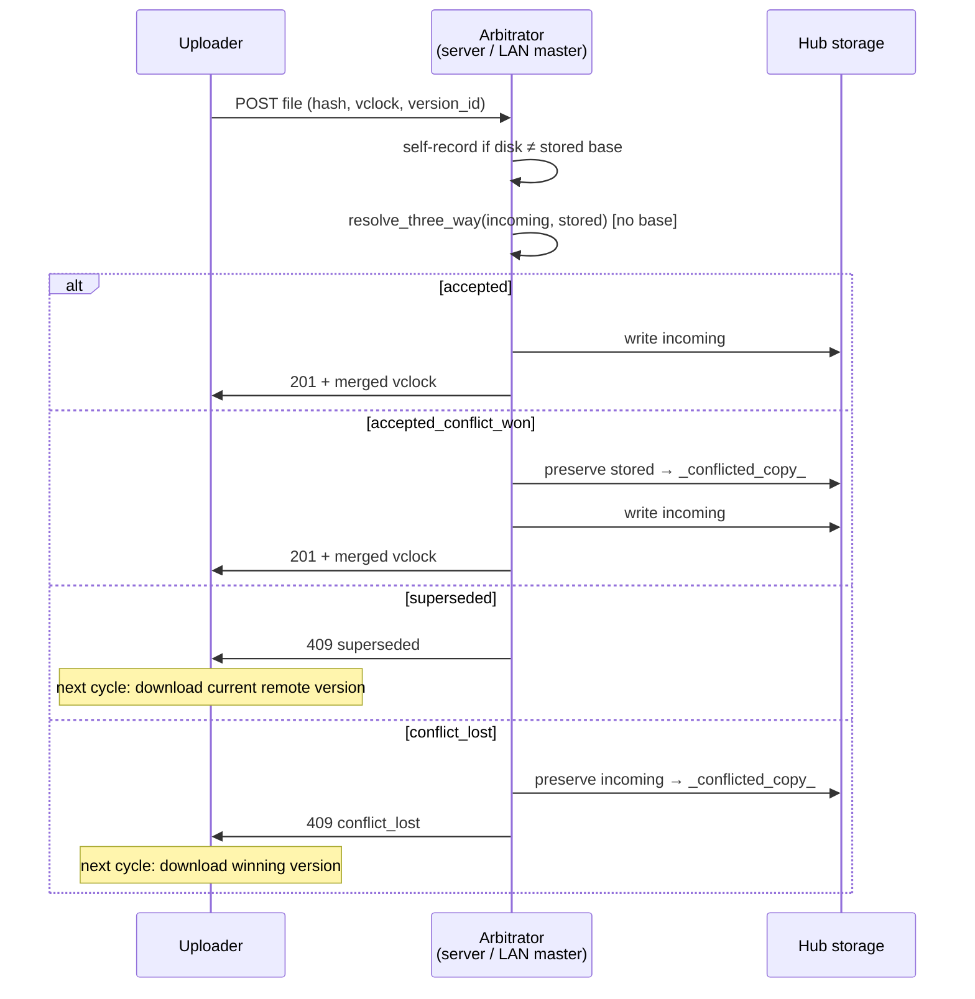

# Conflict Resolution & Causal Vector-Clock Merge

HSYNC uses a **decentralized causal model** (ADR-0022): every node records, per
file, the content hash it last agreed on with the cluster (**base**) plus a
**vector clock** (vclock) summarising the causal history of that version.
Comparing the local clock, the remote clock and the common ancestor lets a peer
tell whether only one side moved on (dominance) or both did (true concurrency)
— without trusting wall-clock timestamps. This is immune to clock skew and to
the false conflicts that arise when files relay through intermediate nodes.

On a true divergence (concurrent clocks) a **chronological tie-break**
(ADR-0023) picks the winner: the version with the most recent
*clock-offset-corrected* modification time (`corrected_mtime`) keeps the
original path. The offset is measured against a shared time reference — the
server in server mode, a list of public SNTP servers (configurable via
`HSYNC_NTP_HOSTS`) in LAN mode — so raw device-clock skew never decides the
outcome. When either side does not carry the field (or the two values tie),
a **deterministic SHA-256 fallback** decides, so every peer still converges.
The losing content is preserved as a `_conflicted_copy_` (extrema ratio).
**No node is authoritative**: the server and the elected LAN master are
transport hubs only; every node applies the same algorithm, and uploads
arriving at the server/master are arbitrated with the *same* matrix.

## Table of Contents

- [How it works](#how-it-works)
- [Decision tree (all cases)](#decision-tree-all-cases)
- [The version (`FileVersion`)](#the-version-fileversion)
- [The decision (`resolve_three_way`)](#the-decision-resolve_three_way)
- [The store (`SyncStateStore`)](#the-store-syncstatestore)
- [Lifecycle in a sync cycle](#lifecycle-in-a-sync-cycle)
- [Conflict handling on the pulling side](#conflict-handling-on-the-pulling-side)
- [Upload arbitration on the server / LAN master](#upload-arbitration-on-the-server--lan-master)
- [Deletions and tombstones (ADR-0003)](#deletions-and-tombstones-adr-0003)
- [Boundary cases](#boundary-cases)

---

## How it works

Each file has a causal identity made of three pieces:

1. **Content hash** — SHA-256 of the bytes (`base_hash` for the agreed version,
   `sha256sum` for the versions being compared).
2. **Vector clock** — a map `peer cid → logical counter`. Every node ticks *its
   own* counter by one for each local edit it authors or observes
   (`tick_vclock`), so clocks grow monotonically and two distinct versions can
   never alias the same clock (the anti-aliasing invariant).
3. **Common ancestor** — the `base_hash` recorded after the last successful
   sync. The base is what makes a three-way merge possible without trusting
   timestamps.

Comparing two clocks componentwise (`compare_vclocks`) yields `equal`,
`dominates`, `dominated`, or `concurrent`. After every successful sync the
agreed clock is the componentwise maximum of the two sides (`merge_vclocks`):
in dominance it equals the dominant clock; in a conflict it includes *both*
histories, so third nodes recognise either side as an ancestor and no false
conflict propagates downstream (convergence invariant D11).

```
        ┌─────────────┐
        │  Common     │
        │  Ancestor   │  ← "base" (hash + vclock recorded after last sync)
        │  hash=A     │
        └──────┬──────┘
               │
       ┌───────┴───────┐
       ▼               ▼
┌─────────────┐  ┌─────────────┐
│  Local      │  │  Remote     │
│  hash=A     │  │  hash=B     │  ← remote clock dominates → download
│  vclock M:1 │  │  vclock M:2 │
└─────────────┘  └─────────────┘

       OR

┌─────────────┐  ┌─────────────┐
│  Local      │  │  Remote     │
│  hash=X     │  │  hash=Y     │  ← concurrent clocks → corrected-mtime
│  vclock M:1 │  │  vclock N:1 │     tie-break (SHA-256 fallback)
└─────────────┘  └─────────────┘
```

The *raw* wall clock is never consulted for the direction of a transfer: only
the offset-corrected `corrected_mtime` enters the chronological tie-break, and
only after causal dominance failed to find a winner. The algorithm lives in
`hsync_common.models.version.resolve_three_way()` and is consumed by the
client's `get_sync_actions()`, by the real-time inbound-event path, and by the
upload arbitration on both the central server and the LAN master.

---

## Decision tree (all cases)



Every possible outcome falls into one of five decisions:

| Decision | Meaning | Loser preservation |
|----------|---------|--------------------|
| `in_sync` | Contents identical; nothing to transfer | — |
| `upload` | Local causally ahead (or remote at base) | — |
| `download` | Remote causally ahead (or local at base) | — |
| `conflict_upload` | Concurrent; local wins the chronological tie-break (or the SHA-256 fallback) | **Remote side** preserves its losing copy when the upload is arbitrated |
| `conflict_download` | Concurrent; remote wins the chronological tie-break (or the SHA-256 fallback) | **Local side** preserves its losing copy as `_conflicted_copy_` |

---

## The version (`FileVersion`)

Each recorded version entry contains five fields:

| Field | Type | Purpose |
|-------|------|---------|
| `base_hash` | `str` | SHA-256 of the file content at the last successful sync |
| `version_id` | `str` | Opaque, random 128-bit id identifying this version lineage |
| `origin_cid` | `str \| None` | Client ID that authored the version (`None` if unknown) |
| `ts` | `int` | Wall-clock timestamp when the base was recorded (informational only) |
| `vclock` | `dict[str, int]` | Causal history: node cid → logical counter |

The `vclock` is the causal history: each node increments its own counter once
per observed local edit (`tick_vclock`), producing monotonically increasing
clocks so two distinct versions can never alias the same clock (the
anti-aliasing invariant). Comparing two clocks componentwise (`compare_vclocks`)
yields `equal`, `dominates`, `dominated`, or `concurrent`.

On the wire (inside `FileDict["version"]`), the form is `VersionInfo`: the
same `vclock`/`version_id`/`origin_cid`/`ts` but **without** `base_hash` — the
content hash of the version is the `sha256sum` of the enclosing `FileDict`.

---

## The decision (`resolve_three_way`)

```python
def resolve_three_way(
    local_hash: str | None,
    local_vclock: dict[str, int] | None,
    remote_hash: str | None,
    remote_vclock: dict[str, int] | None,
    base_hash: str | None,
    *,
    local_corrected_mtime: int = 0,
    remote_corrected_mtime: int = 0,
) -> SyncDecision:
```

The full matrix, in evaluation order:

| # | Condition | Decision |
|---|-----------|----------|
| 1 | `local_hash == remote_hash` | `in_sync` |
| 2 | `base_hash` set and `local_hash == base_hash` | `download` |
| 3 | `base_hash` set and `remote_hash == base_hash` | `upload` |
| 4 | local clock **dominates** remote clock | `upload` |
| 5 | remote clock **dominates** local clock | `download` |
| 6 | concurrent (or both empty / equal-clock anomaly) **and** both `corrected_mtime` known (> 0) **and** different — higher corrected mtime wins | `conflict_upload` / `conflict_download` |
| 7 | concurrent (or both empty / equal-clock anomaly) **and** either `corrected_mtime` unknown (0) or the two tie — `local_hash > remote_hash` | `conflict_upload` / `conflict_download` |

Rules 2–3 are the **base fast paths**: knowing the common ancestor decides the
direction immediately, whatever the clocks say. Rules 4–5 handle the case
where the base is unknown or neither side matches it: causal dominance alone
decides. Rules 6–7 are the **true conflict**: first the chronological
offset-corrected `corrected_mtime` tie-break (ADR-0023) elects the winner, then
the deterministic SHA-256 fallback covers the cases where a side does not carry
the field — so every node converges on the same content without coordination,
and the loser is preserved.

---

## The store (`SyncStateStore`)

The store is an in-memory `dict[relpath, FileVersion]` persisted in the
installation **`syncstate.db`**, keyed by the `.hsyncfolder` UUID. Properties:

- **Private to each peer** — never exchanged with the server or other peers
  (the wire form `VersionInfo` carries the clock inside the listing/event).
- **Outside the bucket** — WAL/FULL SQLite on the system state directory;
  the bucket only holds the `.hsyncfolder` marker.
- **Garbage collected** — entries for files no longer in the bucket are pruned.
- **Thread-safe** — wrapped by a re-entrant lock in `hsync_client.sync_state`
  because transfers record their base from the parallel transfer thread pool.

The recorded clock after a sync is `merge(local_effective, remote_advertised)`
(`merge_and_record`): in dominance it equals the dominant clock, in conflict it
includes both histories so third nodes recognise either side as an ancestor
(the convergence invariant D11).

A **dry-run/preview** (`get_sync_actions(persist_state=False)`) never mutates
the store: the causal decisions are still accurate (the local clock is read
through the pure `local_version_for_compare`), but nothing is persisted.

The local clock used for comparison is the **effective honest version**: when
the current content differs from the recorded base, the stored clock is ticked
by this node's cid **purely** (no store mutation) before comparing — the same
anti-aliasing self-record the server arbitration performs out-of-band.

---

## Lifecycle in a sync cycle



The same matrix also runs on the **real-time** path: an inbound WS "modified"
event for an existing file re-checks the causal relationship before applying,
so a stale echo can never overwrite a newer local edit.

---

## Conflict handling on the pulling side

When `resolve_three_way` returns `conflict_download` (the remote won the
tie-break):

1. The **local file is copied** to `<stem>_conflicted_copy_<ISO8601-UTC>_<cid>.<ext>`
   — preserving the user's local changes.
2. The **remote version is downloaded**.
3. The **base is updated** with a merged clock, so subsequent syncs don't
   re-trigger the conflict.
4. A **`conflict_resolved` UI event** is emitted so the Desktop GUI can notify.

When `resolve_three_way` returns `conflict_upload` (the local won the
tie-break), the local version is uploaded and the **receiver** preserves its
losing copy — no conflict copy is made on the client side.

### Naming convention

```
<stem>_conflicted_copy_<YYYY-MM-DDTHHMMSSZ>_<cid>.<ext>
```

- Timestamps are always **UTC**.
- `<cid>` is the client ID that authored the losing version.
- The same format is used whether the conflict is detected client-side
  (`_save_conflict_copy` in `sync.py`) or receiver-side (`arbitration.py`).

### Chronological tie-break with deterministic fallback (no auto-merge)

HSYNC uses a **chronological tie-break with preservation**: when both sides
diverge concurrently, the version whose offset-corrected modification time is
the most recent keeps the original path. The offset is measured against a
shared time reference — the server's `/api/v1/time` endpoint in server mode,
public SNTP servers (configurable via `HSYNC_NTP_HOSTS`) in LAN mode — so a
skewed device clock cannot decide the winner. When either side lacks the
field (e.g. a legacy peer or a degraded offline measurement) the higher
SHA-256 hash (lexicographic) wins instead, so every peer still converges.
The loser is preserved as a conflicted copy. This is the same "keep both"
approach as Dropbox/OneDrive.

**HSYNC does not perform automatic content merging.** Rationale:

- Most synced files are binary (images, archives, databases) where text-merge
  is meaningless.
- A three-way text merge can silently produce semantically broken files.
- A deterministic tie-break + conflicted copy is predictable: every node
  converges on the same winner without coordination, and the user can merge
  manually with their tool of choice.

---

## Upload arbitration on the server / LAN master

The server and the LAN master are transport hubs, but every upload landing on
them is **arbitrated** with the same causal matrix (`arbitrate_upload`),
mirrored on the client side for the LAN master. Four outcomes exist:

| Outcome | Condition | Action taken |
|---------|-----------|--------------|
| `accepted` | incoming is causally ahead (or at parity) | Write incoming content; record merged clock |
| `accepted_conflict_won` | concurrent; incoming wins the tie-break (corrected mtime, or the hash fallback) | Write incoming content; preserve previous stored content as `_conflicted_copy_` |
| `superseded` | incoming is causally dominated (stale ancestor) | Reject (`409`); **no copy** — the ancestor's bytes are in the winner |
| `conflict_lost` | concurrent; incoming loses the tie-break (corrected mtime, or the hash fallback) | Reject (`409`); preserve incoming bytes as `_conflicted_copy_`; keep stored winner |

Out-of-band edits are self-recorded first: if the file on disk differs from
the stored `base_hash` (a write the hub did not observe), the stored clock is
ticked by the hub's own cid before comparing — the receiver's clock is always
honest.



The uploader handles the `409` responses through
`_handle_upload_conflict_response`: `superseded`/`conflict_lost` mark the file
for download on the next cycle; a legacy "already present" response records
the base as in-sync.

---

## Deletions and tombstones (ADR-0003)

Deletions are causal too. When a file is deleted on a peer, a **tombstone**
marker is recorded: `(hashed path, SHA-256 of the deleted content, vclock)`,
with the clock ticked by the deleting peer. Markers are gossiped between peers
and merged by **vector-clock dominance** — a marker whose clock dominates the
effective local clock is positive proof that the local copy is a stale
ancestor, so the file is deleted instead of being resurrected. The deletion
**timestamp is never consulted** for the decision.

| Case | Causal verdict | Action |
|------|----------------|--------|
| Tombstone clock **dominates** local clock | Local copy is a stale ancestor | Delete locally (even with an older timestamp) |
| Tombstone clock **equal** to local clock | No descent proof | Keep (never delete on equal clocks) |
| Tombstone and local clocks **concurrent** | Local edit is an intentional re-creation | Keep / upload |
| Local clock **dominates** tombstone | Re-creation happened after the deletion | Keep |

Every peer records the marker when **it** observes the deletion — as LAN master
or as slave alike — so a deletion made while the elected master is temporarily
unreachable is never lost: the next reconciliation recognises the recorded
marker and deletes the stale copy still held by the (restarted) master, instead
of downloading it back. A file that exists only on the remote side is deleted
there only when the tombstone clock **causally dominates** the remote version
(positive proof that the remote copy is a stale ancestor of the deletion).
Content equality is deliberately **not** a delete proof: a file re-created
byte-for-byte identically — an empty file being the trivial case, since every
empty file shares the same SHA-256 — is an intentional re-creation and is
downloaded normally (add-wins, mirroring Syncthing's
modification-beats-deletion policy).

The tombstone exemption also plugs into the mass-deletion guard: deletions
backed by a matching tombstone are never blocked, because the marker is
positive proof the removal was intentional.

Tombstones are not a recycle bin. They do not store file bytes and there is
no restore command or API. The default 90-day TTL only garbage-collects the
marker; after a delete the content is already gone from disk. Keep verified
backups if undelete is required.

---

## Boundary cases

| Scenario | Behavior |
|----------|----------|
| **File deleted locally, changed remotely** | Tombstone logic (ADR-0003, causal) handles the absent-file branch. |
| **File deleted remotely, changed locally** | Tombstone logic; local edit is uploaded if direction allows. |
| **New file on both sides with same content** | `local == remote` → `in_sync` |
| **New file on both sides, different content** | Both clocks empty → concurrent → corrected-mtime tie-break, then hash fallback. |
| **Base unknown, both clocks empty, differing content** | Equal-clock anomaly → concurrent → corrected-mtime tie-break, then hash fallback. |
| **File replaced with empty content** | Hash `""` is treated as absent by `record_base()` — a no-op guard prevents corrupting the store. |
| **Upload superseded** | The hub arbitrates: a causally-dominated upload is rejected (`409 superseded`) and the client downloads the current remote version on the next cycle. |
| **Upload loses tie-break** | The incoming bytes are preserved as a conflicted copy (`409 conflict_lost`); the stored winner is kept. |
| **Malformed wire `version` / vclock** | Tolerantly parsed as absent (empty clock); the causal matrix handles it. A malformed stored row is dropped rather than masked. |
| **Concurrent uploads of the same path** | Serialized per path (file lock); the second sees the version the first registered. |
| **Relay A → B → C** | No false conflict: merged clocks carry the full causal history through the relay. |

## See also

- [Sync Flow](sync-flow.md) — client-side sync flow with conflict handling diagrams.
- [Architecture](internal/architecture.md) — high-level system overview.
- [Developer Guide](internal/developer.md) — performance optimizations and internals.
- [HSYNC Common → Version models](https://github.com/albertobasso/hsync-common/blob/main/docs/internal/architecture.md) — shared version store.
