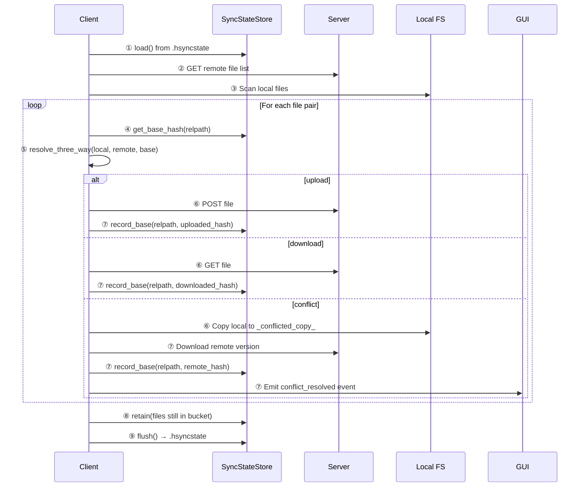

# Conflict Resolution & Three-Way Merge

HSYNC uses a **master-authoritative** model: the server (or the elected LAN
master) is the source of truth, not a CRDT. To resolve concurrent edits
correctly without trusting wall-clock timestamps, each peer remembers, per
file, the content hash it last agreed on with the master — the **base**.
Comparing the local hash, the remote hash, and this base lets a peer determine
whether only the local side, only the remote side, or *both* sides changed
since the last successful sync. This is the same three-way strategy used by
Syncthing and `git merge-base`.

## Table of Contents

- [How it works](#how-it-works)
- [The base (`FileVersion`)](#the-base-fileversion)
- [The decision (`resolve_three_way`)](#the-decision-resolve_three_way)
- [The store (`SyncStateStore`)](#the-store-syncstatestore)
- [Lifecycle in a sync cycle](#lifecycle-in-a-sync-cycle)
- [Conflict handling](#conflict-handling)
- [Boundary cases](#boundary-cases)
- [Legacy fallback](#legacy-fallback)

---

## How it works

```
        ┌─────────────┐
        │  Common     │
        │  Ancestor   │  ← "base" (hash recorded after last successful sync)
        │  hash=A     │
        └──────┬──────┘
               │
       ┌───────┴───────┐
       ▼               ▼
┌─────────────┐  ┌─────────────┐
│  Local      │  │  Remote     │
│  hash=A     │  │  hash=B     │  ← only remote changed → download
└─────────────┘  └─────────────┘

       OR

┌─────────────┐  ┌─────────────┐
│  Local      │  │  Remote     │
│  hash=X     │  │  hash=Y     │  ← both changed since base → conflict
└─────────────┘  └─────────────┘
```

On every sync cycle, for each file that appears on both sides with different
hashes:

1. Look up the **base hash** from the local `.hsyncstate` store.
2. If `local == base` → the remote side moved, **download**.
3. If `remote == base` → the local side moved, **upload**.
4. If neither matches the base → **genuine conflict**: both sides edited
   independently.
5. If no base is recorded (first-ever sync) → fall back to the legacy
   mtime/hash heuristic.

This algorithm is implemented in `hsync_common.models.version.resolve_three_way()`
and consumed by the client's `get_sync_actions()`.

---

## The base (`FileVersion`)

Each recorded version entry contains four fields:

| Field | Type | Purpose |
|-------|------|---------|
| `base_hash` | `str` | SHA-256 of the file content at the last successful sync |
| `version_id` | `str` | Opaque, random 128-bit id identifying this version lineage |
| `origin_cid` | `str \| None` | Client ID that authored the version (`None` if remote/unknown) |
| `ts` | `int` | Wall-clock timestamp when the base was recorded (unix seconds) |

The `version_id` is **not** content-derived — it is a freshly minted random token
(`secrets.token_hex(16)`) that serves as a lineage marker. It lets a peer
detect when a file was replaced with a completely different file that happens to
have the same hash (hash collision is astronomically unlikely, but the lineage
check makes the model robust).

---

## The decision (`resolve_three_way`)

```python
def resolve_three_way(
    local_hash: str | None,
    remote_hash: str | None,
    base_hash: str | None,
) -> SyncDecision:
```

| Input | Decision | Action |
|-------|----------|--------|
| `local == remote` | `in_sync` | Nothing to do |
| `local == base` | `download` | Pull remote version |
| `remote == base` | `upload` | Push local version |
| both differ from base | `conflict` | Keep both versions (see below) |
| `base is None` | `unknown_base` | Fall back to legacy mtime/hash heuristic |

---

## The store (`SyncStateStore`)

The store is an in-memory `dict[relpath, FileVersion]` persisted to a
**`.hsyncstate`** side-car file at the bucket root. Properties:

- **Private to each peer** — never exchanged with the server or other peers.
- **Atomic writes** — written to a `.tmp` file first, then renamed (no partial
  writes on crash).
- **Garbage collected** — after each sync, entries for files that no longer
  exist in the bucket are pruned via `retain()`.
- **Thread-safe** — wrapped by a re-entrant lock in `hsync_client.sync_state`
  because transfers record their base from the parallel transfer thread pool.

### Per-bucket persistence

```python
# On sync start
store = get_sync_state_store()  # loads .hsyncstate into memory

# During sync, after each successful transfer
record_base("/bucket/docs/report.pdf", base_hash="abc123...")

# On sync end
flush()  # writes .hsyncstate atomically
```

---

## Lifecycle in a sync cycle



---

## Conflict handling

When `resolve_three_way` returns `conflict`:

1. The **local file is copied** to `<stem>_conflicted_copy_<ISO8601-UTC>_<cid>.<ext>`
   in the same directory — preserving the user's local changes.
2. The **remote version is downloaded** — the master (server or LAN master) wins.
3. The **base is updated** to the downloaded remote hash, so subsequent syncs
   don't re-trigger the conflict.
4. A **`conflict_resolved` UI event** is emitted (via the `--events-json-fd`
   channel) so the Desktop GUI can show a notification to the user.

### Naming convention

The conflicted-copy naming is **unified** between client and server:

```
<stem>_conflicted_copy_<YYYY-MM-DDTHHMMSSZ>_<cid>.<ext>
```

- Timestamps are always **UTC** (not local time) to avoid ambiguity across
  devices in different time zones.
- `<cid>` is the client ID that authored the losing version, truncated to 32
  alphanumeric characters.
- The same format is used whether the conflict is detected client-side
  (`_save_conflict_copy` in `sync.py`) or server-side (overwrite in
  `upload.py`).

### Last-writer-wins with preservation (no auto-merge)

HSYNC uses a **last-writer-wins (LWW) with preservation** strategy. This is
the same approach used by Dropbox and OneDrive: when both sides diverge, the
master version wins and the local version is preserved as a conflicted copy.

**HSYNC does not perform automatic content merging** (unlike `git merge` or
Syncthing's optional text-merge). Rationale:

- Most synced files are binary (images, archives, databases) where text-merge
  is meaningless.
- A three-way text merge can silently produce semantically broken files
  (e.g. merging two edits to the same code block).
- LWW + conflicted copy is predictable: the user always knows what happened
  and can merge manually with their tool of choice.

The `conflict_resolved` event lets the GUI surface conflicts immediately
rather than requiring the user to discover `_conflicted_copy_` files by
browsing the file system.

> HSYNC is master-authoritative, not a CRDT. The master (server or elected LAN
> master) is always the source of truth. The conflict file preserves the local
> changes so nothing is lost; it's up to the user to merge manually.

---

## Boundary cases

| Scenario | Behavior |
|----------|----------|
| **File deleted locally, changed remotely** | `local is None`, `remote has hash` → `unknown_base` (base can't help) → falls back to legacy heuristic → downloads remote |
| **File deleted remotely, changed locally** | `remote is None`, `local has hash` → `unknown_base` → falls back to legacy → uploads local (if direction allows) |
| **File deleted on both sides** | `local is None`, `remote is None` → `in_sync` → nothing to do |
| **New file on both sides with same content** | `local == remote` → `in_sync` |
| **New file on both sides with different content** | `base is None` → `unknown_base` → falls back to legacy → mtime comparison |
| **File replaced with empty content** | Hash `""` is treated as absent by `record_base()` — a no-op guard prevents corrupting the store |

---

## Legacy fallback

When `unknown_base` is returned (first sync, or file never synced before), the
client falls back to a **mtime + hash** heuristic:

- Compare file modification times
- If mtimes diverge meaningfully, compare SHA-256 hashes
- Use sync direction rules (`upload-only`, `download-only`, `bidirectional`) as
  tiebreakers

This fallback is sufficient for the initial sync and for files that have no
recorded base, but it is vulnerable to clock skew — which is why the three-way
merge is preferred once a base is established.

## See also

- [Sync Flow](sync-flow.md) — client-side sync flow with conflict handling diagrams.
- [Architecture](internal/architecture.md) — high-level system overview.
- [Developer Guide](internal/developer.md) — performance optimizations and internals.
- [HSYNC Common → Version models](https://github.com/albertobasso/hsync-common/blob/main/docs/internal/architecture.md) — shared version store.
