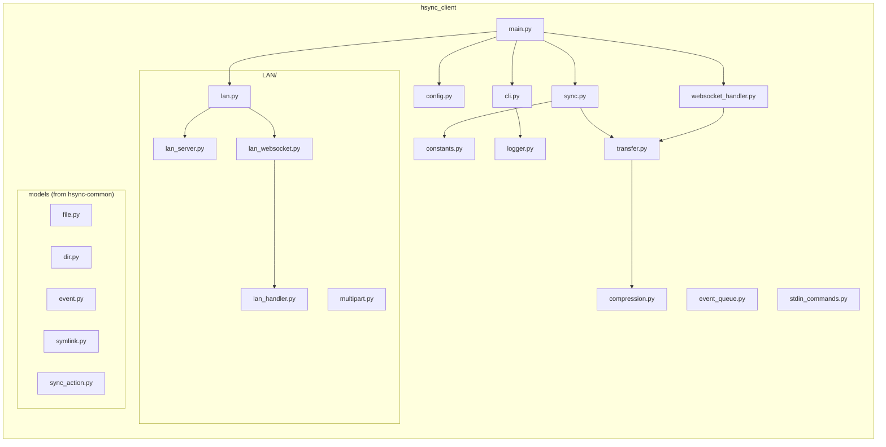
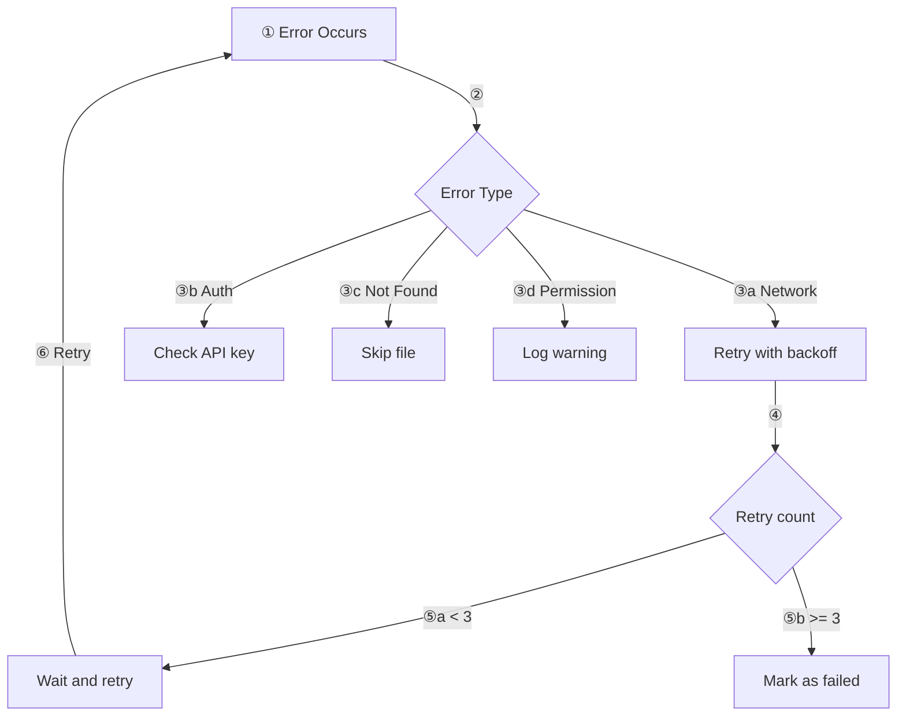
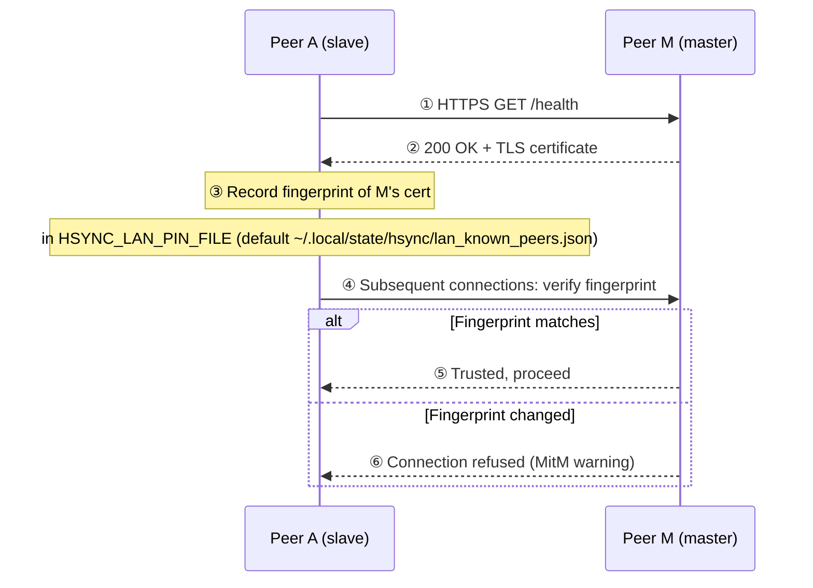

# HSYNC Client — Developer Guide

This page covers internal implementation details useful for contributors and
developers working on the HSYNC Client codebase.

> For the high-level system design, see [Architecture](architecture.md).
> For the sync protocol, see [Sync Flow](../sync-flow.md).

## Table of Contents

- [Module Structure](#module-structure)
- [Performance Optimizations](#performance-optimizations)
- [Error Handling & Retries](#error-handling--retries)
- [Compression Internals](#compression-internals)
- [WebSocket Reconnection](#websocket-reconnection)
- [Stdin Command Protocol](#stdin-command-protocol)
- [LAN Peer Pairing Flow](#lan-peer-pairing-flow)

---

## Module Structure



## Performance Optimizations

### SHA-256 Cache with mtime Validation

To avoid redundant SHA-256 computations during a single sync operation, the client maintains an in-memory cache that maps file paths to `(sha256sum, mtime)` tuples. On each `File.get()` call, the cached SHA-256 is returned only if the file's modification time hasn't changed — otherwise the entry is automatically invalidated and recomputed.

- Cache is cleared at the start of each sync cycle (`sync()`, `_run_preview()`)
- Individual entries are invalidated after downloads/uploads and before watchdog `File.get()` calls
- mtime validation provides automatic staleness detection even if manual invalidation is missed

### Adaptive Chunk Size for SHA-256 Computation

SHA-256 hashing uses different I/O chunk sizes based on file size for optimal throughput:

| File Size | Chunk Size |
|-----------|------------|
| < 1 MB | 8 KB |
| < 100 MB | 64 KB |
| ≥ 100 MB | 256 KB |

### Configurable Parallelization for File Scanning

Local file scanning uses `ThreadPoolExecutor` with an adaptive worker count:

| File Count | Workers |
|------------|---------|
| < 10 | min(2, files) |
| < 100 | min(4, files, CPU cores) |
| ≥ 100 | min(8, files, CPU cores) |

Override with `HSYNC_MAX_FILE_WORKERS` environment variable.

### Bandwidth Limiting

Upload and download bandwidth can be limited via `--limit-upload` and `--limit-download` CLI options. The implementation uses a **token bucket** algorithm for smooth rate control:

- **Uploads**: `_ThrottledFileReader` wraps file handles and injects delays after each `read()` call
- **Downloads**: Throttle delay is applied after each downloaded chunk in the streaming loop
- Throttle state is reset between sync sessions via `reset_bandwidth_throttle()`

For usage details, see [Configuration > Bandwidth Limiting](../configuration.md#bandwidth-limiting).

### Transfer Throughput Optimizations

Transfers are optimized end-to-end; the effects are measurable with
`scripts/benchmark_lan_transfers.py` (HTTP-level micro-benchmark against
the LAN master — sequential requests run ~3× faster with keep-alive), and the
peer-download half (exact-hash peer fetch vs master fallback, source lookup,
seeder read cap) with `bench/bench_lan_peer_transfer.py` /
`bench/bench_lan_sources.py` — see `bench/README.md`:

- **HTTP/1.1 keep-alive on the LAN master** (`lan_server.py`): connections
  are reused across requests, so no TCP+TLS handshake is paid per file;
  every response is framed with an exact `Content-Length` and idle
  connections are reaped after 300 s.
- **TCP_NODELAY on every master connection**: without it, Nagle parks the
  small response body behind the peer's delayed ACK — a ~40 ms stall per
  response on persistent connections (24 vs 5500 req/s in the benchmark).
- **Persistent worker pools**: the transfer executor and both realtime
  pools (LAN slave ops, remote uploads) are process-wide singletons
  (`pools.py`), keeping per-thread keep-alive `requests.Session`s warm
  across sync cycles instead of paying a fresh TLS handshake per worker.
- **Streaming compressed upload**: the zstd frame is built incrementally
  into a temp file (`hsync_common.compress_file_to_file`) and streamed as
  a regular file part — neither the source nor the compressed payload is
  ever fully resident in RAM.
- **Fused/incremental SHA-256**: the client hashes downloads while
  streaming (resumed downloads ingest the `.part` prefix into the hasher
  first) and the server hashes uploads during the copy loop — no second
  full read of the file after the write in either direction.
- **256 KiB I/O chunks** on the upload/download streaming loops (matching
  the `CHUNK_SIZE_LARGE` download tier), reducing per-chunk syscall
  overhead on fast links.

## Error Handling & Retries

Errors are classified by type and handled independently so a single failing file
never aborts the whole sync:



- **Network errors** are retried with backoff up to a bounded number of attempts,
  then the item is marked failed and the sync continues with the next file.
- **Authentication errors** abort early with a clear message (see
  [Configuration > API Key & Encryption Policy](../configuration.md#api-key--encryption-policy)).
- **Not-found** items are skipped; **permission** issues are logged as warnings.

## Compression Internals

HSYNC uses **Zstandard (zstd)** for transfer compression. Compression is enabled
by default and can be disabled with `--no-compression` or
`HSYNC_COMPRESSION_ENABLED=false`.

### Thresholds

Different thresholds balance CPU cost vs. bandwidth savings for each direction:

| Context | Threshold | Rationale |
|---------|-----------|-----------|
| **Download** (Server→Client) | 10 KB | Server CPU is acceptable, clear benefit above this size |
| **Upload** (Client→Server) | 32 KB | Client CPU is more precious, typical production threshold |
| **LAN mode** | 100 KB | Local network is fast (1Gbps+), only compress large files |

### Skipped Files

Compression is automatically skipped for:
- Files below the threshold (depends on context)
- Pre-compressed formats: `.jpg`, `.png`, `.mp4`, `.zip`, `.gz`, `.pdf`, `.docx`, etc.

### Protocol

- Server informs client about compression support during WebSocket handshake
- In LAN mode, peers advertise compression capability via mDNS

For usage and configuration, see [Configuration > Compression](../configuration.md#compression).

## WebSocket Reconnection

When the WebSocket connection drops in continuous mode, `remote_connect`
loops forever: sleep a **full-jitter exponential backoff**, refresh autotune
RTT, then run a full `sync()` and re-enter `remote_events`. There is no
attempt cap and no fatal exit after N failures. The backoff is
`random.uniform(0, min(RECONNECT_DELAY * 2**attempts, RECONNECT_DELAY_MAX))`
and the attempt counter resets after a healthy loop, so an immediately
available server is not missed while simultaneous daemons stay spread out
(no thundering herd).

```
Connected ──(disconnect)──► sleep backoff(attempts++)
                         ──► full sync() ──► Connected (attempts=0)
```

`RECONNECT_DELAY` defaults to 5 seconds (range 1–60) and feeds the backoff
base; `RECONNECT_DELAY_MAX` (60) caps the worst case. Autotune may change
the base from measured RTT. Exponential backoff also covers per-file
transfer retries (`retry.py`) and the outbound `EventQueue`.

### Reconnect vs. periodic resync

Every reconnect already runs a full `sync()` before listening again.
`HSYNC_RESYNC` (default 300 seconds) is a separate safety net that
re-reconciles while the connection stays up, in case events were missed.

## Stdin Command Protocol

In continuous mode, the client accepts runtime commands via stdin. Each command is a
single JSON line:

```json
{"command": "SET_SYNC_DIRECTION", "direction": "upload-only"}
```

### Supported commands

| Command | Payload | Effect |
|---------|---------|--------|
| `SET_SYNC_DIRECTION` | `{"direction": "bidirectional"}` / `{"direction": "upload-only"}` / `{"direction": "download-only"}` | Change sync direction at runtime |
| `SYNC` | (none) | Trigger an immediate full resync |
| `PREVIEW` | (none) | Run a dry-run preview of pending sync actions |
| `SET_BANDWIDTH` | `{"upload": 1048576}` / `{"download": 500000}` | Update upload/download bandwidth limits at runtime |

Commands are processed asynchronously by `stdin_commands.py`. The direction
change is applied inline without restarting the watchdog observer — events
already in the queue are filtered by the new direction immediately.

> The desktop client (`hsync-desktop`) uses this protocol via the subprocess
> stdin pipe to implement GUI controls like the sync direction selector.

## LAN Peer Pairing Flow

When two LAN peers discover each other for the first time, they establish trust
through a **Trust On First Use (TOFU)** model:



### Fingerprint pinning

The certificate's SHA-256 fingerprint is stored in a local JSON file
(`HSYNC_LAN_PIN_FILE`, default `~/.local/state/hsync/lan_known_peers.json`).
On every subsequent connection, the presented certificate's fingerprint is
checked against the pinned value. If it doesn't match, the connection is
refused — this prevents man-in-the-middle attacks on the LAN.

### Strict pairing (`--require-pairing`)

When strict pairing is enabled, a first-seen master certificate is **not**
automatically trusted. Instead, the fingerprint must be confirmed out-of-band
(e.g., compared manually or via a QR code). Until confirmed, all connections to
that peer are refused. This is the most secure mode and is recommended when
multiple untrusted devices share the same network.

### see also

- [Conflict Resolution](../conflict-resolution.md) — three-way merge algorithm and conflict handling.
- [Architecture](architecture.md) — high-level system overview and data flows.
- [Sync Flow](../sync-flow.md) — client-side sync flow.
- [LAN Internals](lan-internals.md) — deep dive into the LAN protocol.
- [Contributing](../../CONTRIBUTING.md) — development setup and guidelines.
- [HSYNC Common docs](https://github.com/albertsdk/hsync-common/blob/main/docs/README.md) — shared models and protocol.
