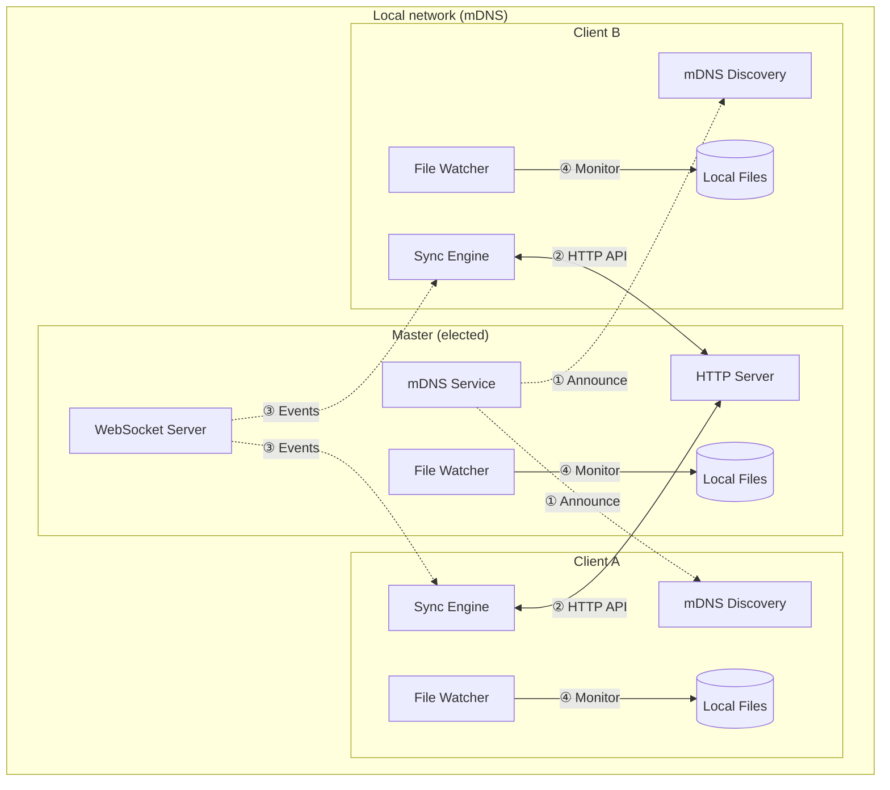
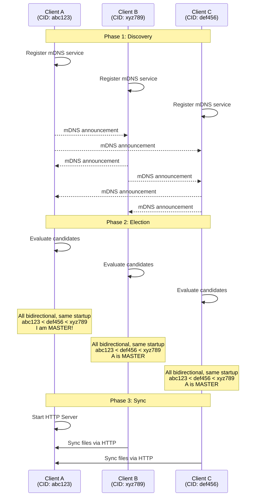
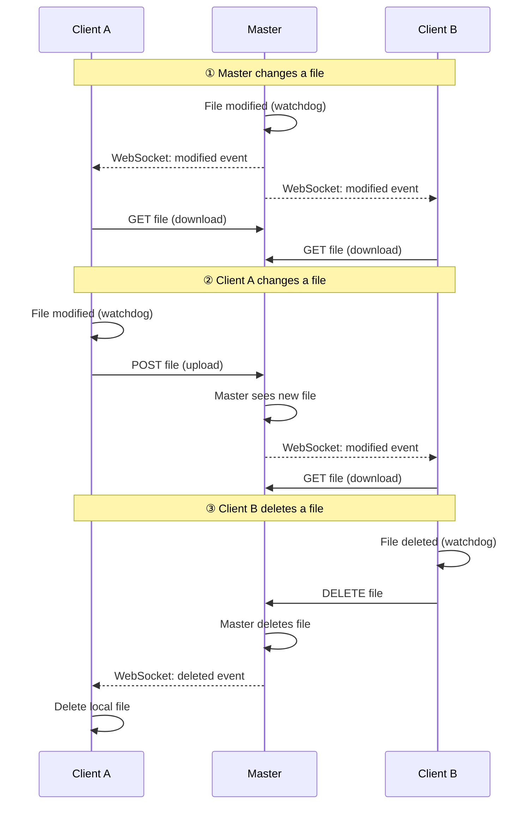
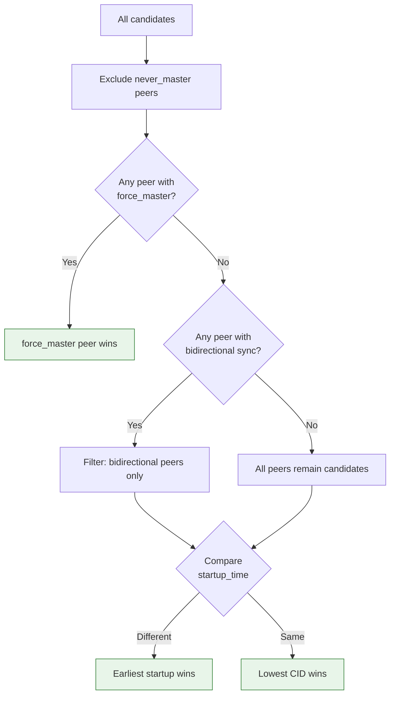
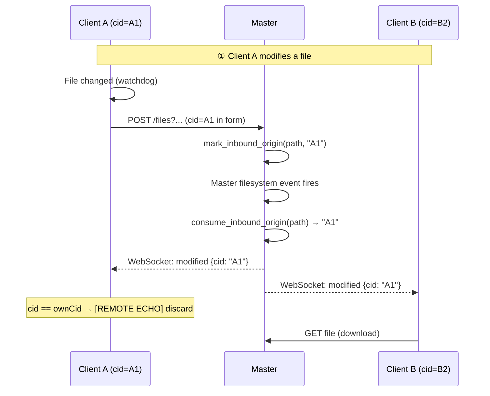
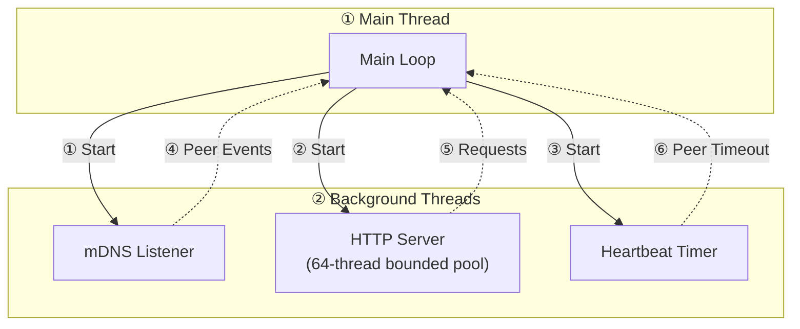

# p2p Mode — Internals (Technical Reference)

This is the **technical companion** to [p2p Mode](../p2p-mode.md). It documents the
low-level mechanisms behind peer-to-peer synchronization: the master's HTTP/WS
API, the discovery/election/sync flows, certificate pinning, and the
echo-suppression machinery.

> **Most users do not need this page.** For setup, options and recipes start
> from [p2p Mode](../p2p-mode.md), [Configuration](../configuration.md) and
> [Examples](../examples.md). Read on only if you want to understand or extend the
> protocol.

## Architecture



## Discovery and Election Flow



## Synchronization Flow

During initial sync (when a client connects or reconnects), the **master serves
as the reconciliation reference**:

```mermaid
sequenceDiagram
    participant C as Client (Client)
    participant M as Master

    Note over C,M: List Remote Files
    C->>M: GET /api/v1/buckets/{bucket}/files
    M->>C: [{filepath: "doc.txt", mtime: ...}, ...]

    Note over C,M: Compare with Local
    C->>C: Determine sync actions

    Note over C,M: Download Files (remote causally ahead or remote-only)
    C->>M: GET /api/v1/buckets/{bucket}/files/download?filename=doc.txt
    M->>C: [file content]

    Note over C,M: Local-only files (bidirectional)
    C->>M: POST upload of files that exist only locally
    Note right of C: download-only slaves delete local-only files;<br/>tombstones delete when the marker dominates
```

> **Important**: In default **bidirectional** p2p mode, files that exist only
> on the client are **uploaded**, not deleted. Local-only files are removed
> when the slave is `--sync-direction download-only`, or when a causal
> tombstone dominates the local copy (deletion while offline). The master is
> a transport hub, not a content authority.

### Reconnection behavior

When a client reconnects after being offline:

1. **Causal reconcile** — local listing, master's listing, and tombstones
   drive the same three-way merge as server mode
2. **Missing files are downloaded** — files on master but not on client
   (unless a local tombstone proves they were deleted)
3. **Local-only files are uploaded** in bidirectional/upload-only; deleted
   only for download-only slaves or a dominating tombstone
4. **Modified files are synced** — differences are reconciled causally via
   the vector-clock matrix (ADR-0022 / ADR-0003), never by mtime "newer wins";
   the master never decides content by role

This ensures consistent state across all peers, even after network interruptions.

### Peer-assisted full-download flow

The master remains authoritative for listing metadata and the expected
lowercase SHA-256. A slave first attempts master delta transfer. If a full body
is still required, the slave sends one bounded `(path, sha256)` wantlist to the
master's read-only `/files/sources` endpoint — eligibility is a live seeder
holding that exact content, never a file-size gate (ADR-0030). The master joins
its per-session inventory with live mDNS peers that advertise the peer-download
capability and hold a live capacity advertisement, excluding the requester and
itself.

Each returned source carries its HTTPS URL, CID, certificate fingerprint,
compression flag and the seeder's advertised capacity. The requester TOFU-pins
`(source CID, bucket)` before opening an explicit per-fingerprint HTTP session.
It ranks candidates by predicted transfer cost (`setup + size/bandwidth`) from
process telemetry, keeps its concurrent reads within each candidate's announced
capacity, and falls back to the canonical master. Interrupted exact bodies
retain a `.part` prefix across sources; malformed ranges/totals/source hashes
and completed hash failures discard it. Only final master transient failures
enter the existing retry policy. A peer-originated successful transfer event
adds `source_cid`; master and delta successes omit it.

Continuous non-dry-run slaves run the read-only seeder and publish inventory
over their master WSS connection. One-shot slaves are requester-only. On role
change the slave stops accepting seeder requests, withdraws its endpoint
advertisement (the `https`/`cert_fp` material and the capacity it announced),
stops the publisher, and only then starts master services.


## Real-Time Bidirectional Sync

After initial sync, all peers maintain a **WebSocket connection** to the master
for real-time updates. Changes are propagated **bidirectionally**:



**Supported operations (bidirectional):**

| Operation | Master→Slaves | Slaves→Master | HTTP Method |
|-----------|---------------|---------------|-------------|
| Create file | ✅ WebSocket | ✅ | POST |
| Modify file | ✅ WebSocket | ✅ | POST |
| Delete file | ✅ WebSocket | ✅ | DELETE |
| Rename file/dir | ✅ WebSocket | ✅ | PATCH |
| Create directory | ✅ WebSocket | ✅ | Implicit |
| Delete directory | ✅ WebSocket | ✅ | DELETE |
| Symlink | ✅ WebSocket | ✅ | POST |

## Master Election Algorithm

The conceptual rules, priority table and worked scenarios live in
[p2p Mode → Master Election](../p2p-mode.md#master-election). The diagram below
shows the decision flow each peer runs independently:



> The canonical algorithm is shared across the Python client and Android via
> `hsync_common.protocol.p2p`. See `hsync-common/docs/p2p-protocol.md` for the
> protocol specification.

## Transport Security Internals

p2p mode is **HTTPS/WSS only**: all peer communication is encrypted with the
master's self-signed certificate, pinned at the connection level (TOFU). The
user-facing summary is in [p2p Mode → Security & Pairing](../p2p-mode.md#security--pairing).

### How it works

1. **Persistent identity** — every installation owns a device identity: a
   stable device ID (`device_id` file) plus a self-signed keypair, stored in
   the device directory (`$XDG_STATE_HOME/hsync/device`, or
   `~/.local/state/hsync/device` when `XDG_STATE_HOME` is unset; overridable
   via `HSYNC_DEVICE_DIR`). Both are reused on every restart, so the device ID
   peers pinned and the fingerprint stay stable.
2. **Fingerprint sharing** — the certificate fingerprint (SHA-256) is shared via
   mDNS TXT records (`cert_fp`).
3. **Connection-level pinning** — clients pin the fingerprint on the very TLS
   connection that carries the data: REST via urllib3's `assert_fingerprint`,
   WSS via a post-handshake peer-certificate check — so a mismatch fails the
   handshake instead of leaving a TOCTOU window.
4. **Independent source pins** — master and seeder connections never share a
   mutable global fingerprint. Every selected source is persisted under its own
   `(device ID, bucket)` pin and receives an explicitly pinned HTTP session.

The pin store serializes the complete read-modify-write transaction with a
sibling lock file, reloads while locked, writes a unique same-directory temp,
fsyncs the file and parent directory, then atomically replaces the JSON store.
`--require-pairing` applies to a new master only; source seeders use persistent
TOFU after source selection.

```
┌──────────────────────────────────────────────────────────────────┐
│                    HTTPS Certificate Flow                        │
├──────────────────────────────────────────────────────────────────┤
│                                                                  │
│   Master                              Client                     │
│   ══════                              ══════                     │
│   ┌────────────────┐                                             │
│   │ Load/create    │                                             │
│   │ persistent key │                                             │
│   └───────┬────────┘                                             │
│           │                                                      │
│   ┌───────▼────────┐                                             │
│   │ Self-signed    │                                             │
│   │ X.509 cert     │                                             │
│   └───────┬────────┘                                             │
│           │                                                      │
│   ┌───────▼────────┐        mDNS TXT record                      │
│   │ Calculate      │ ─────────────────────────>  ┌──────────────┐│
│   │ SHA-256        │     cert_fp=abc123...       │ Receive      ││
│   │ fingerprint    │                             │ fingerprint  ││
│   └───────┬────────┘                             └──────┬───────┘│
│           │                                             │        │
│   ┌───────▼────────┐        HTTPS handshake             │        │
│   │ Start HTTPS    │ <───────────────────────  ┌────────▼───────┐│
│   │ server         │   pinned at connection    │ Pin fingerprint││
│   └────────────────┘                           │ (assert_fp)    ││
│                                                └────────────────┘│
└──────────────────────────────────────────────────────────────────┘
```

| Aspect | Description |
|--------|-------------|
| **Identity** | Device ID + persistent keypair under `$XDG_STATE_HOME/hsync/device` (or `~/.local/state/hsync/device`; `HSYNC_DEVICE_DIR`) |
| **Certificate Validity** | 20 years (trust comes from the pin, not the date) |
| **Private Key** | Unencrypted PKCS#8, protected by filesystem permissions (`0o600`) |
| **Key Type** | ECDSA P-256 |
| **Fingerprint** | SHA-256 (64 hex characters) |
| **Trust Model** | Trust-on-first-use (TOFU), pinned at the connection level |

> **Limitations**: certificates are self-signed (strict third-party clients may
> warn) and there is no CA verification — trust is established via the pinned
> mDNS fingerprint (TOFU).

## API Endpoints

The master exposes HTTP and WebSocket endpoints. All requests carry the shared
secret (when configured) as a Bearer token: `Authorization: Bearer <key>`. With
no key, read endpoints remain available but filesystem mutations return `403`
unless `HSYNC_P2P_ALLOW_UNAUTHENTICATED_WRITES=true` or the equivalent CLI
opt-in was used. TTY state and `--yes` do not authorize writes.

### HTTP API

| Endpoint | Method | Description |
|----------|--------|-------------|
| `/api/v1/health` | GET | Health check |
| `/api/v1/buckets/{bucket}/files` | GET | List files with metadata |
| `/api/v1/buckets/{bucket}/files/download` | GET | Download a file |
| `/api/v1/buckets/{bucket}/files/sources` | POST | Resolve bounded exact-hash peer candidates (read-only operation) |
| `/api/v1/buckets/{bucket}/files` | POST | Upload a file |
| `/api/v1/buckets/{bucket}/files` | DELETE | Delete a file/directory |
| `/api/v1/buckets/{bucket}/files` | PATCH | Rename a file/directory |
| `/api/v1/buckets/{bucket}/files/delta/signatures` | GET | Get block signatures of a file (upload delta) |
| `/api/v1/buckets/{bucket}/files/delta/signatures` | POST | Match client signatures, get delta instructions (download delta) |
| `/api/v1/buckets/{bucket}/files/delta/apply` | POST | Apply a computed delta to update a file |
| `/api/v1/buckets/{bucket}/files/delta/data/{token}` | GET | Download literal payload for a delta operation |

### WebSocket API

The master serves the real-time event stream on the **same TLS port** as the
REST data plane (single HTTPS/WSS listener):

| Endpoint | Description |
|----------|-------------|
| `ws[s]://master:port/api/v1/buckets/{bucket}/events/{cid}` | Real-time file system events |

**Event Types:** `added`, `modified`, `renamed`, `deleted`, `symlink`.

### List Files

```http
GET /api/v1/buckets/photos/files HTTP/1.1
Authorization: Bearer mySecretKey123
```

**Response:**
```json
[
  {
    "filepath": "vacation/photo1.jpg",
    "name": "photo1.jpg",
    "size": 2048576,
    "mtime": 1706000000,
    "ctime": 1705900000,
    "sha256sum": "d41d8cd98f00b204e9800998ecf8427e",
    "permissions": "-rw-r--r--"
  }
]
```

### Download File

```http
GET /api/v1/buckets/photos/files/download?filename=vacation/photo1.jpg HTTP/1.1
Authorization: Bearer mySecretKey123
```

> **Compression**: when compression is enabled, eligible files are served with
> `Content-Encoding: zstd` only when the requester explicitly advertises
> `Accept-Encoding: zstd`. The sender creates the frame in a bounded temporary
> file, not RAM. `Range` requests force identity encoding. `Content-Length`
> always describes wire bytes; the requester validates decoded size separately.

The slave seeder exposes only `/health`, `/time`, and exact-hash download. Its
download query requires exactly one normalized `filename`, lowercase `sha256`,
and valid requester `cid`; the currently opened regular file must hash to that
value. It opens beneath the bucket without following symlinks, hashes and
streams the same descriptor, enforces a concurrent body cap, and returns
`409` if local content no longer matches. Mutating and unrelated methods/routes
return `405`.

> All peer-supplied paths (download `filename`, delete `path`, rename
> `src`/`dst`, upload `path` + filename) are validated and confined to the
> bucket root; traversal (`..`), absolute paths, backslashes and internal
> engine files (`.hsyncignore`, `.hsyncfolder`, leftover `.hsyncstate` /
> `.hsynctombstones`, `*.part`)
> are rejected.

### Upload File

The `cid` form field identifies the originating peer. The master uses it to tag
the resulting filesystem event so that the sender can discard the echo.

The `sha256sum` form field is **mandatory**: the master verifies the received
bytes against it before atomically renaming the `.part` file over the
destination, and rejects the upload (400) on mismatch. For compressed uploads
(`compressed=true`) the `size` field is also mandatory and the decompressed
bytes are capped at it (anti decompression-bomb). Peer-supplied paths are
validated and confined to the bucket, and far-future mtimes are clamped.

```http
POST /api/v1/buckets/photos/files HTTP/1.1
Authorization: Bearer mySecretKey123
Content-Type: multipart/form-data; boundary=...

--boundary
Content-Disposition: form-data; name="cid"

client123
--boundary
Content-Disposition: form-data; name="path"

vacation
--boundary
Content-Disposition: form-data; name="mtime"

1706000000.0
--boundary
Content-Disposition: form-data; name="sha256sum"

b94d27b9934d3e08a52e52d7da7dabfa...
--boundary
Content-Disposition: form-data; name="file"; filename="photo2.jpg"
Content-Type: application/octet-stream

[binary content]
--boundary--
```

### Delete File

The `cid` query parameter identifies the originating peer.

```http
DELETE /api/v1/buckets/photos/files?path=vacation/photo2.jpg&cid=client123 HTTP/1.1
Authorization: Bearer mySecretKey123
```

To delete a directory, add `is_dir=true`:

```http
DELETE /api/v1/buckets/photos/files?path=vacation&is_dir=true&cid=client123 HTTP/1.1
Authorization: Bearer mySecretKey123
```

### Rename File or Directory

The `cid` query parameter identifies the originating peer.

```http
PATCH /api/v1/buckets/photos/files?src=vacation/old.jpg&dst=vacation/new.jpg&cid=client123 HTTP/1.1
Authorization: Bearer mySecretKey123
```

### WebSocket Event Payload

Each event broadcast by the master includes the originating peer's `cid`:

```json
{
  "event": "modified",
  "filepath": "vacation/photo2.jpg",
  "cid": "TestClientX1234567890"
}
```

Slaves compare `cid` against their own local CID and **discard events where they
match** — this is the echo-suppression mechanism.

## CID Handling & Echo Suppression

In bidirectional p2p mode, every peer has a unique **Client ID (CID)** generated
at startup. CIDs are used to:

1. **Tag HTTP operations** — upload, delete and rename requests include the
   originator's CID as a parameter.
2. **Propagate origin through the filesystem** — the master uses
   `InboundOriginTracker` to remember which CID triggered a write, so the
   resulting filesystem event is broadcast with the correct originator CID
   instead of the master's own CID.
3. **Suppress echoes** — slaves discard incoming WebSocket events whose `cid`
   matches their own, preventing them from re-downloading/re-deleting files they
   just uploaded/deleted.

### InboundOriginTracker

`InboundOriginTracker` (`p2p_websocket.py`) is an in-memory map
`path → (cid, expiry)` with a **10-second TTL**:

| Function | Description |
|----------|-------------|
| `mark_inbound_origin(path, cid)` | Record that `path` was written on behalf of `cid` |
| `consume_inbound_origin(path)` | Return (and remove) the originator CID for `path` if still fresh |

The master's HTTP handlers call `mark_inbound_origin` after receiving an
upload/delete/rename. The master's filesystem watcher calls
`consume_inbound_origin` when it sees the resulting event — if a fresh entry
exists, the broadcast uses the original peer's CID instead of the master's CID.

### Bidirectional Sync Flow with Echo Suppression



## Technical Details

### mDNS Service

p2p mode uses mDNS (Multicast DNS) for peer discovery:

- **Service Type**: `_hsync._tcp.local.`
- **TXT Records**: the canonical key set of the
  [p2p protocol](https://github.com/albertsdk/hsync-common/blob/main/docs/p2p-protocol.md)
  (`P2P_TXT_KEYS`) — `cid`, `bucket`, `version`, `cert_fp`, `sync_direction`,
  `server_ready`, `force_master`, `never_master`, `startup_time`, `group`,
  `delta`, `peer_download`, `connected`, `compression`, `https` — boolean flags
  only when true
- **Dependency**: `zeroconf` (Python library for mDNS/DNS-SD)

When the group uses a bootnode instead, the same election inputs (`server_ready`,
`force_master`, `never_master`, `startup_time`, `sync_direction`) travel in the
`register` frame and come back on every relayed peer of a `query`, so the master
election is identical whether mDNS runs alone or alongside the bootnode. They are
unauthenticated hints, exactly like the TXT flags: the data plane pins the peer
certificate before any file is exchanged.

The `delta` TXT record is advertised only when delta transfer is enabled
(`HSYNC_DELTA_ENABLED=true`, the default). Peers parse this flag to determine
whether delta transfer can be used with that peer.

`peer_download=true` advertises protocol implementation. The runtime fact that a
continuous slave's read-only HTTPS seeder is bound is deliberately **not** on the
TXT record: it travels on the authenticated WSS session and its `serve_slots`
capacity advertisement (ADR-0030), so a stale discovery record can never exclude a
seeder that is in fact serving. A serving slave still advertises the endpoint
material (`https`/`cert_fp`) while its listener is bound.

### Thread Model



> The HTTP server is a bounded pool of request threads
> (`P2P_SERVER_MAX_THREADS`, 64). Connections are **HTTP/1.1 keep-alive**
> with `TCP_NODELAY` — no TCP+TLS handshake per request, and no Nagle stall
> on small responses — and idle connections are reaped after 300 s so they
> cannot pin pool slots forever. On the slave side, realtime operations
> (uploads, inbound event downloads, deletes, renames) run on a
> process-wide bounded pool of 8 workers instead of one thread per
> filesystem event, so worker keep-alive sessions to the master are reused.

> The canonical discovery/election protocol is specified in
> `hsync-common/docs/p2p-protocol.md` and shared across the Python client and
> Android via `hsync_common.protocol.p2p`.
