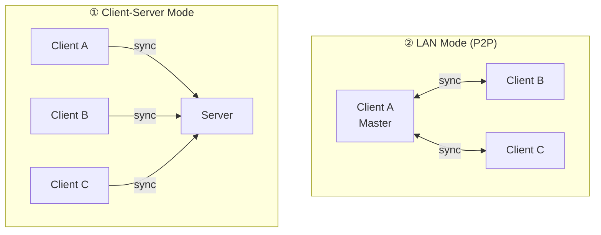
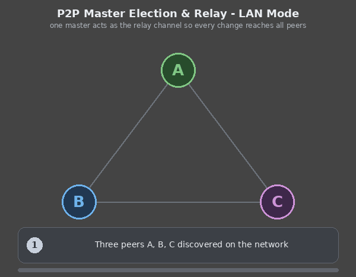

# HSYNC LAN Mode (P2P Synchronization)

LAN Mode lets devices on the same local network synchronize files directly,
peer-to-peer, without a centralized HSYNC server.

> **Quick links**
> - Full option & environment-variable reference → [Configuration — LAN P2P Mode](configuration-lan.md#lan-mode-options)
> - Ready-to-use recipes → [Examples](examples.md)
> - Server vs LAN comparison → [Sync Modes](sync-modes.md)
> - Protocol internals (diagrams, HTTP/WS API, echo suppression) → [LAN Internals](internal/lan-internals.md)

## Overview

LAN Mode enables direct peer-to-peer file synchronization between devices on the
same local network, without requiring a centralized HSYNC server.



## Key Features

| Feature | Description |
|---------|-------------|
| **Zero Configuration** | Automatic peer discovery via mDNS/Bonjour |
| **No Server Required** | Works without internet or central server |
| **Automatic Master Election** | Priority: `force_master` > bidirectional preference > earliest startup > lowest CID |
| **Passive Peers** | `--never-master` keeps a peer out of the election; it syncs but never becomes master |
| **Real-Time Sync** | WebSocket-based instant event propagation (implicit; continuous mode is the default) |
| **Bidirectional Sync** | Any peer can create/modify/delete files |
| **Directional Sync** | Slaves can use `upload-only` or `download-only` via `--sync-direction` |
| **Peer-Assisted Downloads** | Large files can be fetched from exact-hash continuous slaves before master fallback |
| **Optional Authentication** | Shared key authenticates all traffic; no-key operation is read-only by default |
| **Random Port Allocation** | Avoids port conflicts |
| **Auto-Tuning** | Environment-adaptive defaults for HTTP timeout, retry, and concurrency |

## How It Works

In plain terms, LAN mode works in three steps:

1. **Discovery** — every device announces itself on the local network (mDNS), so
   peers find each other automatically with no IP addresses to configure.
2. **Election** — the peers agree on a single **master** that coordinates sync.
   The choice is automatic (see [Master Election](#master-election)).
3. **Sync** — peers connect to the master over an encrypted channel. For an
   eligible full download, the master may identify continuous slaves that hold
   the exact listed hash; the requester tries those sources before downloading
   the full file from the master. The master remains the source of metadata,
   delta transfer, and final fallback. Afterwards every change
   (create, modify, delete, rename) is propagated in real time, in both
   directions, over a live WebSocket connection. No peer is authoritative —
   concurrent edits are resolved causally (see
   [Conflict Resolution](conflict-resolution.md)).

<p align="center">
  
</p>

> **Important — local-only files.** In the default **bidirectional** direction,
> files that exist only on this peer are **uploaded** to the master, not
> deleted. A local-only file is removed only when:
> - `--sync-direction download-only` (the slave mirrors the master), or
> - a causal tombstone proves the path was deleted while this peer was offline.
>
> Deletions made on the master still reach the peer via tombstones, not by
> wiping every unmatched local file. See
> [Sync Modes — LAN](sync-modes-lan.md) and
> [Conflict Resolution](conflict-resolution.md).

> The architecture and discovery/election/sync **sequence diagrams**, the full
> bidirectional operations table and the WebSocket event format are in
> [LAN Internals](internal/lan-internals.md).

> **First sync?** → Follow the step-by-step
> [Getting Started — LAN P2P Mode](getting-started-lan.md) guide; this page
> explains how LAN Mode works. Authentication (`HSYNC_LAN_KEY`), specific
> ports, and every other LAN option live in
> [Configuration — LAN P2P Mode](configuration-lan.md).

## Continuous Mode (Default)

Continuous mode is the default in LAN mode. The client stays active indefinitely, even when no peers are found, and automatically starts a file system watcher that propagates events in real time. Discovery waits indefinitely by default (`--discovery-timeout 0`), mirroring the server-mode default of retrying an unreachable server forever.

This is useful for:

- **Always-on sync services**: Keep a device ready to sync whenever others come online
- **NAS/Server deployments**: Run as a background service waiting for clients
- **Intermittent connectivity**: Handle peers that connect and disconnect frequently

Pass `--once` to disable this behavior and exit after a single sync attempt.

### Peer-Assisted Downloads

Peer assistance is enabled by default for files of at least 1 MiB. A continuous,
non-dry-run slave publishes an inventory and exposes a read-only HTTPS seeder on
its advertised LAN port. The master returns candidate endpoints only for the
exact `(path, SHA-256)` from its listing. The requester verifies the final body
against that listing hash before replacing the destination, regardless of which
source sent the bytes.

The transfer order is deterministic: master delta first when applicable, then
ranked peer full-download candidates, then canonical master full-download. An
interrupted exact body may resume from another source; malformed ranges, wrong
sizes, or completed hash failures discard the partial body. One-shot slaves can
request from peers but never seed. Use `--no-peer-download` to disable this path.
Threshold and concurrency settings are listed in
[Configuration — LAN P2P Mode](configuration-lan.md).

### Behavior

| Scenario | Message | Action |
|----------|---------|--------|
| No peers ever found | "Waiting for peers to join..." | Retry discovery |
| Peers disconnected | "All peers disconnected, waiting for new peers..." | Retry discovery |
| Peer found | Normal sync flow | Sync, then continue discovery |
| Master role change | "No longer master, switching to client mode..." | Restart as client |

### Example Flow

```
$ hsync lan -b photos -p ~/Pictures

[INFO] LAN P2P mode enabled
[INFO] Continuous mode enabled - will wait indefinitely for peers
[INFO] Loading persistent LAN master certificate...
[INFO] Certificate fingerprint: a1b2c3d4e5f6...
[INFO] Waiting for peers to join...
[INFO] Waiting for peers to join...
[INFO] Peer discovered: laptop-001 at 192.168.1.100:54321
[INFO] This client is the MASTER - acting as sync coordinator
[INFO] Master server listening on port 12345 (HTTPS)
[INFO] Press Ctrl+C to stop...
```

## Options & Environment Variables

All LAN command-line options and `HSYNC_*` environment variables — including the
master-election flags `--force-master`/`--never-master`, the discovery/heartbeat
timeouts, `HSYNC_LAN_KEY`, `HSYNC_DEVICE_DIR` and persistence — are documented
in the single reference:
[Configuration — LAN P2P Mode](configuration-lan.md).

> **Key incompatibilities** (the client refuses to start otherwise):
> - `--force-master` cannot be combined with `--sync-direction upload-only`/`download-only` — the master must stay bidirectional.
> - `--force-master` and `--never-master` are mutually exclusive.
>
> The LAN authentication key is only ever supplied via the `HSYNC_LAN_KEY`
> environment variable, never as a CLI flag.

## Security & Pairing

LAN mode is **HTTPS/WSS only** — every peer connection is encrypted and there is
no plain-HTTP transport. Trust is established the first time you connect
(trust-on-first-use): the elected master presents a persistent self-signed
certificate, and peers pin its SHA-256 fingerprint (shared over mDNS) on the very
connection that carries the data.

- **No setup required** — encryption is always on; you don't manage certificates.
- **Optional shared secret** — set the same `HSYNC_LAN_KEY` on every peer to
  require authentication. It is sent as a Bearer token over the encrypted channel
  and is configured via environment variable only:

  ```bash
  # All peers must use the same key
  export HSYNC_LAN_KEY="mySecretKey123"
  hsync lan -b photos -p ~/Pictures
  ```

- **No-key mode is read-only by default** — discovery, listings, downloads,
  exact-hash source lookup, and download delta remain available, but any
  write-capable sync is refused and mutating HTTP endpoints return `403`.
- **Dangerous explicit opt-in** — `--allow-unauthenticated-writes` or
  `HSYNC_LAN_ALLOW_UNAUTHENTICATED_WRITES=true` permits no-key mutations on a
  fully trusted LAN. A TTY or `--yes` does not grant this permission.
- **Per-source trust** — each selected seeder is pinned independently by device
  ID and bucket before connecting. `--require-pairing` remains specific to the
  elected master; seeder trust uses persistent TOFU.

> The certificate flow, fingerprint-pinning details and key parameters are in
> [LAN Internals → Transport Security](internal/lan-internals.md#transport-security-internals).

## Device Identity

Every hsync installation owns **one persistent device identity** (the same
model as Syncthing's device IDs): a stable 21-character **device ID** plus the
TLS keypair used for the LAN transport. Both live in the device directory
(`HSYNC_DEVICE_DIR`, default `~/.local/state/hsync/device/`):

> Frequently asked questions about the device ID and `HSYNC_DEVICE_DIR` are
> answered in [FAQ — LAN P2P Mode → Device Identity](faq-lan.md#device-identity).

| File | Content | Permissions |
|------|---------|-------------|
| `device_id` | The device ID (identity anchor for TOFU pins) | `0600` |
| `lan_master_cert.pem` / `lan_master_key.pem` | The LAN keypair (may be rotated) | `0600` |

Consequences:

- **Pins survive restarts** — TOFU pins are keyed on `(device_id, bucket)`, so
  a restarted master is recognised by its peers instead of being re-pinned
  silently.
- **Key rotation is detectable** — deleting only the `*.pem` files regenerates
  the keypair while the device ID stays; peers then see a changed fingerprint
  for a known device and refuse the connection (`[FINGERPRINT CHANGED]`).
- **Copying the device directory clones the device** — keep it private. If a
  clone appears on the network, hsync detects the duplicated identity at
  runtime, refuses to sync with it (`[SECURITY] Duplicate device identity`)
  and raises a **Duplicate Device Identity** notification in the desktop app,
  instead of silently ignoring it.

### Multiple instances on one host

- **Different buckets** — works out of the box: the mDNS service name is
  `{bucket}-{device_id}`, so instances never clash.
- **Same bucket** — not possible with one device identity (the instances are
  the *same device* and ignore each other in discovery; the second mDNS
  registration fails with a clear error). Give the second instance its own
  identity:

  ```bash
  HSYNC_DEVICE_DIR=~/.local/state/hsync/device-alt hsync lan -b photos -p ~/Other
  ```

### One process per directory

Two hsync processes can never sync the **same local directory** at the same
time (regardless of buckets): they would race the same folder UUID in
`syncstate.db`. The client enforces this with a cross-process
`flock` (per-directory, in `$XDG_RUNTIME_DIR/hsync/locks/` or
`HSYNC_LOCKS_DIR`) and refuses to start with an error naming the conflicting
directory and PID. The lock is released by the kernel even if the process is
killed, so it can never go stale.

## Group Filtering

Group filtering allows multiple hsync instances on the same LAN to be isolated. Peers with different groups will ignore each other.

### Filtering Logic

The group is a **strict partition key**: two peers are compatible **only** when
their groups are exactly equal. "No group" is itself a distinct partition, so a
peer without a group matches **only** other peers that also run without a group.

| Local Group | Peer Group | Result |
|-------------|------------|--------|
| `None` | `None` | ✅ Compatible |
| `None` | `team-a` | ❌ Ignored |
| `team-a` | `None` | ❌ Ignored |
| `team-a` | `team-a` | ✅ Compatible |
| `team-a` | `team-b` | ❌ Ignored |

**Rule**: A peer is visible only if its group is identical to the local group, where "no group" counts as its own group. This guarantees full isolation — a groupless peer can never bridge two named groups.

### Usage Examples

```bash
# Team A - only sees other Team A peers
hsync lan -b project -p ~/Projects --group "team-a"

# Team B - only sees other Team B peers
hsync lan -b project -p ~/Projects --group "team-b"

# No group - only sees other peers that also run without a group
hsync lan -b project -p ~/Projects
```

### Use Cases

- **Separate teams**: Different teams on the same network sync independently
- **Dev vs Prod**: Isolate development and production environments
- **Multiple projects**: Same bucket name but different groups for different projects

## Master Election

The master is elected using a **multi-criteria priority system**. Each peer independently runs the same algorithm, ensuring all peers agree on the same master.

### Election Priority (highest to lowest)

| Priority | Criterion | Description |
|----------|-----------|-------------|
| 1 | `force_master` | If a peer has `--force-master`, it always wins |
| 2 | **Bidirectional preference** | Peers with `bidirectional` sync direction are preferred over `upload-only` or `download-only` |
| 3 | **Earliest startup** | Among equal peers, the one that started first wins |
| 4 | **Lowest CID** | Final tiebreaker: lexicographic comparison of Client IDs |

> **Note**: Peers running with `--never-master` are **excluded from the candidate pool** before any of the criteria above are applied. They never win the election, regardless of startup time or CID.

> The decision-flow diagram for this algorithm is in
> [LAN Internals → Master Election Algorithm](internal/lan-internals.md#master-election-algorithm).

**Rules:**
- The `sync_direction` and `never_master` flag of each peer are shared via mDNS TXT records during discovery
- `--force-master` is **incompatible** with `--sync-direction upload-only` or `download-only` — the client will refuse to start
- `--never-master` peers are removed from the candidate pool, so they are never elected (locally or by other peers)
- `--never-master` is **incompatible** with `--force-master` — the client will refuse to start
- If a non-bidirectional peer is elected as master (no bidirectional peers available), a **WARNING** is logged
- If **all** discovered peers are `--never-master`, no master is elected; after 60 s a `[NO MASTER]` warning is logged
- If the master goes offline, a new election occurs among remaining peers

### Examples

**Scenario 1**: Three peers, all bidirectional (classic behavior)
```
Peer A: CID=abc123, bidirectional, startup=10:00
Peer B: CID=def456, bidirectional, startup=10:01
Peer C: CID=xyz789, bidirectional, startup=10:00
→ Winner: Peer A (same startup as C, but lower CID)
```

**Scenario 2**: Mixed sync directions
```
Peer A: CID=abc123, upload-only,    startup=10:00
Peer B: CID=xyz789, bidirectional,  startup=10:05
→ Winner: Peer B (bidirectional preferred, even though A started earlier)
```

**Scenario 3**: No bidirectional peers
```
Peer A: CID=abc123, upload-only,    startup=10:00
Peer B: CID=def456, download-only,  startup=10:01
→ Winner: Peer A (both non-bidirectional, A started earlier)
⚠️ WARNING: Master has sync_direction=upload-only
```

**Scenario 4**: A peer opts out with `--never-master`
```
Peer A: CID=abc123, bidirectional, never_master=true,  startup=10:00
Peer B: CID=def456, bidirectional, never_master=false, startup=10:01
→ Winner: Peer B (A is excluded from the candidate pool despite lower CID / earlier startup)
```

**Scenario 5**: Every peer is `--never-master` (no master can be elected)
```
Peer A: CID=abc123, never_master=true, startup=10:00
Peer B: CID=def456, never_master=true, startup=10:01
→ No master elected; candidate pool is empty
⚠️ WARNING: [NO MASTER] no master elected after 60s — all peers are never-master
```

## Use Cases & Recipes

Practical, copy-paste recipes — home sync, office file sharing, backup to a NAS,
one-shot sync, read-only slaves, isolated groups and fixed ports — live in
[Examples → LAN P2P Examples](examples.md).

### Deletion Risk Warning

When running in LAN mode **without `--force-master`** and the shared directory is non-empty, the client warns that local files could be deleted — because the elected master serves the file listing the slave converges on, and files not present on the master will be removed during initial sync. The master is a transport coordinator, not an authority (ADR-0022): concurrent edits are resolved causally by every node.

```bash
# The client will show a warning and ask for confirmation
hsync lan -b photos -p ~/Pictures

# Skip the interactive confirmation (e.g. in scripts or systemd services)
hsync lan -b photos -p ~/Pictures -y
```

The warning is **not shown** when:
- The shared directory is empty (nothing to lose)
- `--force-master` is set (this peer serves files — deletion risk is about the slave role)
- `--sync-direction upload-only` is set (local files are never deleted)

See also: [Architecture > Pre-Sync Safety Check](internal/architecture.md#pre-sync-safety-check-deletion-risk)

## Troubleshooting

### Peers Not Discovering Each Other

1. **Check firewall**: Ensure mDNS (UDP port 5353) is allowed
2. **Check network**: All devices must be on the same subnet
3. **Increase timeout**: Use `--discovery-timeout 15` for slower networks, or `--discovery-timeout 0` to wait indefinitely for the first peer/master
4. **Running in a container?**: mDNS multicast cannot cross the NAT boundary of
   the default bridge network used by container runtimes, so peers will never
   be found. Run the client with host networking (e.g.
   `docker run --network host ...`) — the client detects the container at
   startup and logs this hint as a warning.

### Authentication Failures

1. **Check key**: Ensure all peers use the exact same `HSYNC_LAN_KEY` environment variable
2. **Check logs**: Look for "401 Unauthorized" errors

### Port Conflicts

1. **Use random port**: Default `--listen-port 0` avoids conflicts
2. **Specify port**: Use `--listen-port 9000` if you need a fixed port

## Comparison: Server Mode vs LAN Mode

See [Sync Modes](sync-modes.md) for the full Server vs LAN comparison table.

## Technical Internals

The deep protocol details — architecture and sequence diagrams, the master's
HTTP/WS API with request/response examples, the certificate flow, the
master-election decision diagram, CID/echo suppression
(`InboundOriginTracker`), and the mDNS/thread model — live in
[LAN Internals](internal/lan-internals.md).
