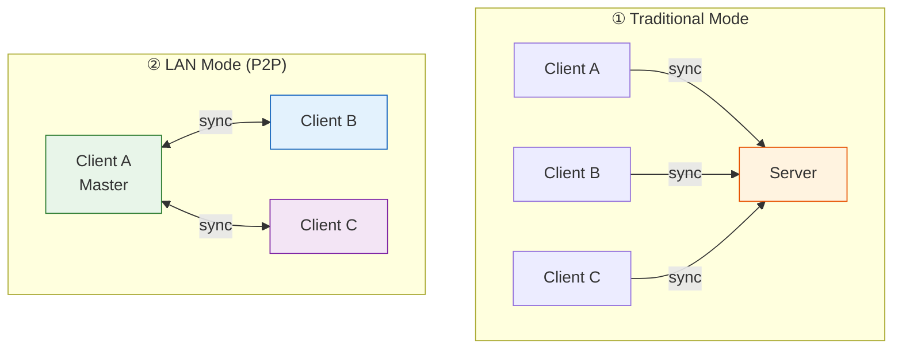
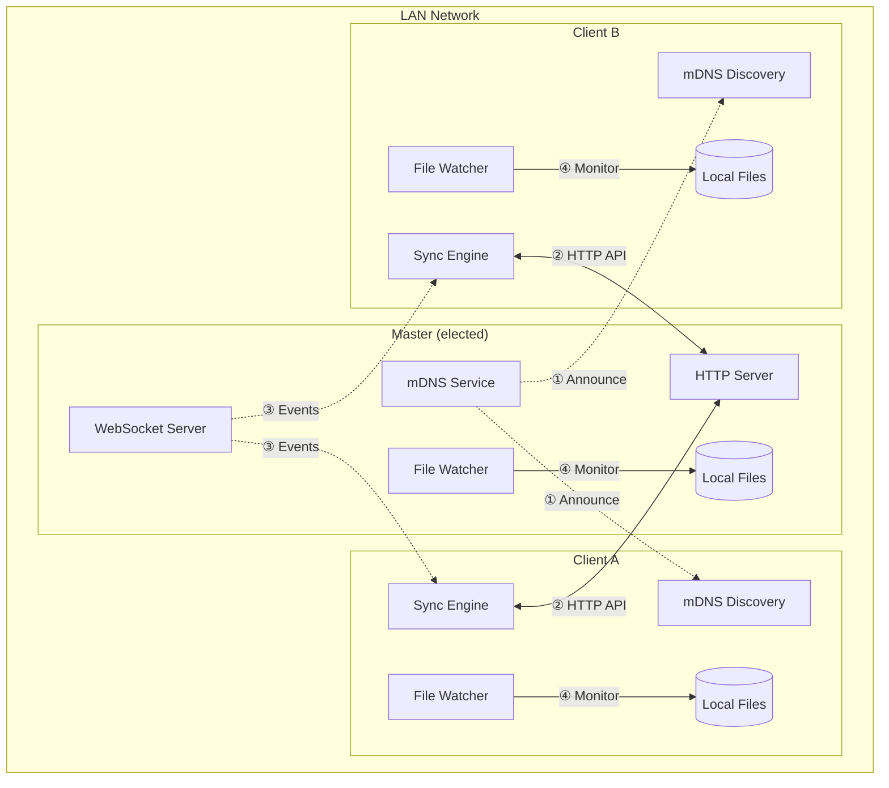
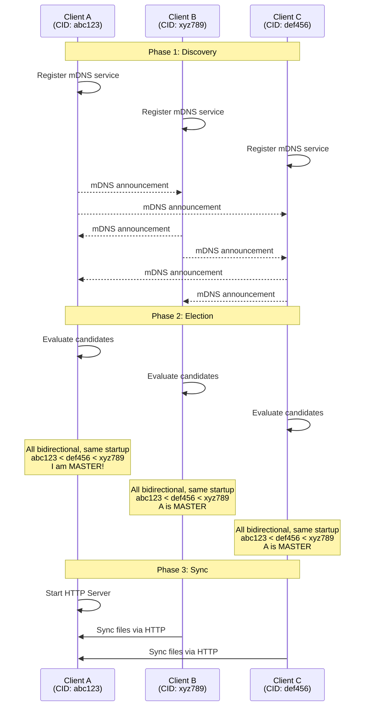
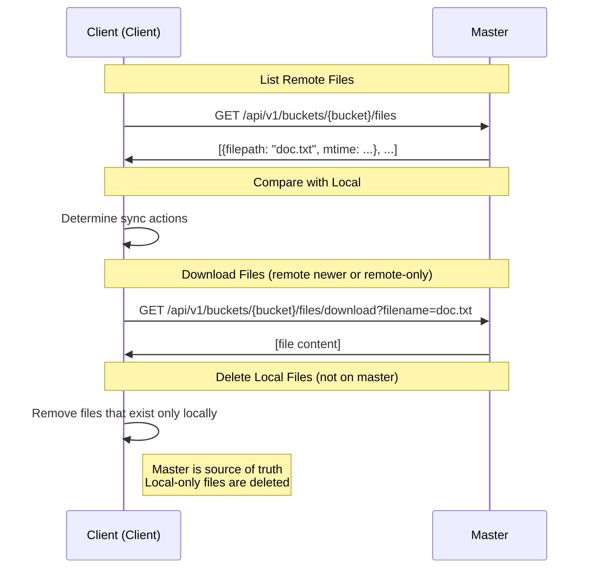
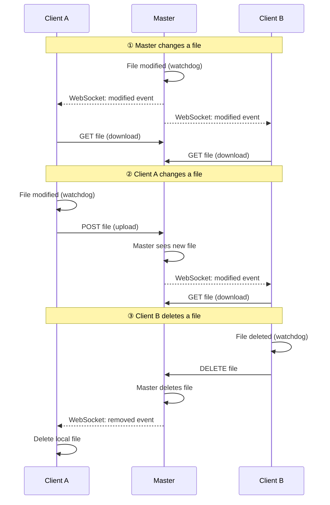
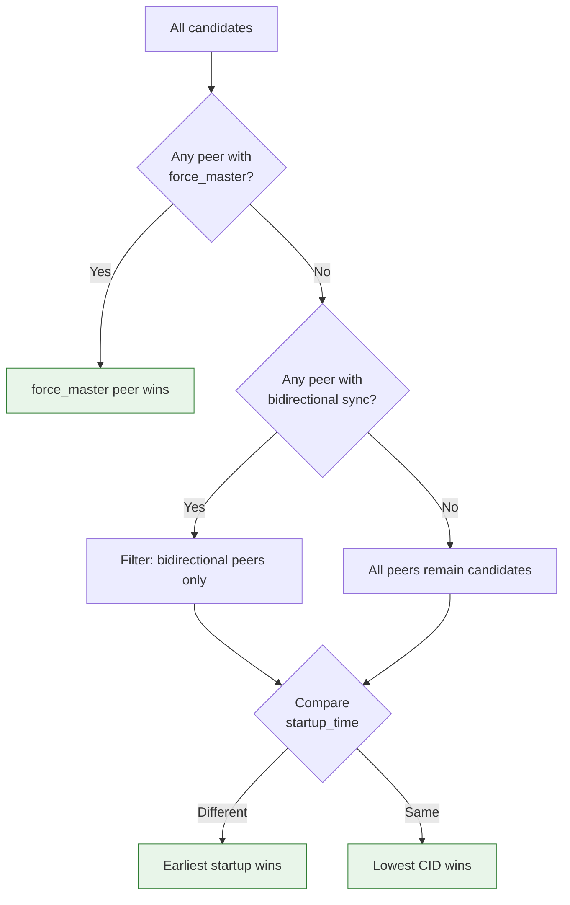
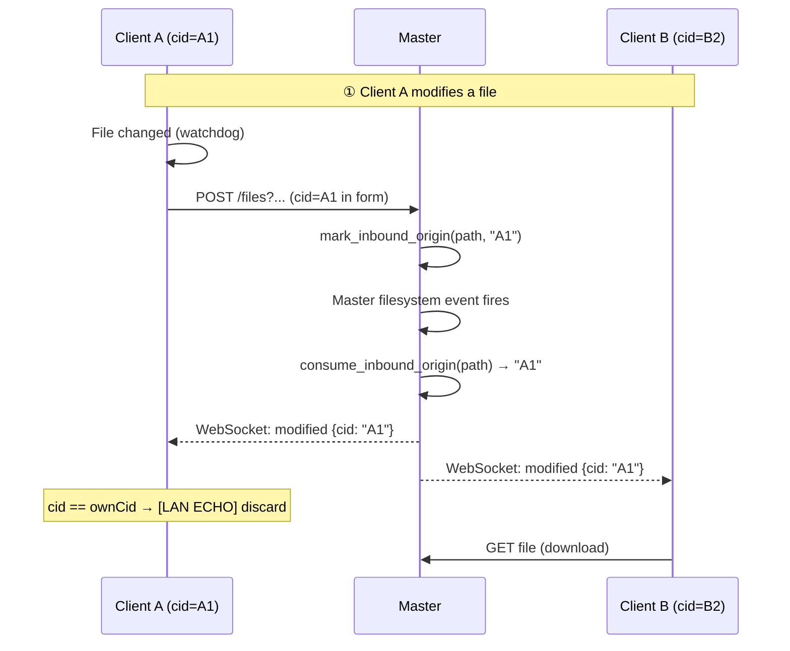
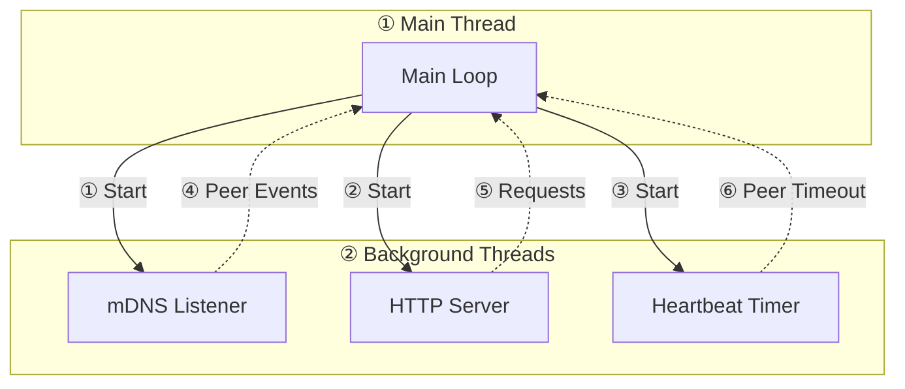

# HSYNC LAN Mode (P2P Synchronization)

This document describes the LAN Mode feature for peer-to-peer file synchronization without a centralized server.

> **Note**: Diagrams are written in Mermaid. If they don't render, run `./generate-diagrams.sh` to generate PNG images in the `images/` directory.

## Overview

LAN Mode enables direct peer-to-peer file synchronization between devices on the same local network, without requiring a centralized HSYNC server.



## Key Features

| Feature | Description |
|---------|-------------|
| **Zero Configuration** | Automatic peer discovery via mDNS/Bonjour |
| **No Server Required** | Works without internet or central server |
| **Automatic Master Election** | Priority: `force_master` > bidirectional preference > earliest startup > lowest CID |
| **Real-Time Sync** | WebSocket-based instant event propagation (implicit `--watch`) |
| **Bidirectional Sync** | Any peer can create/modify/delete files |
| **Directional Sync** | Slaves can use `upload-only` or `download-only` via `--sync-direction` |
| **Optional Authentication** | Shared secret key for security |
| **Random Port Allocation** | Avoids port conflicts |

## How It Works

### Architecture



### Discovery and Election Flow



### Synchronization Flow

During initial sync (when a client connects or reconnects), the **master is the source of truth**:



> **Important**: In LAN mode, files that exist only on the client (not on master) are **deleted locally** during initial sync. This ensures that if a file was deleted on the master while the client was offline, the deletion is correctly propagated when the client reconnects.

### Reconnection Behavior

When a client reconnects after being offline:

1. **Master state is authoritative** - The master's file list is the source of truth
2. **Missing files are downloaded** - Files on master but not on client are downloaded
3. **Extra files are deleted** - Files on client but not on master are deleted locally
4. **Modified files are synced** - Files with different mtimes are synced (newer wins)

This ensures consistent state across all peers, even after network interruptions.

### Real-Time Bidirectional Sync

After initial sync, all peers maintain a **WebSocket connection** to the master for real-time updates. Changes are propagated **bidirectionally**:



**Supported Operations (Bidirectional):**

| Operation | Master→Slaves | Slaves→Master | HTTP Method |
|-----------|---------------|---------------|-------------|
| Create file | ✅ WebSocket | ✅ | POST |
| Modify file | ✅ WebSocket | ✅ | POST |
| Delete file | ✅ WebSocket | ✅ | DELETE |
| Rename file/dir | ✅ WebSocket | ✅ | PATCH |
| Create directory | ✅ WebSocket | ✅ | Implicit |
| Delete directory | ✅ WebSocket | ✅ | DELETE |
| Symlink | ✅ WebSocket | ✅ | POST |

## Quick Start

### Basic Usage (No Authentication)

```bash
# On all devices - they will discover each other automatically
./dist/<platform>/hsync -b photos -p ~/Pictures --lan-mode
```

### With Authentication

```bash
# On all devices - use the same key via environment variable
export HSYNC_LAN_KEY="mySecretKey123"
./dist/<platform>/hsync -b photos -p ~/Pictures --lan-mode

# Or inline
HSYNC_LAN_KEY="mySecretKey123" ./dist/<platform>/hsync -b photos -p ~/Pictures --lan-mode
```

### With Specific Port

```bash
# Use a specific port instead of random
./dist/<platform>/hsync -b photos -p ~/Pictures --lan-mode --lan-port 9000
```

### Disable Persistent Mode

```bash
# Exit immediately if no peers are found (one-shot sync)
./dist/<platform>/hsync -b photos -p ~/Pictures --lan-mode --no-lan-persistent

# Or via environment variable
HSYNC_LAN_PERSISTENT=false ./dist/<platform>/hsync -b photos -p ~/Pictures --lan-mode
```

## Persistent Mode (Default)

Persistent mode is **enabled by default** in LAN mode. The client stays active indefinitely, even when no peers are found. In this mode, the `--watch` behavior is **implicit**: the client automatically starts a file system watcher and propagates events in real-time.

This is useful for:

- **Always-on sync services**: Keep a device ready to sync whenever others come online
- **NAS/Server deployments**: Run as a background service waiting for clients
- **Intermittent connectivity**: Handle peers that connect and disconnect frequently

Use `--no-lan-persistent` to disable this behavior and exit after a single sync attempt.

### Behavior

| Scenario | Message | Action |
|----------|---------|--------|
| No peers ever found | "Waiting for peers to join..." | Retry discovery |
| Peers disconnected | "All peers disconnected, waiting for new peers..." | Retry discovery |
| Peer found | Normal sync flow | Sync, then continue discovery |
| Master role change | "No longer master, switching to client mode..." | Restart as client |

### Example Flow

```
$ ./dist/<platform>/hsync -b photos -p ~/Pictures --lan-mode

[INFO] LAN P2P mode enabled
[INFO] Persistent mode enabled - will wait indefinitely for peers
[INFO] Generating self-signed certificate for HTTPS...
[INFO] Certificate fingerprint: a1b2c3d4e5f6...
[INFO] Waiting for peers to join...
[INFO] Waiting for peers to join...
[INFO] Peer discovered: laptop-001 at 192.168.1.100:54321
[INFO] This client is the MASTER - acting as sync coordinator
[INFO] Master server listening on port 12345 (HTTPS)
[INFO] Press Ctrl+C to stop...
```

## CLI Options

| Option | Description | Default |
|--------|-------------|---------|
| `--lan-mode` | Enable LAN P2P mode | `false` |
| `--lan-port` | Port for HTTP server (0 = random) | `0` |
| `--lan-group` | Group name for peer filtering | `None` |
| `--no-lan-https` | Disable HTTPS (use plain HTTP) | HTTPS enabled |
| `--discovery-timeout` | Peer discovery timeout (seconds) | `10` |
| `--no-lan-persistent` | Disable persistent mode (exit when no peers) | Persistent enabled |
| `--sync-direction` | Sync direction: `bidirectional`, `upload-only`, `download-only` | `bidirectional` |
| `--force-master` | Force this peer to be the LAN master | `false` |
| `-y, --yes` | Skip deletion risk confirmation prompt (still shows the warning) | `false` |

> **Note**: For security, the LAN authentication key is only available via the `HSYNC_LAN_KEY` environment variable (not as a CLI option).

> ⚠️ **Error**: `--force-master` is **incompatible** with `--sync-direction upload-only` or `download-only`. The client will refuse to start with an error message. The LAN master must always operate in bidirectional mode.

> ⚠️ **Warning**: During automatic master election, peers with **bidirectional** sync are preferred. If no bidirectional peer is available and a non-bidirectional peer becomes master, a WARNING is logged indicating that synchronization capabilities may be limited for other peers.

## Environment Variables

All LAN options can also be configured via environment variables:

| Variable | Description | Default |
|----------|-------------|---------|
| `HSYNC_LAN_PORT` | Port for HTTP server (0 = random) | `0` |
| `HSYNC_DISCOVERY_TIMEOUT` | Peer discovery timeout (seconds) | `10` |
| `HSYNC_HEARTBEAT_INTERVAL` | Heartbeat interval for peer health (seconds) | `5` |
| `HSYNC_PEER_TIMEOUT` | Timeout before marking peer as offline (seconds) | `15` |
| `HSYNC_LAN_KEY` | Shared secret for authentication | `None` |
| `HSYNC_LAN_GROUP` | Group name for peer filtering | `None` |
| `HSYNC_LAN_HTTPS` | Enable/disable HTTPS (`true`/`false`) | `true` |
| `HSYNC_LAN_PERSISTENT` | Stay active indefinitely waiting for peers | `true` |

### Configuration Priority

```
CLI argument > Environment variable > Default value
```

## Authentication

### No Authentication (Trust LAN)

By default, LAN mode operates without authentication. This is suitable for trusted home networks.

```bash
./dist/<platform>/hsync -b photos -p ~/Pictures --lan-mode
```

### Shared Secret (Recommended)

For security, use a shared secret key that all peers must know:

```bash
# All peers must use the same key (via environment variable)
export HSYNC_LAN_KEY="mySecretKey123"
./dist/<platform>/hsync -b photos -p ~/Pictures --lan-mode
```

The key is transmitted as a Bearer token in HTTP headers:

```
Authorization: Bearer mySecretKey123
```

## Group Filtering

Group filtering allows multiple hsync instances on the same LAN to be isolated. Peers with different groups will ignore each other.

### Filtering Logic (Option B - Backward Compatible)

| Local Group | Peer Group | Result |
|-------------|------------|--------|
| `None` | `None` | ✅ Compatible |
| `None` | `team-a` | ✅ Compatible |
| `team-a` | `None` | ✅ Compatible |
| `team-a` | `team-a` | ✅ Compatible |
| `team-a` | `team-b` | ❌ Ignored |

**Rule**: If **both** peers have a group defined, they must match. If **at least one** has no group, they are compatible (no filtering).

### Usage Examples

```bash
# Team A - only sees other Team A peers
./dist/<platform>/hsync -b project -p ~/Projects --lan-mode --lan-group "team-a"

# Team B - only sees other Team B peers
./dist/<platform>/hsync -b project -p ~/Projects --lan-mode --lan-group "team-b"

# No group - sees ALL peers (including team-a and team-b)
./dist/<platform>/hsync -b project -p ~/Projects --lan-mode
```

### Use Cases

- **Separate teams**: Different teams on the same network sync independently
- **Dev vs Prod**: Isolate development and production environments
- **Multiple projects**: Same bucket name but different groups for different projects

## HTTPS Support

LAN mode supports encrypted communication using HTTPS with self-signed certificates.

### How It Works

1. **Certificate Generation**: When HTTPS is enabled, a self-signed certificate is generated per session
2. **Fingerprint Sharing**: The certificate fingerprint (SHA-256) is shared via mDNS TXT records
3. **Automatic Verification**: Clients can verify the master's certificate using the fingerprint

```
┌──────────────────────────────────────────────────────────────────┐
│                    HTTPS Certificate Flow                        │
├──────────────────────────────────────────────────────────────────┤
│                                                                  │
│   Master                              Client                     │
│   ══════                              ══════                     │
│   ┌────────────────┐                                            │
│   │ Generate RSA   │                                            │
│   │ 2048-bit key   │                                            │
│   └───────┬────────┘                                            │
│           │                                                      │
│   ┌───────▼────────┐                                            │
│   │ Create X.509   │                                            │
│   │ certificate    │                                            │
│   └───────┬────────┘                                            │
│           │                                                      │
│   ┌───────▼────────┐        mDNS TXT record                     │
│   │ Calculate      │ ─────────────────────────>  ┌──────────────┐│
│   │ SHA-256        │     cert_fp=abc123...       │ Receive      ││
│   │ fingerprint    │                             │ fingerprint  ││
│   └───────┬────────┘                             └──────┬───────┘│
│           │                                             │        │
│   ┌───────▼────────┐        HTTPS request               │        │
│   │ Start HTTPS    │ <───────────────────────  ┌────────▼───────┐│
│   │ server         │                           │ Verify cert    ││
│   └────────────────┘                           │ fingerprint    ││
│                                                └────────────────┘│
└──────────────────────────────────────────────────────────────────┘
```

### Usage

HTTPS is **enabled by default** in LAN mode. No additional configuration is needed:

```bash
# HTTPS is enabled by default
./dist/<platform>/hsync -b photos -p ~/Pictures --lan-mode

# Combine with authentication for maximum security
HSYNC_LAN_KEY="mySecret" ./dist/<platform>/hsync -b photos -p ~/Pictures --lan-mode

# Disable HTTPS (use plain HTTP)
./dist/<platform>/hsync -b photos -p ~/Pictures --lan-mode --no-lan-https

# Disable via environment variable
export HSYNC_LAN_HTTPS=false
./dist/<platform>/hsync -b photos -p ~/Pictures --lan-mode
```

### Security Considerations

| Aspect | Description |
|--------|-------------|
| **Certificate Validity** | 1 day (session-based) |
| **Key Size** | RSA 2048-bit |
| **Fingerprint** | SHA-256 (64 hex characters) |
| **Trust Model** | Trust-on-first-use (TOFU) via mDNS |

### When to Use HTTPS

- **Shared networks**: Office or shared home networks where traffic sniffing is a concern
- **Sensitive data**: When syncing confidential files
- **Combined with `HSYNC_LAN_KEY`**: For both encryption and authentication

### Limitations

- **Self-signed certificates**: Browsers and strict clients may show warnings
- **No CA verification**: Trust is established via mDNS fingerprint sharing
- **Session-based**: New certificate generated on each restart

## Master Election

The master is elected using a **multi-criteria priority system**. Each peer independently runs the same algorithm, ensuring all peers agree on the same master.

### Election Priority (highest to lowest)

| Priority | Criterion | Description |
|----------|-----------|-------------|
| 1 | `force_master` | If a peer has `--force-master`, it always wins |
| 2 | **Bidirectional preference** | Peers with `bidirectional` sync direction are preferred over `upload-only` or `download-only` |
| 3 | **Earliest startup** | Among equal peers, the one that started first wins |
| 4 | **Lowest CID** | Final tiebreaker: lexicographic comparison of Client IDs |



**Rules:**
- The `sync_direction` of each peer is shared via mDNS TXT records during discovery
- `--force-master` is **incompatible** with `--sync-direction upload-only` or `download-only` — the client will refuse to start
- If a non-bidirectional peer is elected as master (no bidirectional peers available), a **WARNING** is logged
- If the master goes offline, a new election occurs among remaining peers

### Examples

**Scenario 1**: Three peers, all bidirectional (classic behavior)
```
Peer A: CID=abc123, bidirectional, startup=10:00
Peer B: CID=def456, bidirectional, startup=10:01
Peer C: CID=xyz789, bidirectional, startup=10:00
→ Winner: Peer A (same startup as C, but lower CID)
```

**Scenario 2**: Mixed sync directions
```
Peer A: CID=abc123, upload-only,    startup=10:00
Peer B: CID=xyz789, bidirectional,  startup=10:05
→ Winner: Peer B (bidirectional preferred, even though A started earlier)
```

**Scenario 3**: No bidirectional peers
```
Peer A: CID=abc123, upload-only,    startup=10:00
Peer B: CID=def456, download-only,  startup=10:01
→ Winner: Peer A (both non-bidirectional, A started earlier)
⚠️ WARNING: Master has sync_direction=upload-only
```

## API Endpoints

The master exposes HTTP and WebSocket endpoints:

### HTTP API

| Endpoint | Method | Description |
|----------|--------|-------------|
| `/api/v1/health` | GET | Health check |
| `/api/v1/buckets/{bucket}/files` | GET | List files with metadata |
| `/api/v1/buckets/{bucket}/files/download` | GET | Download a file |
| `/api/v1/buckets/{bucket}/files` | POST | Upload a file |
| `/api/v1/buckets/{bucket}/files` | DELETE | Delete a file/directory |
| `/api/v1/buckets/{bucket}/files` | PATCH | Rename a file/directory |

### WebSocket API

The master also runs a WebSocket server (on port+1) for real-time event propagation:

| Endpoint | Description |
|----------|-------------|
| `ws[s]://master:port+1/` | Real-time file system events |

**Event Types:**
- `added` - File/directory created
- `modified` - File modified
- `renamed` - File/directory renamed
- `removed` - File/directory deleted
- `symlink` - Symbolic link created

### List Files

```http
GET /api/v1/buckets/photos/files HTTP/1.1
Authorization: Bearer mySecretKey123
```

**Response:**
```json
[
  {
    "filepath": "vacation/photo1.jpg",
    "name": "photo1.jpg",
    "size": 2048576,
    "mtime": 1706000000,
    "ctime": 1705900000,
    "sha256sum": "d41d8cd98f00b204e9800998ecf8427e",
    "permissions": "-rw-r--r--"
  }
]
```

### Download File

```http
GET /api/v1/buckets/photos/files/download?filename=vacation/photo1.jpg HTTP/1.1
Authorization: Bearer mySecretKey123
```

### Upload File

The `cid` form field identifies the originating peer. The master uses it to tag the resulting filesystem event so that the sender can discard the echo.

```http
POST /api/v1/buckets/photos/files HTTP/1.1
Authorization: Bearer mySecretKey123
Content-Type: multipart/form-data; boundary=...

--boundary
Content-Disposition: form-data; name="cid"

client123
--boundary
Content-Disposition: form-data; name="path"

vacation
--boundary
Content-Disposition: form-data; name="mtime"

1706000000.0
--boundary
Content-Disposition: form-data; name="file"; filename="photo2.jpg"
Content-Type: application/octet-stream

[binary content]
--boundary--
```

### Delete File

The `cid` query parameter identifies the originating peer.

```http
DELETE /api/v1/buckets/photos/files?path=vacation/photo2.jpg&cid=client123 HTTP/1.1
Authorization: Bearer mySecretKey123
```

To delete a directory, add `is_dir=true`:

```http
DELETE /api/v1/buckets/photos/files?path=vacation&is_dir=true&cid=client123 HTTP/1.1
Authorization: Bearer mySecretKey123
```

### Rename File or Directory

The `cid` query parameter identifies the originating peer.

```http
PATCH /api/v1/buckets/photos/files?src=vacation/old.jpg&dst=vacation/new.jpg&cid=client123 HTTP/1.1
Authorization: Bearer mySecretKey123
```

### WebSocket Event Payload

Each event broadcast by the master includes the originating peer's `cid`:

```json
{
  "event": "modified",
  "filepath": "vacation/photo2.jpg",
  "cid": "client123"
}
```

Slaves compare `cid` against their own local CID and **discard events where they match** — this is the echo-suppression mechanism.

## CID Handling & Echo Suppression

### Overview

In bidirectional LAN mode, every peer has a unique **Client ID (CID)** generated at startup. CIDs are used to:

1. **Tag HTTP operations** — Upload, delete and rename requests include the originator's CID as a parameter.
2. **Propagate origin through the filesystem** — The master uses `InboundOriginTracker` to remember which CID triggered a write, so the resulting filesystem event is broadcast with the correct originator CID instead of the master's own CID.
3. **Suppress echoes** — Slaves discard incoming WebSocket events whose `cid` matches their own, preventing them from re-downloading/re-deleting files they just uploaded/deleted.

### InboundOriginTracker

`InboundOriginTracker` (`lan_websocket.py`) is an in-memory map `path → (cid, expiry)` with a **10-second TTL**:

| Function | Description |
|----------|-------------|
| `mark_inbound_origin(path, cid)` | Record that `path` was written on behalf of `cid` |
| `consume_inbound_origin(path)` | Return (and remove) the originator CID for `path` if still fresh |

The master's HTTP handlers call `mark_inbound_origin` after receiving an upload/delete/rename. The master's filesystem watcher calls `consume_inbound_origin` when it sees the resulting event — if a fresh entry exists, the broadcast uses the original peer's CID instead of the master's CID.

### Bidirectional Sync Flow with Echo Suppression



## Use Cases

### Home Network Sync

Sync photos between laptop and desktop without internet:

```bash
# On laptop
./dist/<platform>/hsync -b photos -p ~/Pictures --lan-mode

# On desktop
./dist/<platform>/hsync -b photos -p ~/Pictures --lan-mode
```

### Office File Sharing

Share project files between team members on the same network:

```bash
# All team members run:
export HSYNC_LAN_KEY="team-secret-2024"
./dist/<platform>/hsync -b project -p ~/Projects/myproject --lan-mode
```

### Backup to NAS

Sync files to a NAS device on the local network:

```bash
# On workstation
HSYNC_LAN_KEY="backup-key" ./dist/<platform>/hsync -b backup -p ~/Documents --lan-mode

# On NAS
HSYNC_LAN_KEY="backup-key" ./dist/<platform>/hsync -b backup -p /volume1/backups --lan-mode
```

### Directional Sync in LAN Mode

Use `--sync-direction` on client nodes to control the direction of synchronization:

```bash
# Client that only downloads from master (read-only mirror)
./dist/<platform>/hsync -b photos -p ~/Pictures --lan-mode --sync-direction download-only

# Client that only uploads to master (push-only source)
./dist/<platform>/hsync -b logs -p ~/Logs --lan-mode --sync-direction upload-only
```

> **Note**: During automatic master election, peers with bidirectional sync are preferred. If `--force-master` is used, the peer must have bidirectional sync direction (the client will refuse to start otherwise).

### Deletion Risk Warning

When running in LAN mode **without `--force-master`** and the shared directory is non-empty, the client warns that local files could be deleted — because the master peer is the authoritative source of truth and files not present on the master will be removed during initial sync.

```bash
# The client will show a warning and ask for confirmation
./dist/<platform>/hsync -b photos -p ~/Pictures --lan-mode

# Skip the interactive confirmation (e.g. in scripts or systemd services)
./dist/<platform>/hsync -b photos -p ~/Pictures --lan-mode -y
```

The warning is **not shown** when:
- The shared directory is empty (nothing to lose)
- `--force-master` is set (this peer is authoritative)
- `--sync-direction upload-only` is set (local files are never deleted)

See also: [Architecture > Pre-Sync Safety Check](architecture.md#pre-sync-safety-check-deletion-risk)

## Troubleshooting

### Peers Not Discovering Each Other

1. **Check firewall**: Ensure mDNS (UDP port 5353) is allowed
2. **Check network**: All devices must be on the same subnet
3. **Increase timeout**: Use `--discovery-timeout 15` for slower networks

### Authentication Failures

1. **Check key**: Ensure all peers use the exact same `HSYNC_LAN_KEY` environment variable
2. **Check logs**: Look for "401 Unauthorized" errors

### Port Conflicts

1. **Use random port**: Default `--lan-port 0` avoids conflicts
2. **Specify port**: Use `--lan-port 9000` if you need a fixed port

## Comparison: Server Mode vs LAN Mode

| Feature | Server Mode | LAN Mode |
|---------|-------------|----------|
| **Requires Server** | ✅ Yes | ❌ No |
| **Internet Required** | ✅ Yes | ❌ No |
| **Multi-Network Sync** | ✅ Yes | ❌ No (same LAN only) |
| **Automatic Discovery** | ❌ No | ✅ Yes (mDNS) |
| **Central Storage** | ✅ Yes | ❌ No (distributed) |
| **Authentication** | API Key | Shared Secret |
| **Real-time Sync** | ✅ Yes (WebSocket) | ✅ Yes (WebSocket) |
| **Bidirectional Sync** | ✅ Yes | ✅ Yes |
| **Directional Sync** | ✅ Yes (any client) | ✅ Slaves only |
| **Source of Truth** | Server | Master (elected via priority) |
| **Reconnection Behavior** | Upload local changes | Sync to master state |

## Technical Details

### mDNS Service

LAN mode uses mDNS (Multicast DNS) for peer discovery:

- **Service Type**: `_hsync._tcp.local.`
- **TXT Records**: `cid`, `bucket`, `version`

### Dependencies

- **zeroconf**: Python library for mDNS/DNS-SD

### Thread Model


