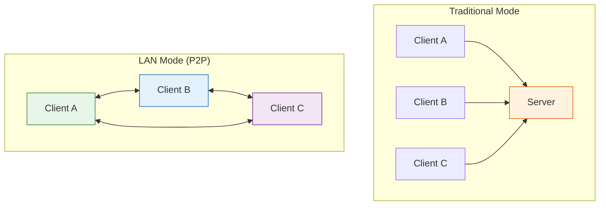
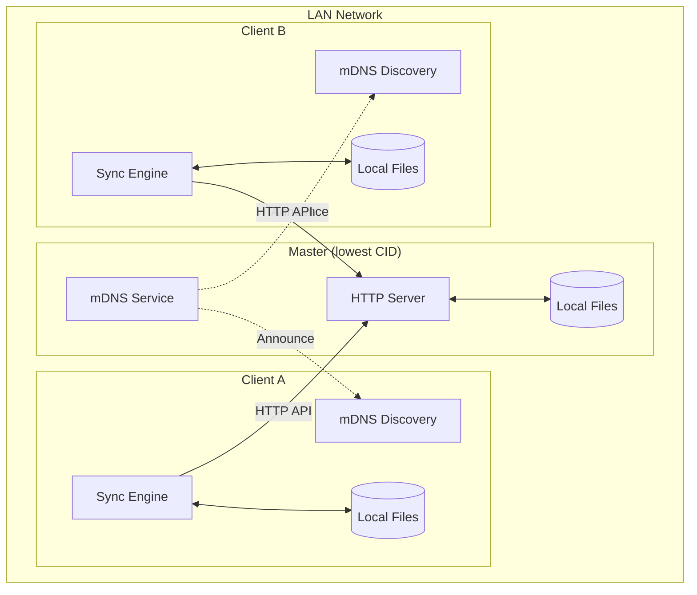
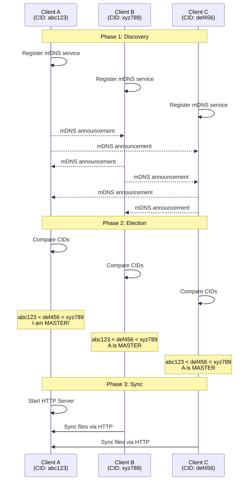
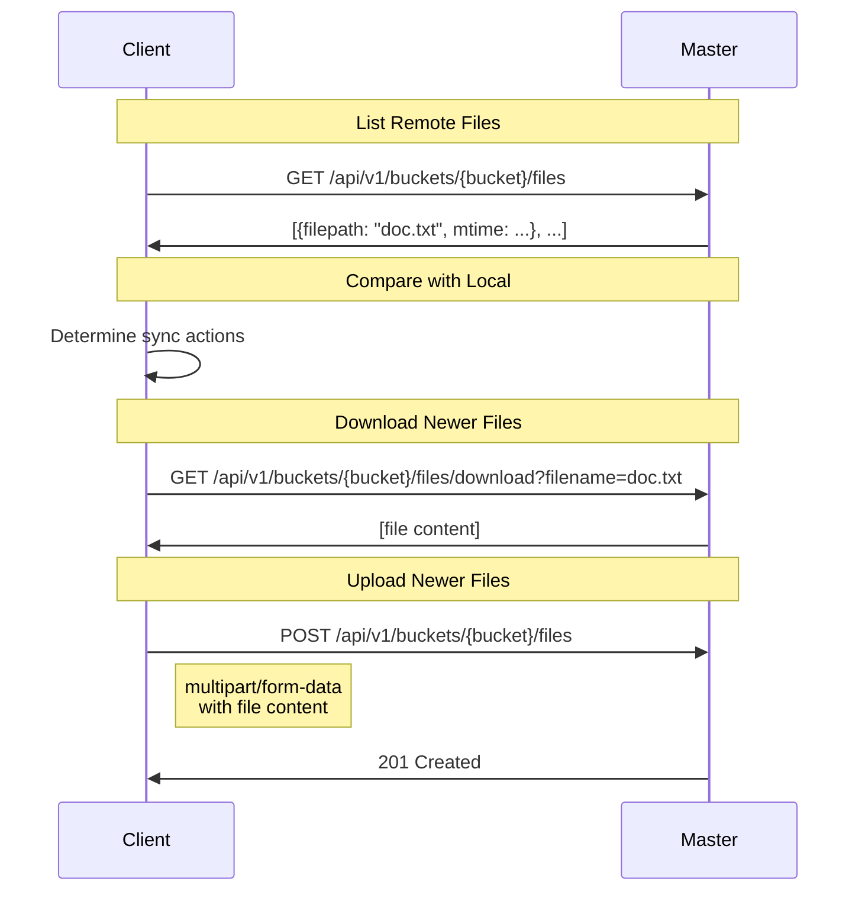
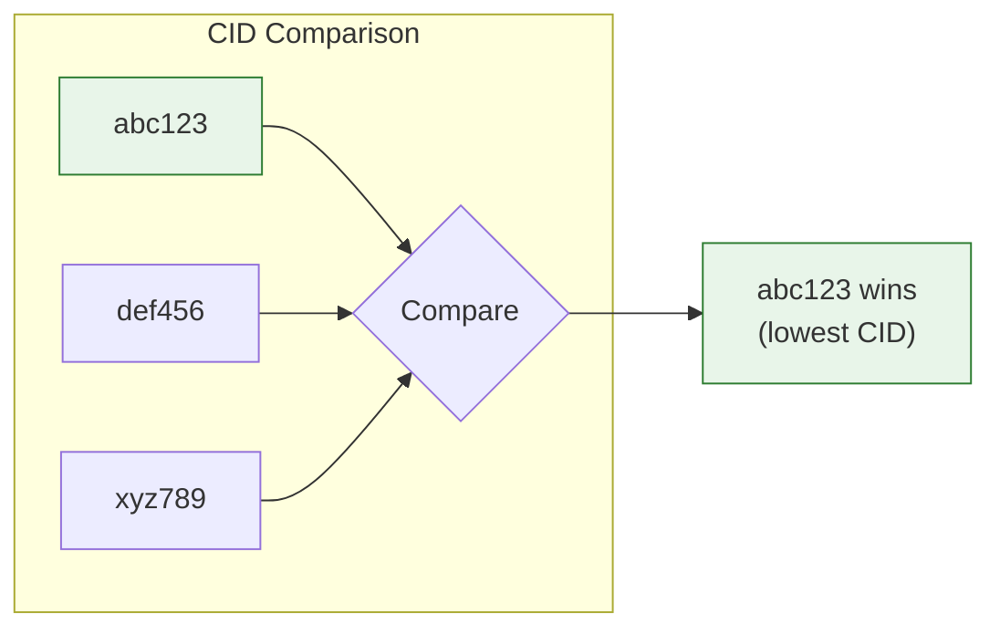
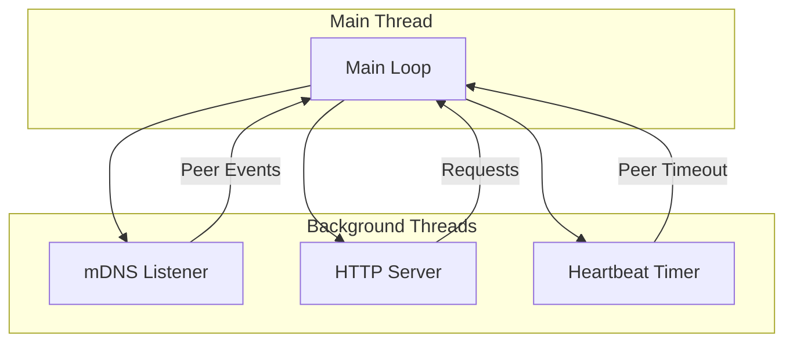

# HSYNC LAN Mode (P2P Synchronization)

This document describes the LAN Mode feature for peer-to-peer file synchronization without a centralized server.

> **Note**: Diagrams are written in Mermaid. If they don't render, run `./generate-diagrams.sh` to generate PNG images in the `images/` directory.

## Overview

LAN Mode enables direct peer-to-peer file synchronization between devices on the same local network, without requiring a centralized HSYNC server.




## Key Features

| Feature | Description |
|---------|-------------|
| **Zero Configuration** | Automatic peer discovery via mDNS/Bonjour |
| **No Server Required** | Works without internet or central server |
| **Automatic Master Election** | Lowest CID becomes the master |
| **Optional Authentication** | Shared secret key for security |
| **Random Port Allocation** | Avoids port conflicts |

## How It Works

### Architecture




### Discovery and Election Flow




### Synchronization Flow




## Quick Start

### Basic Usage (No Authentication)

```bash
# On all devices - they will discover each other automatically
./dist/hsync -b photos -p ~/Pictures --lan-mode
```

### With Authentication

```bash
# On all devices - use the same key
./dist/hsync -b photos -p ~/Pictures --lan-mode --lan-key "mySecretKey123"

# Or via environment variable
export HSYNC_LAN_KEY="mySecretKey123"
./dist/hsync -b photos -p ~/Pictures --lan-mode
```

### With Specific Port

```bash
# Use a specific port instead of random
./dist/hsync -b photos -p ~/Pictures --lan-mode --lan-port 9000
```

## CLI Options

| Option | Description | Default |
|--------|-------------|---------|
| `--lan-mode` | Enable LAN P2P mode | `false` |
| `--lan-port` | Port for HTTP server (0 = random) | `0` |
| `--lan-key` | Shared secret for authentication | `None` |
| `--discovery-timeout` | Peer discovery timeout (seconds) | `5` |

## Environment Variables

All LAN options can also be configured via environment variables:

| Variable | Description | Default |
|----------|-------------|---------|
| `HSYNC_LAN_PORT` | Port for HTTP server (0 = random) | `0` |
| `HSYNC_DISCOVERY_TIMEOUT` | Peer discovery timeout (seconds) | `5` |
| `HSYNC_HEARTBEAT_INTERVAL` | Heartbeat interval for peer health (seconds) | `5` |
| `HSYNC_PEER_TIMEOUT` | Timeout before marking peer as offline (seconds) | `15` |
| `HSYNC_LAN_KEY` | Shared secret for authentication | `None` |

### Configuration Priority

```
CLI argument > Environment variable > Default value
```

## Authentication

### No Authentication (Trust LAN)

By default, LAN mode operates without authentication. This is suitable for trusted home networks.

```bash
./dist/hsync -b photos -p ~/Pictures --lan-mode
```

### Shared Secret (Recommended)

For security, use a shared secret key that all peers must know:

```bash
# All peers must use the same key
./dist/hsync -b photos -p ~/Pictures --lan-mode --lan-key "mySecretKey123"
```

The key is transmitted as a Bearer token in HTTP headers:

```
Authorization: Bearer mySecretKey123
```

## Master Election

The master is elected using **lexicographic comparison** of Client IDs (CIDs):




**Rules:**
- The peer with the **lowest CID** becomes the master
- CIDs are random alphanumeric strings generated at startup
- If the master goes offline, a new election occurs

## API Endpoints

The master exposes these HTTP endpoints:

| Endpoint | Method | Description |
|----------|--------|-------------|
| `/api/v1/health` | GET | Health check |
| `/api/v1/buckets/{bucket}/files` | GET | List files with metadata |
| `/api/v1/buckets/{bucket}/files/download` | GET | Download a file |
| `/api/v1/buckets/{bucket}/files` | POST | Upload a file |

### List Files

```http
GET /api/v1/buckets/photos/files?sync_order=mtime HTTP/1.1
Authorization: Bearer mySecretKey123
```

**Response:**
```json
[
  {
    "filepath": "vacation/photo1.jpg",
    "name": "photo1.jpg",
    "size": 2048576,
    "mtime": 1706000000,
    "ctime": 1705900000,
    "md5sum": "d41d8cd98f00b204e9800998ecf8427e",
    "permissions": "-rw-r--r--"
  }
]
```

### Download File

```http
GET /api/v1/buckets/photos/files/download?filename=vacation/photo1.jpg HTTP/1.1
Authorization: Bearer mySecretKey123
```

### Upload File

```http
POST /api/v1/buckets/photos/files HTTP/1.1
Authorization: Bearer mySecretKey123
Content-Type: multipart/form-data; boundary=...

--boundary
Content-Disposition: form-data; name="cid"

client123
--boundary
Content-Disposition: form-data; name="path"

vacation
--boundary
Content-Disposition: form-data; name="file"; filename="photo2.jpg"
Content-Type: application/octet-stream

[binary content]
--boundary--
```

## Use Cases

### Home Network Sync

Sync photos between laptop and desktop without internet:

```bash
# On laptop
./dist/hsync -b photos -p ~/Pictures --lan-mode

# On desktop
./dist/hsync -b photos -p ~/Pictures --lan-mode
```

### Office File Sharing

Share project files between team members on the same network:

```bash
# All team members run:
export HSYNC_LAN_KEY="team-secret-2024"
./dist/hsync -b project -p ~/Projects/myproject --lan-mode
```

### Backup to NAS

Sync files to a NAS device on the local network:

```bash
# On workstation
./dist/hsync -b backup -p ~/Documents --lan-mode --lan-key "backup-key"

# On NAS
./dist/hsync -b backup -p /volume1/backups --lan-mode --lan-key "backup-key"
```

## Troubleshooting

### Peers Not Discovering Each Other

1. **Check firewall**: Ensure mDNS (UDP port 5353) is allowed
2. **Check network**: All devices must be on the same subnet
3. **Increase timeout**: Use `--discovery-timeout 10` for slower networks

### Authentication Failures

1. **Check key**: Ensure all peers use the exact same `--lan-key`
2. **Check logs**: Look for "401 Unauthorized" errors

### Port Conflicts

1. **Use random port**: Default `--lan-port 0` avoids conflicts
2. **Specify port**: Use `--lan-port 9000` if you need a fixed port

## Comparison: Server Mode vs LAN Mode

| Feature | Server Mode | LAN Mode |
|---------|-------------|----------|
| **Requires Server** | ✅ Yes | ❌ No |
| **Internet Required** | ✅ Yes | ❌ No |
| **Multi-Network Sync** | ✅ Yes | ❌ No (same LAN only) |
| **Automatic Discovery** | ❌ No | ✅ Yes (mDNS) |
| **Central Storage** | ✅ Yes | ❌ No (distributed) |
| **Authentication** | API Key | Shared Secret |
| **Watch Mode** | ✅ Yes | ❌ Not yet |

## Technical Details

### mDNS Service

LAN mode uses mDNS (Multicast DNS) for peer discovery:

- **Service Type**: `_hsync._tcp.local.`
- **TXT Records**: `cid`, `bucket`, `version`

### Dependencies

- **zeroconf**: Python library for mDNS/DNS-SD

### Thread Model




