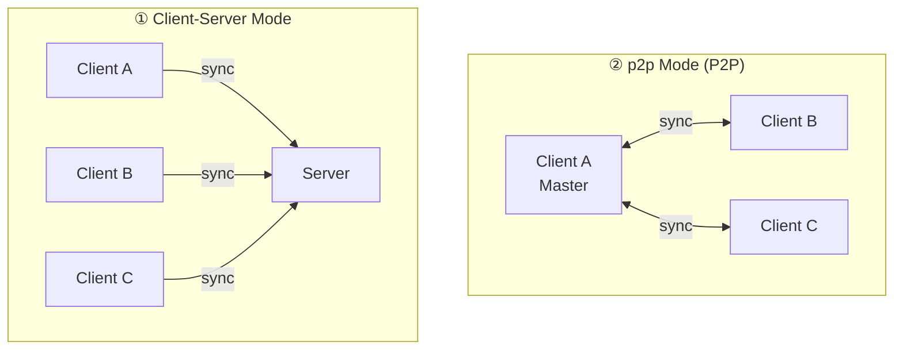

# HSYNC p2p Mode (P2P Synchronization)

p2p Mode lets devices synchronize files directly, peer-to-peer, without a
centralized HSYNC server. Discovery uses **mDNS on the local network always**,
plus an optional `boot/1` bootstrap node for devices on different networks:
with no bootnode configured only mDNS runs; with a bootnode configured both run
together, so a node next to you is still found locally without a round trip
through the node.

> **Quick links**
> - Full option & environment-variable reference → [Configuration — p2p Mode](configuration-p2p.md#p2p-mode-options)
> - Ready-to-use recipes → [Examples](examples.md)
> - Sync on the local network (mDNS) → [p2p on the local network](p2p-lan.md)
> - Sync across networks (bootnode) → [p2p across networks](p2p-bootnode.md)
> - Server vs p2p comparison → [Sync Modes](sync-modes.md)
> - Protocol internals (diagrams, HTTP/WS API, echo suppression) → [p2p Internals](internal/p2p-internals.md)

## Overview

p2p Mode enables direct peer-to-peer file synchronization between devices on the
same network, without requiring a centralized HSYNC server. Discovery always uses
mDNS on the local network; cross-network groups add a bootnode, which runs
alongside mDNS on the same client. Everything below (election, transport,
security) is identical whether mDNS runs alone or alongside the bootnode.



## Key Features

| Feature | Description |
|---------|-------------|
| **Zero Configuration** | Automatic peer discovery via mDNS/Bonjour |
| **No Server Required** | Works without internet or central server |
| **Automatic Master Election** | Priority: `server_ready` (incumbent) > `prefer_master` > bidirectional preference > earliest startup > lowest CID |
| **Passive Peers** | `--never-master` keeps a peer out of the election; it syncs but never becomes master |
| **Real-Time Sync** | WebSocket-based instant event propagation (implicit; continuous mode is the default) |
| **Bidirectional Sync** | Any peer can create/modify/delete files |
| **Directional Sync** | Slaves can use `upload-only` or `download-only` via `--sync-direction` |
| **Peer-Assisted Downloads** | Listed files can be fetched from exact-hash continuous slaves, within their announced capacity, before master fallback |
| **Optional Authentication** | Shared key authenticates all traffic; no-key operation is read-only by default |
| **Random Port Allocation** | Avoids port conflicts |
| **Auto-Tuning** | Environment-adaptive defaults for HTTP timeout, retry, and concurrency |

## How It Works

In plain terms, p2p mode works in three steps:

1. **Discovery** — every device announces itself on the local network (mDNS), so
   peers find each other automatically with no IP addresses to configure.
2. **Election** — the peers agree on a single **master** that coordinates sync.
   The choice is automatic (see [Master Election](#master-election)).
3. **Sync** — peers connect to the master over an encrypted channel. For an
   eligible full download, the master may identify continuous slaves that hold
   the exact listed hash; the requester tries those sources before downloading
   the full file from the master. The master remains the source of metadata,
   delta transfer, and final fallback. Afterwards every change
   (create, modify, delete, rename) is propagated in real time, in both
   directions, over a live WebSocket connection (deletions follow
   `--deletion-policy`, see [Configuration](configuration.md#deletions)). No
   peer is authoritative —
   concurrent edits are resolved causally (see
   [Conflict Resolution](conflict-resolution.md)).

<p align="center">
  
</p>

> **Important — local-only files.** In the default **bidirectional** direction,
> files that exist only on this peer are **uploaded** to the master, not
> deleted. A local-only file is removed only when:
> - `--sync-direction download-only` (the slave mirrors the master), or
> - a causal tombstone proves the path was deleted while this peer was offline.
>
> Deletions made on the master still reach the peer via tombstones, not by
> wiping every unmatched local file. See
> [Sync Modes — p2p](sync-modes-p2p.md) and
> [Conflict Resolution](conflict-resolution.md).

> The architecture and discovery/election/sync **sequence diagrams**, the full
> bidirectional operations table and the WebSocket event format are in
> [p2p Internals](internal/p2p-internals.md).

> **First sync?** → Follow the step-by-step
> [Getting Started — p2p Mode](getting-started-p2p.md) guide; this page
> explains how p2p Mode works. Authentication (`HSYNC_P2P_PASSPHRASE` or the raw
> `HSYNC_P2P_KEY`), specific
> ports, and every other p2p option live in
> [Configuration — p2p Mode](configuration-p2p.md).

## Continuous Mode (Default)

Continuous mode is the default in p2p mode. The client stays active indefinitely, even when no peers are found, and automatically starts a file system watcher that propagates events in real time. Discovery waits indefinitely by default (`--discovery-timeout 0`), mirroring the server-mode default of retrying an unreachable server forever.

This is useful for:

- **Always-on sync services**: Keep a device ready to sync whenever others come online
- **NAS/Server deployments**: Run as a background service waiting for clients
- **Intermittent connectivity**: Handle peers that connect and disconnect frequently

Pass `--once` to disable this behavior and exit after a single sync attempt.

### Peer-Assisted Downloads

Peer assistance is enabled by default and has no minimum-file-size gate: any
listed file whose exact `(path, SHA-256)` is held by a live seeder is eligible,
and the requester keeps its concurrent reads within that seeder's advertised
capacity. A continuous, non-dry-run slave publishes an inventory and exposes a
read-only HTTPS seeder on its advertised p2p port. The master returns candidate
endpoints only for the exact `(path, SHA-256)` from its listing. The requester
verifies the final body against that listing hash before replacing the
destination, regardless of which source sent the bytes.

The transfer order is deterministic: master delta first when applicable, then
ranked peer full-download candidates, then canonical master full-download. An
interrupted exact body may resume from another source; malformed ranges, wrong
sizes, or completed hash failures discard the partial body. One-shot slaves can
request from peers but never seed. Use `--no-peer-download` to disable this path.
Concurrency settings are listed in
[Configuration — p2p Mode](configuration-p2p.md).

Each seeder announces how many concurrent downloads it accepts, so a requester
never exceeds that capacity: it briefly waits for a free slot and then takes the
master instead of hammering the peer. If a seeder is momentarily full anyway, it
answers "try again shortly" and the requester simply defers that peer for the
suggested moment — a busy peer is never treated as a broken one.

### Behavior

| Scenario | Message | Action |
|----------|---------|--------|
| No peers ever found | "Waiting for peers to join..." | Retry discovery |
| Peers disconnected | "All peers disconnected, waiting for new peers..." | Retry discovery |
| Peer found | Normal sync flow | Sync, then continue discovery |
| Master role change | "No longer master, switching to client mode..." | Restart as client |
| Network changed (new local address) | `Network link restored: local address …` | Automatic: the mDNS record is rebuilt on the new address and the bootnode endpoint republished; no restart |

### Example Flow

```console
HSYNC_P2P_PASSPHRASE="a-long-shared-password" hsync p2p -b photos -p ~/Pictures

[INFO] p2p mode enabled
[INFO] Continuous mode enabled - will wait indefinitely for peers
[INFO] Loading persistent p2p master certificate...
[INFO] Certificate fingerprint: a1b2c3d4e5f6...
[INFO] Waiting for peers to join...
[INFO] Waiting for peers to join...
[INFO] Peer discovered: laptop-001 at 192.168.1.100:54321
[INFO] This client is the MASTER - acting as sync coordinator
[INFO] Master server listening on port 12345 (HTTPS)
[INFO] Press Ctrl+C to stop...
```

## Options & Environment Variables

All p2p command-line options and `HSYNC_*` environment variables — including the
master-election flags `--prefer-master`/`--never-master`, the discovery/heartbeat
timeouts, `HSYNC_P2P_PASSPHRASE`/`HSYNC_P2P_KEY`, `HSYNC_DEVICE_DIR` and persistence — are documented
in the single reference:
[Configuration — p2p Mode](configuration-p2p.md).

> **Key incompatibilities** (the client refuses to start otherwise):
> - `--prefer-master` cannot be combined with `--sync-direction upload-only`/`download-only` — the master must stay bidirectional.
> - `--prefer-master` and `--never-master` are mutually exclusive.
>
> The p2p shared secret is only ever supplied via the environment, never as a
> CLI flag. Two forms exist: `HSYNC_P2P_PASSPHRASE` (at least 12 characters, the
> usual choice; it is expanded to the group key with scrypt) and
> `HSYNC_P2P_KEY` (a full raw group key, at least 32 characters). That secret is
> what authorizes writes: a keyless p2p is read-only, and a write-capable run
> without a key is refused with `[AUTH REQUIRED]`. Only
> `--sync-direction download-only` needs no key.

## Security & Pairing

p2p mode is **HTTPS/WSS only** — every peer connection is encrypted and there is
no plain-HTTP transport. Trust is established the first time you connect
(trust-on-first-use): the elected master presents a persistent self-signed
certificate, and peers pin its SHA-256 fingerprint (shared over mDNS) on the very
connection that carries the data.

- **No setup required** — encryption is always on; you don't manage certificates.
- **Optional shared secret** — set the same `HSYNC_P2P_PASSPHRASE` on every
  peer to require authentication. It must be at least 12 characters; the client
  derives the 32-byte group key with scrypt (fixed, versioned salt) and sends the
  result as a Bearer token over the encrypted channel. Use a password unique to
  this group:

  ```bash
  # All peers must use the same password
  export HSYNC_P2P_PASSPHRASE="a-long-shared-password"
  hsync p2p -b photos -p ~/Pictures
  ```

- **No-key mode is read-only by default** — discovery, listings, downloads,
  exact-hash source lookup, and download delta remain available, but any
  write-capable sync is refused and mutating HTTP endpoints return `403`.
- **Keyless runs are confirmed** — without a shared password or key the client asks for
  confirmation on a terminal and fails closed otherwise; proceed only with
  `--allow-unauthenticated-p2p` or `HSYNC_P2P_ALLOW_UNAUTHENTICATED=true`.
- **Dangerous explicit opt-in** — `--allow-unauthenticated-writes` or
  `HSYNC_P2P_ALLOW_UNAUTHENTICATED_WRITES=true` permits no-key mutations on a
  fully trusted network. A TTY does not grant this permission.
- **Per-source trust** — each selected seeder is pinned independently by device
  ID and bucket before connecting. The master trust policy remains specific to
  the elected master; seeder trust uses persistent TOFU.
- **Master trust policy (`--p2p-trust`)** — decides what happens the first time
  the elected master is seen: `ask` (default) confirms its fingerprint on a
  terminal and refuses it when there is none, `accept-new` pins it silently
  (trust-on-first-use) and `strict` refuses it until it is pinned. A first-seen
  certificate refused this way is logged as `[PAIRING NEEDED]`; to accept it you
  confirm its fingerprint through a channel you control ("out of band") and pin
  it with
  `hsync trust peer add MASTER_DEVICE_ID sha256:FINGERPRINT --bucket BUCKET_NAME`.
  The exact steps are in
  [FAQ — p2p Mode → Security & Safety](faq-p2p.md#security--safety).
- **Managing trust from the command line** — both trust stores are managed with
  the `hsync` CLI; verify a fingerprint out of band before pinning it:

  ```bash
  hsync trust peer list    # device-id|bucket fingerprint
  hsync trust peer list --json   # machine-readable
  hsync trust peer add DEVICE_ID sha256:FINGERPRINT --bucket BUCKET_NAME
  hsync trust peer remove DEVICE_ID --bucket BUCKET_NAME   # like ssh-keygen -R
  ```

  `hsync trust peer add` accepts a `sha256:<hex>` or bare-hex fingerprint and
  refuses anything else; `remove` forgets the pin so the peer is prompted again
  at the next connection. The bootnode known-hosts store has its own parallel
  group, `hsync trust bootnode {list,show,add,remove,fingerprint}`, documented in
  [Sync across networks](p2p-bootnode.md).

> The certificate flow, fingerprint-pinning details and key parameters are in
> [p2p Internals → Transport Security](internal/p2p-internals.md#transport-security-internals).

## Device Identity

Every hsync installation owns **one persistent device identity** (the same
model as Syncthing's device IDs): a stable 21-character **device ID** plus the
TLS keypair used for the p2p transport. Both live in the device directory
(`HSYNC_DEVICE_DIR`, default `$XDG_STATE_HOME/hsync/device/` or
`~/.local/state/hsync/device/` when `XDG_STATE_HOME` is unset), together with
the per-folder sync-state databases (`syncstate/<uuid>.db`,
`syncstate/index.db`):

> Frequently asked questions about the device ID and `HSYNC_DEVICE_DIR` are
> answered in [FAQ — p2p Mode → Device Identity](faq-p2p.md#device-identity).

| File | Content | Permissions |
|------|---------|-------------|
| `device_id` | The device ID (identity anchor for TOFU pins) | `0600` |
| `p2p_master_cert.pem` / `p2p_master_key.pem` | The p2p keypair (may be rotated) | `0600` |

Consequences:

- **Pins survive restarts** — TOFU pins are keyed on `(device_id, bucket)`, so
  a restarted master is recognised by its peers instead of being re-pinned
  silently.
- **Key rotation is detectable** — deleting only the `*.pem` files regenerates
  the keypair while the device ID stays; peers then see a changed fingerprint
  for a known device and refuse the connection (`[FINGERPRINT CHANGED]`). Re-pin
  with `hsync trust peer add`, or forget the pin with `hsync trust peer remove`
  to be prompted again at the next connection.
- **Copying the device directory clones the device** — keep it private. If a
  clone appears on the network, hsync detects the duplicated identity at
  runtime, refuses to sync with it (`[SECURITY] Duplicate device identity`)
  and raises a **Duplicate Device Identity** notification in the desktop app,
  instead of silently ignoring it.

### Multiple instances on one host

- **Different buckets** — works out of the box: the mDNS service name is
  `{bucket}-{device_id}`, so instances never clash.
- **Same bucket** — not possible with one device identity (the instances are
  the *same device* and ignore each other in discovery; the second mDNS
  registration fails with a clear error). Give the second instance its own
  identity:

  ```bash
  HSYNC_P2P_PASSPHRASE="a-long-shared-password" \
  HSYNC_DEVICE_DIR=~/.local/state/hsync/device-alt \
    hsync p2p -b photos -p ~/Other
  ```

### One process per directory

Two hsync processes can never sync the **same local directory** at the same
time (regardless of buckets): they would race the same folder UUID in
the per-folder state DB. The client enforces this with a cross-process
advisory file lock (`flock` on POSIX, a `msvcrt` byte-range lock on Windows;
per-directory: `$HSYNC_LOCKS_DIR`, else `$XDG_RUNTIME_DIR/hsync/locks`,
else `<device-dir>/locks`) and refuses to start with an error naming the conflicting
directory and PID. The operating system releases the lock even if the process is
killed, so it can never go stale.

## Group Filtering

Group filtering allows multiple hsync instances on the same LAN to be isolated. Peers with different groups will ignore each other.

### Filtering Logic

The group is a **strict partition key**: two peers are compatible **only** when
their groups are exactly equal. "No group" is itself a distinct partition, so a
peer without a group matches **only** other peers that also run without a group.

| Local Group | Peer Group | Result |
|-------------|------------|--------|
| `None` | `None` | ✅ Compatible |
| `None` | `team-a` | ❌ Ignored |
| `team-a` | `None` | ❌ Ignored |
| `team-a` | `team-a` | ✅ Compatible |
| `team-a` | `team-b` | ❌ Ignored |

**Rule**: A peer is visible only if its group is identical to the local group, where "no group" counts as its own group. This guarantees full isolation — a groupless peer can never bridge two named groups.

### Usage Examples

```bash
# The shared key authorizes writes; every peer in the group needs the same one
export HSYNC_P2P_PASSPHRASE="a-long-shared-password"

# Team A - only sees other Team A peers
hsync p2p -b project -p ~/Projects --group "team-a"

# Team B - only sees other Team B peers
hsync p2p -b project -p ~/Projects --group "team-b"

# No group - only sees other peers that also run without a group
hsync p2p -b project -p ~/Projects
```

### Use Cases

- **Separate teams**: Different teams on the same network sync independently
- **Dev vs Prod**: Isolate development and production environments
- **Multiple projects**: Same bucket name but different groups for different projects

## Master Election

The master is elected using a **multi-criteria priority system**. Each peer independently runs the same algorithm, ensuring all peers agree on the same master.

### Election Priority (highest to lowest)

| Priority | Criterion | Description |
|----------|-----------|-------------|
| 1 | `server_ready` (incumbent) | An already-serving master keeps the role, so a newcomer never disrupts it |
| 2 | `prefer_master` | An operator-preferred master wins over ordinary peers (but **not** over a serving incumbent) |
| 3 | **Bidirectional preference** | Peers with `bidirectional` sync direction are preferred over `upload-only` or `download-only` |
| 4 | **Earliest startup** | Among equal peers, the one that started first wins |
| 5 | **Lowest CID** | Final tiebreaker: lexicographic comparison of Client IDs |

> **Note**: Peers running with `--never-master` are **excluded from the candidate pool** before any of the criteria above are applied. They never win the election, regardless of startup time or CID.

> The decision-flow diagram for this algorithm is in
> [p2p Internals → Master Election Algorithm](internal/p2p-internals.md#master-election-algorithm).

**Rules:**
- The `sync_direction`, `never_master`, `prefer_master`, `server_ready` and `startup_time` flags of each peer are shared during discovery — through mDNS TXT records on a local network, and through the bootnode when the group uses one — so the same election runs in both cases
- A serving master (`server_ready`) keeps the role over a newcomer even if the newcomer sets `--prefer-master`; the preference wins once both are at parity on readiness
- `--prefer-master` is **incompatible** with `--sync-direction upload-only` or `download-only` — the client will refuse to start
- `--never-master` peers are removed from the candidate pool, so they are never elected (locally or by other peers)
- `--never-master` is **incompatible** with `--prefer-master` — the client will refuse to start
- If a non-bidirectional peer is elected as master (no bidirectional peers available), a **WARNING** is logged
- If **all** discovered peers are `--never-master`, no master is elected; after 60 s a `[NO MASTER]` warning is logged
- If the master goes offline, a new election occurs among remaining peers

### Examples

**Scenario 1**: Three peers, all bidirectional (classic behavior)
```text
Peer A: CID=abc123, bidirectional, startup=10:00
Peer B: CID=def456, bidirectional, startup=10:01
Peer C: CID=xyz789, bidirectional, startup=10:00
→ Winner: Peer A (same startup as C, but lower CID)
```

**Scenario 2**: Mixed sync directions
```text
Peer A: CID=abc123, upload-only,    startup=10:00
Peer B: CID=xyz789, bidirectional,  startup=10:05
→ Winner: Peer B (bidirectional preferred, even though A started earlier)
```

**Scenario 3**: No bidirectional peers
```text
Peer A: CID=abc123, upload-only,    startup=10:00
Peer B: CID=def456, download-only,  startup=10:01
→ Winner: Peer A (both non-bidirectional, A started earlier)
⚠️ WARNING: Master has sync_direction=upload-only
```

**Scenario 4**: A peer opts out with `--never-master`
```text
Peer A: CID=abc123, bidirectional, never_master=true,  startup=10:00
Peer B: CID=def456, bidirectional, never_master=false, startup=10:01
→ Winner: Peer B (A is excluded from the candidate pool despite lower CID / earlier startup)
```

**Scenario 5**: Every peer is `--never-master` (no master can be elected)
```text
Peer A: CID=abc123, never_master=true, startup=10:00
Peer B: CID=def456, never_master=true, startup=10:01
→ No master elected; candidate pool is empty
⚠️ WARNING: [NO MASTER] no master elected after 60s — all peers are never-master
```

## Use Cases & Recipes

Practical, copy-paste recipes — home sync, office file sharing, backup to a NAS,
one-shot sync, read-only slaves, isolated groups and fixed ports — live in
[Examples → p2p Examples](examples.md).

### Deletion Risk Warning

When running in p2p mode **without `--prefer-master`** and the shared directory is non-empty, the client warns that local files could be deleted — because the elected master serves the file listing the slave converges on, and files not present on the master will be removed during initial sync. The master is a transport coordinator, not an authority (ADR-0022): concurrent edits are resolved causally by every node.

```bash
# The shared key authorizes writes (a keyless p2p is read-only)
export HSYNC_P2P_PASSPHRASE="a-long-shared-password"

# The client will show a warning and ask for confirmation
hsync p2p -b photos -p ~/Pictures

# Accept the deletion-risk confirmation (e.g. in scripts or systemd services)
hsync p2p -b photos -p ~/Pictures --allow-deletions
```

The warning is **not shown** when:
- The shared directory is empty (nothing to lose)
- `--prefer-master` is set (this peer serves files — deletion risk is about the slave role)
- `--sync-direction upload-only` is set (local files are never deleted)

See also: [Architecture > Pre-Sync Safety Check](internal/architecture.md#pre-sync-safety-check-deletion-risk)

## Troubleshooting

### Peers Not Discovering Each Other

1. **Check firewall**: Ensure mDNS (UDP port 5353) is allowed
2. **Check network**: All devices must be on the same subnet (or point the whole group at the same bootnode for cross-network discovery)
3. **Increase timeout**: Use `--discovery-timeout 15` for slower networks, or `--discovery-timeout 0` to wait indefinitely for the first peer/master
4. **Running in a container?**: mDNS multicast cannot cross the NAT boundary of
   the default bridge network used by container runtimes, so peers will never
   be found. Run the client with host networking (e.g.
   `docker run --network host ...`) — the client detects the container at
   startup and logs this hint as a warning.

### Authentication Failures

1. **Check secret**: Ensure all peers use the exact same `HSYNC_P2P_PASSPHRASE` (or `HSYNC_P2P_KEY`) value
2. **Check logs**: Look for "401 Unauthorized" errors

### Port Conflicts

1. **Use random port**: Default `--listen-port 0` avoids conflicts
2. **Specify port**: Use `--listen-port 9000` if you need a fixed port

## Comparison: Server Mode vs p2p Mode

See [Sync Modes](sync-modes.md) for the full Server vs p2p comparison table.

## Technical Internals

The deep protocol details — architecture and sequence diagrams, the master's
HTTP/WS API with request/response examples, the certificate flow, the
master-election decision diagram, CID/echo suppression
(`InboundOriginTracker`), and the mDNS/thread model — live in
[p2p Internals](internal/p2p-internals.md).
