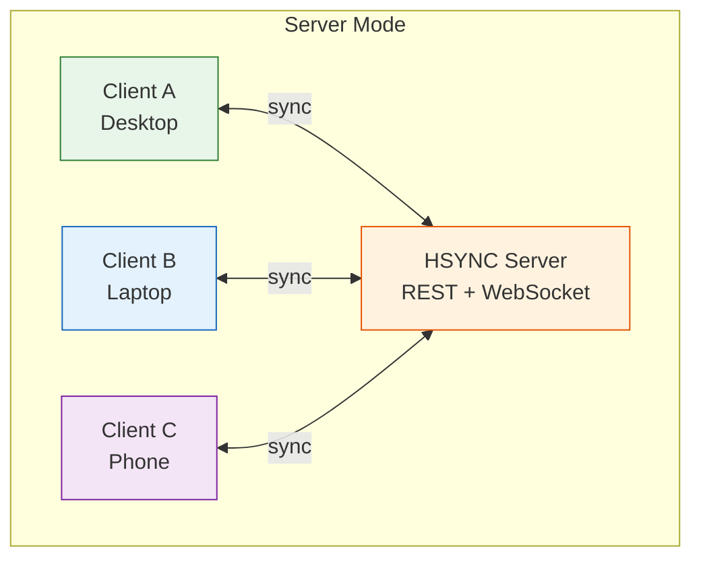
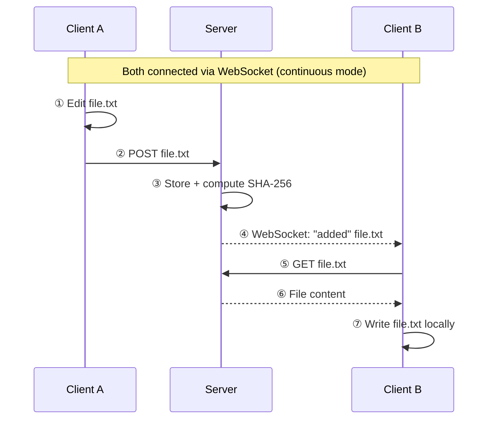

# HSYNC Server Mode (Centralized Synchronization)

Server Mode connects every device to a central **HSYNC server**, which acts as
the canonical store and relays events to all connected clients in real time.

> **Quick links**
> - Full option & environment-variable reference → [Configuration — Server Mode](configuration-server.md#server-connection-options)
> - Ready-to-use recipes → [Examples — Server Mode](examples-server.md)
> - Server vs p2p comparison → [Sync Modes](sync-modes.md)
> - Client-side sync flow (diagrams, delta transfer, event handling) → [Sync Flow](sync-flow.md)

## Overview

In Server Mode every client connects to the same central HSYNC server over HTTPS
(REST + WebSocket). The server stores the files, keeps a canonical listing, and
broadcasts every change to all connected clients so they stay in sync
automatically.



## Key Features

| Feature | Description |
|---------|-------------|
| **Central Hub** | One server, many clients; the server relays sync (transport hub, not an authority) |
| **Real-Time Sync** | WebSocket-based instant event propagation in continuous mode (the default) |
| **Delta Transfer** | Rsync-style block sync for large files with small changes |
| **Compression** | Automatic zstd compression (skips already-compressed formats) |
| **Bandwidth Limiting** | Token-bucket throttling for upload and download |
| **Bidirectional Sync** | Any client can create/modify/delete files; changes propagate to all |
| **Directional Sync** | Upload-only (backup) or download-only (mirror) via `--sync-direction` |
| **Periodic Resync** | Configurable interval for full reconciliation as a safety net |
| **Mass Deletion Guard** | Prevents accidental wipe when the server exposes an empty bucket |
| **Auto-Tuning** | Environment-adaptive defaults for HTTP timeout, retry, and concurrency |

## How It Works

In plain terms, server mode works in four steps:

1. **Connect** — the client establishes an HTTPS connection to the server and
   authenticates with `HSYNC_API_KEY` (Bearer token).
2. **Reconcile** — the client fetches the remote file list (REST), scans the
   local directory, and uploads/downloads every difference.
3. **Watch** — in continuous mode (the default) the client opens a WebSocket
   and receives remote events (add/modify/delete/rename) in real time. A
   periodic full resync (`-i`) runs as a safety net. If the server is
   unreachable, the client keeps retrying forever; pass `--once` for a single
   cycle that exits.
4. **Stay in sync** — as long as the client is running, every local change is
   pushed to the server and every remote change is pulled locally.



> The full initial-sync sequence diagram, the event-handling flow chart, the
> conflict-resolution tree and the delta-transfer internals are in
> [Sync Flow](sync-flow.md).

> **First sync?** → Follow the step-by-step
> [Getting Started — Server Mode](getting-started-server.md) guide; this page
> explains how Server Mode works.

## Continuous Mode & Auto-Sync

Continuous mode (the default) keeps a persistent WebSocket connection open. The server
pushes every remote change (add, modify, delete, rename) to all connected
clients instantly — no polling.

A **periodic full resync** runs every `-i` seconds (default 300, set `0` to
disable) as a safety net: it catches any file-system events the watcher may
have missed (e.g. the inotify watch limit on Linux, sleep/wake cycles).

```bash
# Continuous mode with a 5-minute resync interval
hsync server server.example.com -b mybucket -p /path/to/dir -i 300

# Continuous mode with a longer stability delay (safe for slow storage)
hsync server server.example.com -b media -p /srv/media --stability-delay 30

# Reverse proxy on the standard HTTPS port (the default port is 9753)
hsync server server.example.com --port 443 -b mybucket -p /path/to/dir
```

For scheduled background sync (cron, systemd timer, Task Scheduler) use
one-shot mode (`--once`; `-y` skips interactive prompts):

```bash
# Cron entry: sync every hour
0 * * * * HSYNC_API_KEY="hs_<id>_<secret>" hsync server server.example.com --once -b mybucket -p /path -y
```

## Delta Transfer, Compression & Bandwidth

HSYNC supports **delta transfer** (rsync-style block sync), **zstd
compression**, and **bandwidth limiting** — all enabled by default and
configured via the options detailed in [Configuration](configuration.md).

### Delta transfer (big files, small changes)

For files ≥ 256 KB (server mode) with a previously synced base, only the
changed blocks travel — bandwidth savings of 90%+ are common. The client
automatically falls back to a full transfer on any failure.

```bash
# Delta is enabled by default; disable it:
hsync server server.example.com -b media -p ~/Media --no-delta
```

> Full conditions, configuration and the fallback model are documented in
> [Configuration → Delta Transfer](configuration.md#delta-transfer-rsync-style-block-sync).

### Compression (automatic, skips already-compressed files)

```bash
# Compression is enabled by default; disable it for fast local networks:
hsync server server.example.com -b media -p ~/Media --no-compression
```

### Bandwidth limiting (token bucket)

```bash
# Cap upload to 1 MB/s
hsync server server.example.com -b mybucket --limit-upload 1MB
# Cap download to 500 KB/s
hsync server server.example.com -b mybucket --limit-download 500KB
```

## File Filtering & Ignore Rules

HSYNC includes a **built-in ignore list** of OS cache and editor temporary
files that is always active (`.DS_Store`, `Thumbs.db`, `*.swp`, `*.tmp`,
`*.bak` …). Dotfiles (`.env`, `.git/`, `.config/`) are **synchronised
normally** — add them to `.hsyncignore` if you need to exclude them.

Place a `.hsyncignore` file at the **root of the bucket directory** with
gitignore-style patterns:

```
# Exclude build artefacts
/dist/
/build/

# Exclude .git directory
.git/
```

Or pass patterns directly on the command line without creating a file:

```bash
hsync server server.example.com -b mybucket --ignore-pattern ".git/,*.log,/dist/"
```

> Full syntax, examples and the complete default-pattern list are in
> [Configuration → Ignore Files](configuration.md#ignore-files--patterns).

## Security

Server Mode communicates exclusively over **HTTPS/WSS** — there is no
plain-HTTP transport. The API key (`HSYNC_API_KEY`) is sent as a Bearer token
over the encrypted channel and is **required**.

| Security aspect | How it works |
|---|---|
| **API Key** | Set `HSYNC_API_KEY` (env var only — no CLI flag). Missing key → client aborts before connecting |
| **HTTPS/WSS** | Always on; the client refuses to send the API key over plain HTTP. Works through reverse proxies that terminate TLS |
| **Custom CA** | Trust a self-signed server certificate with `--ca-cert server.crt` |
| **Server cert fingerprint** | The desktop GUI pins the server's SHA-256 fingerprint on first connect (TOFU), like p2p mode does for peer certificates |
| **Skip verification** | `--insecure` disables all certificate checks — **development only** |

> Complete SSL/TLS documentation, including certificate pinning,
> reverse-proxy setup, and the `--ca-cert` / `--insecure` options, is in
> [Configuration — Server Mode → Server Connection Options](configuration-server.md#server-connection-options).

## Mass Deletion Guard

A transient server failure or misconfiguration can make the server expose an
empty (or nearly-empty) bucket. Without protection, a single sync cycle would
delete every local file not in the server's listing — effectively a **mass
accidental wipe**.

The **mass-deletion safety guard** pauses deletions when the count exceeds
either the absolute threshold (`--mass-delete-threshold`, default 50) or the
percentage of local files (`--mass-delete-percent`, default 50%). An empty
remote bucket is **always blocked**, regardless of thresholds.

> **Tombstone exemption**: a deletion backed by a matching tombstone marker
> (the file was deleted elsewhere while this peer was offline) is
> **never blocked** by the guard. A tombstone is positive proof the removal is
> intentional, so an empty master bucket is the expected outcome of a
> legitimate single-file deletion, not a suspect transient state. Only
> *unconfirmed* deletions (no tombstone) are subject to the empty-bucket and
> threshold rules.

```bash
# Disable the guard (when confident deletions observed by the server are safe)
hsync server server.example.com -b mybucket --no-mass-delete-guard

# Tighter guard: pause deletions at 10 files or 10% of the tree
hsync server server.example.com -b mybucket --mass-delete-threshold 10 --mass-delete-percent 10
```

> Full decision flowchart and the relationship with `--ignore-delete` and
> `--sync-direction` are in [Configuration → Mass-Deletion
> Guard](configuration.md#mass-deletion-guard).

## Options & Environment Variables

All server-mode command-line options and `HSYNC_*` environment variables are
documented once in [Configuration](configuration.md) (shared) and
[Configuration — Server Mode](configuration-server.md) (server-specific).

Key server-mode specific options:

| Option | Env var | Description | Default |
|--------|---------|-------------|---------|
| `HOSTNAME` + `--port` | `HSYNC_SERVER` | Server host (`https://` implied; `--port` default `9753`) | (required) |
| `--ca-cert` | — | Path to CA certificate (self-signed servers) | — |
| `--insecure` | — | Skip SSL certificate verification | `false` |
| `--http-timeout` | `HSYNC_HTTP_TIMEOUT` | HTTP request timeout (seconds) | `30` |

> **Tip**: use a `.env` file to avoid typing credentials on every command.
> See [Environment Files](configuration.md#environment-files).

## Comparison: Server Mode vs p2p Mode

See [Sync Modes](sync-modes.md) for the full comparison table.

## Troubleshooting

### 401 / 403 Authentication Errors

- **Check the token**: ensure `HSYNC_API_KEY` is set to a valid account token
  (`hs_<id>_<secret>`) issued by the server, and that the account is active and
  not expired.
- **Check the URL scheme**: the client refuses to send the API key over
  `http://` — always use `https://`.
- **Reverse proxy**: if a reverse proxy terminates TLS, point the client at the
  proxy's `https://` URL.

### SSL / Certificate Errors

- **Self-signed certificate**: copy the server's certificate to the client
  machine and pass `--ca-cert server.crt`.
- **Custom CA**: point `--ca-cert` at your CA bundle.
- **Development only**: `--insecure` skips all verification. Do not use in
  production.

### Server Unreachable / Timeout

- **Check connectivity**: verify you can reach the server's port from the
  client machine (e.g. `curl -k https://server:9753/health`).
- **Firewall**: ensure the server port (default 9753) is open.
- **Increase timeout**: use `--http-timeout 60` for high-latency connections.

### Files Not Syncing

- **`.hsyncignore` placement**: the file must be at the root of the bucket
  directory, not in a subdirectory. See
  [Ignore Files](configuration.md#ignore-files--patterns).
- **Dotfiles**: they sync by default. If they aren't appearing, check that
  `.hsyncignore` or `--ignore-pattern` is not excluding them. If they
  shouldn't sync, add `.git/` or `.env` to `.hsyncignore`.
- **Dry run first**: use `-n` to preview what would happen without making
  changes.
- **Verbose output**: use `-v` for detailed logs.

## Use Cases & Recipes

Practical server-mode recipes — personal sync, backup, mirror, bandwidth
limits, cron/systemd scheduling, mass-deletion guard — are in
[Examples — Server Mode](examples-server.md).

## Technical Internals

For the deep client-side flow — the initial-sync and continuous-mode **sequence
diagrams**, the event-handling flow chart, the conflict-resolution tree, the
delta-transfer protocol and the retry/timeout model — see [Sync
Flow](sync-flow.md). The server-side flow (file storage, event broadcast,
tombstones) is documented in the
[server Sync Flow](https://github.com/albertsdk/hsync-server/blob/main/docs/sync-flow.md).
