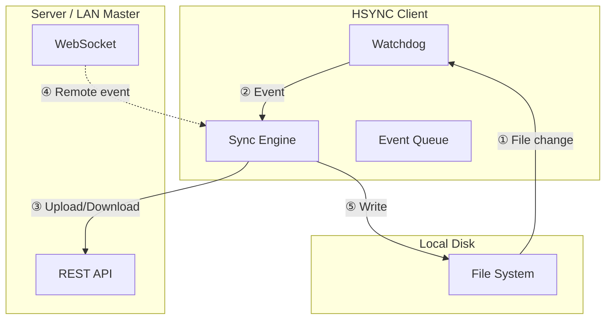
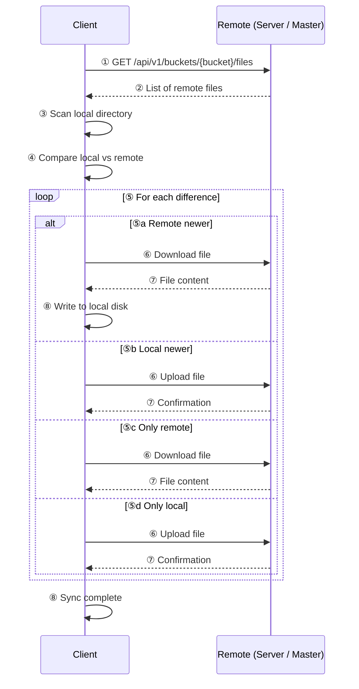
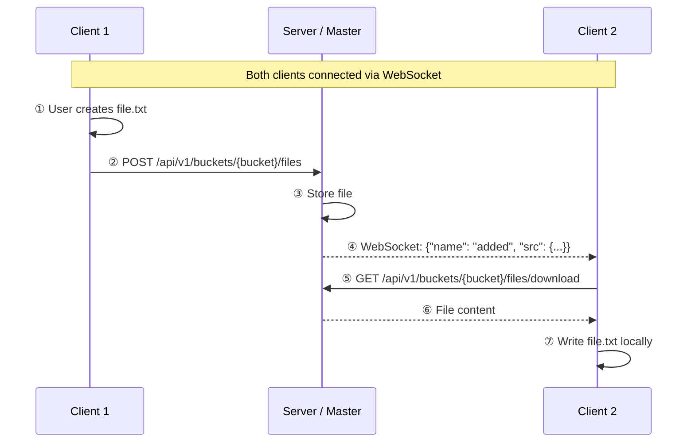
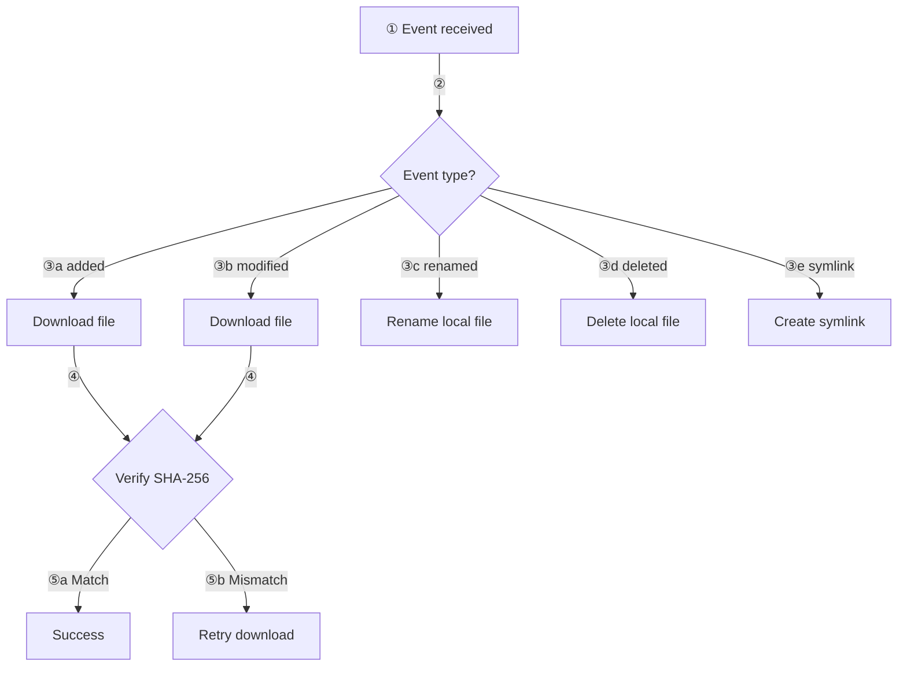
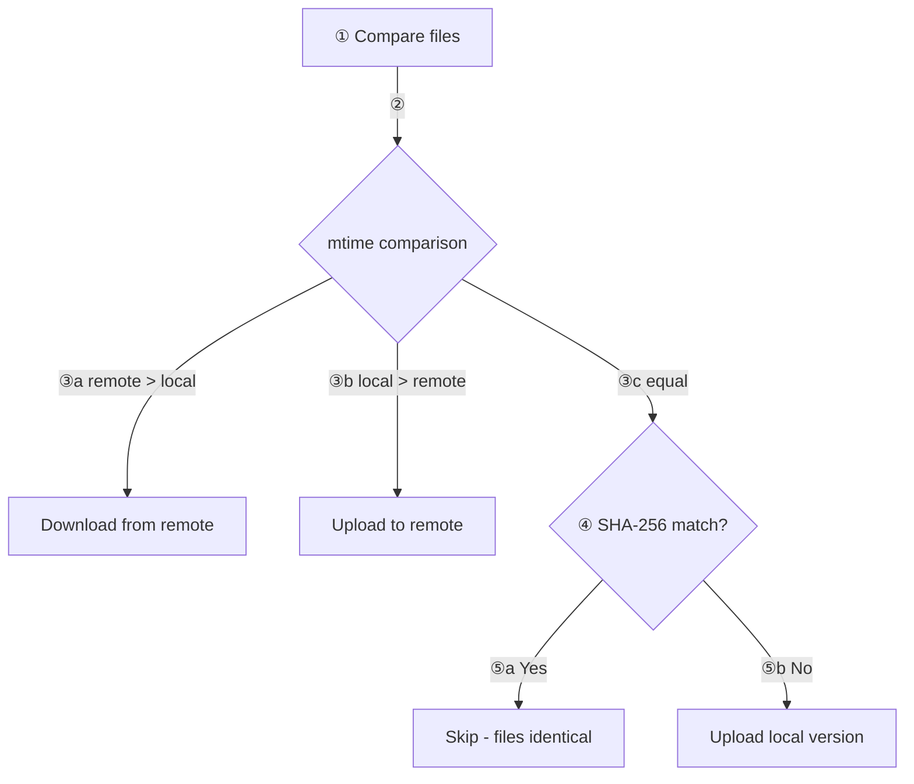
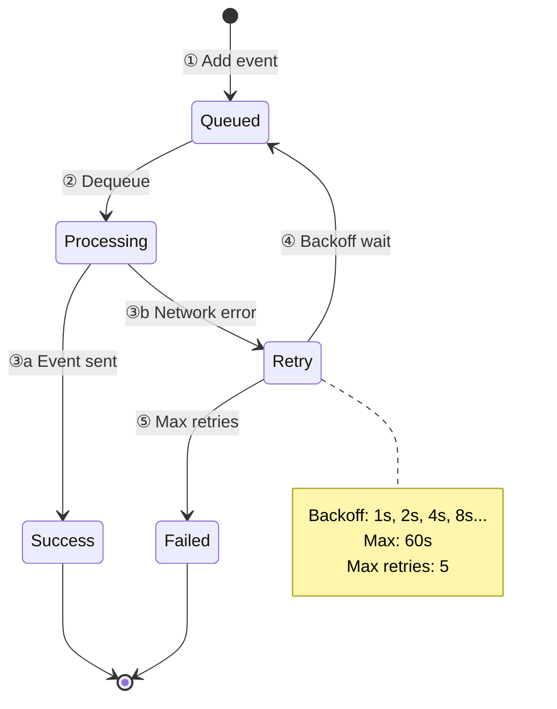
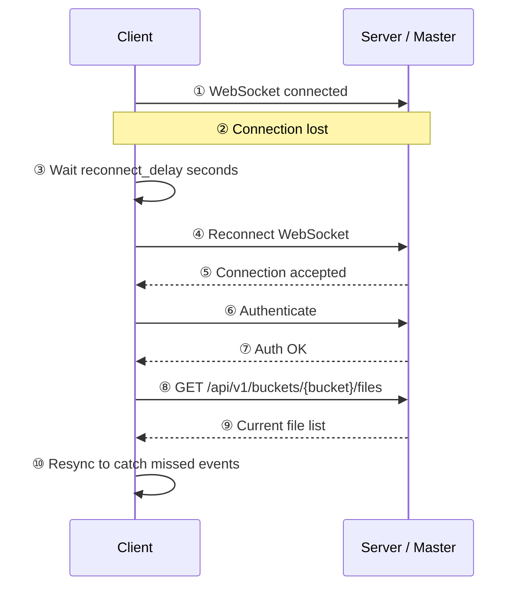
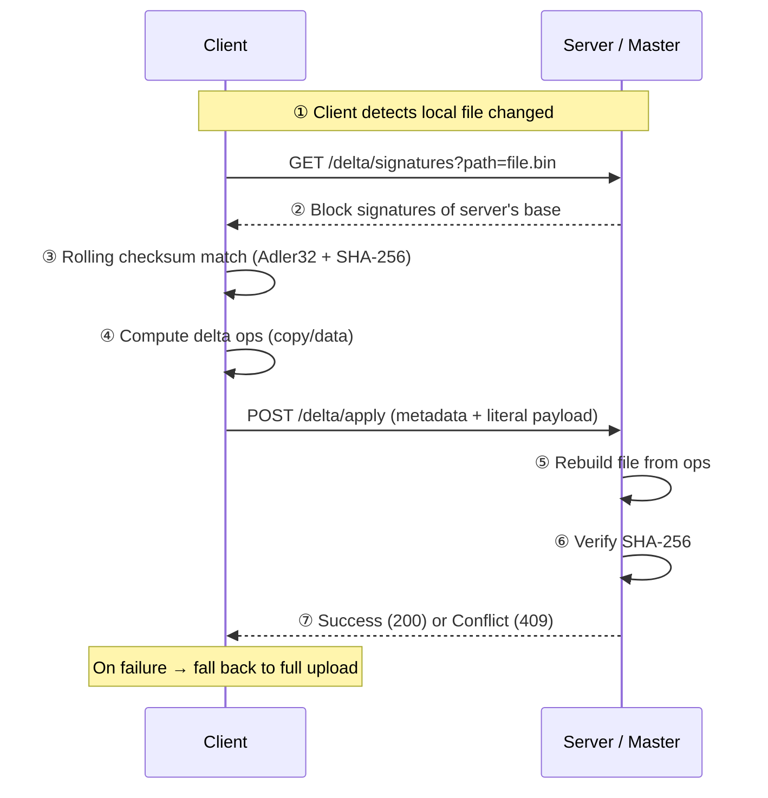
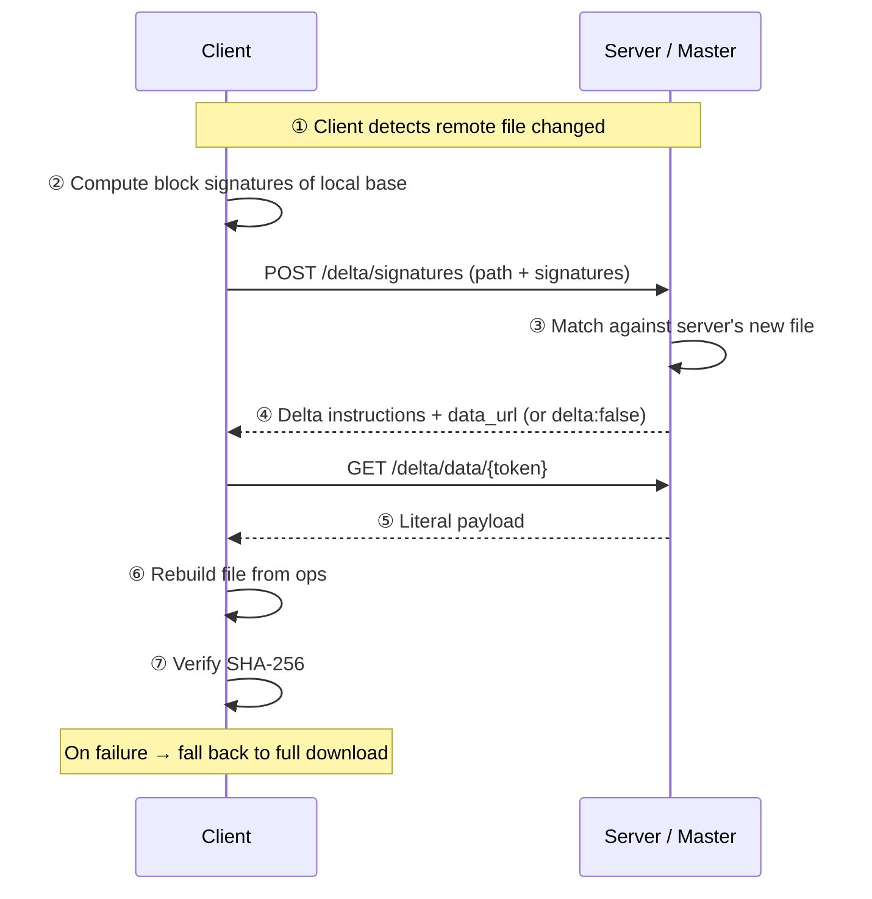

# Client Synchronization Flow

This document describes how the HSYNC client handles file synchronization from
its own perspective. The client is the **active agent**: it watches the local
filesystem, decides what to sync, and drives the transfer.

> For the server-side flow (file storage, event broadcast, tombstones) see the
> [server Sync Flow](https://github.com/albertobasso/hsync-server/blob/main/docs/sync-flow.md).

## Overview



## Initial synchronization

When the client starts, it performs a full reconciliation to ensure consistency
with the remote side (server or LAN master):



## Real-time synchronization (watch mode)

In watch mode, the client maintains a WebSocket connection for instant updates:



## Event handling

When the client receives a remote event via WebSocket, it processes it
according to the event type:



## Conflict resolution

The client uses "last write wins" based on modification time (mtime):



## Event queue and retry

The client queues outbound events (local file changes detected by the watchdog)
and sends them to the server via WebSocket with retry logic:



### Queue interaction with the sync engine

The event queue and the sync engine operate independently but coordinate
through shared state:

- **Event queue** handles real-time propagation: local watchdog events are
  queued immediately and sent to the server as soon as the WebSocket is
  available. Events are not batched — each file change produces a separate
  event.
- **Sync engine** handles full reconciliation: on startup, on reconnection,
  and periodically via `HSYNC_RESYNC`. It compares the full local and remote
  file lists and generates `SyncAction`s.
- **Coordination**: During a full sync, the event queue is drained before
  the sync engine computes its actions. This ensures that events generated
  during the sync window are not lost and are processed before the next
  reconciliation cycle.
- **Debouncing**: The watchdog debounces rapid successive writes to the same
  file (e.g., an editor saving multiple times). On Linux, `on_closed` provides
  natural debouncing; on macOS/Windows, a 1-second debounce window is applied.

> For the three-way merge algorithm used during conflict resolution, see
> [Conflict Resolution](conflict-resolution.md).

## Connection recovery

When the WebSocket connection is lost, the client reconnects and resyncs:



## File stability guard

Before uploading a file, the client waits until the file has stopped changing.
This prevents uploading a half-written file:

- **Fast path (Linux `inotify` `IN_CLOSE_WRITE`)**: the kernel signals that the
  writer closed the file descriptor. The client performs a short re-check
  (0.3 s) and uploads immediately — sub-second propagation.
- **Slow path (polling / non-Linux)**: the client polls size and mtime until
  they settle for `STABILITY_DELAY` seconds (default 5 s).

If a file never stabilises within `MAX_WAIT_TIMEOUT` (default 120 s), the
upload is rescheduled rather than uploading a torn file.

## Delta Transfer (rsync-style block sync)

For large files with small changes, HSYNC can transfer **only the changed blocks**
instead of the whole file. This rsync-style delta transfer significantly reduces
bandwidth usage and transfer time.

### When delta transfer triggers

Delta transfer is attempted automatically when **all** of these conditions are met:

1. **File size threshold**: file is ≥ 256 KB (server mode) or ≥ 1 MB (LAN mode)
2. **Base hash exists**: a previously synced version of the file is recorded in
   `.hsyncstate` (three-way merge state)
3. **Direction check**:
   - **Upload**: local file changed (`local_sha256 != base_hash`)
   - **Download**: local file is still the base (`local_sha256 == base_hash`) and
     remote file changed (`remote_sha256 != base_hash`)
4. **Capability**: both local and remote peers support delta transfer

If any condition is not met, the file is transferred in full — you never have to
choose manually.

### Upload delta flow



### Download delta flow



### Fallback behavior

Delta transfer failures are **transparent**: if any step fails (network error,
hash mismatch, peer doesn't support delta, base changed mid-transfer), the client
automatically falls back to a full file transfer. The retry policy is unchanged —
delta failures do not consume retry attempts.

### Configuration

Delta transfer is **enabled by default**. Disable it with:

```bash
# Environment variable
export HSYNC_DELTA_ENABLED=false

# Or in code
config.delta_enabled = False
```

> For details on delta transfer thresholds and protocol-level negotiation, see
> the [Configuration](configuration.md#delta-transfer) section.

## See also

- [Usage](usage.md) — CLI options reference and log labels.
- [Configuration](configuration.md) — environment variables and CLI options.
- [Sync Modes](sync-modes.md) — single, watch, and LAN mode comparison.
- [Server Sync Flow](https://github.com/albertobasso/hsync-server/blob/main/docs/sync-flow.md) — the server's perspective.
- [Server Delta Transfer Guide](https://github.com/albertobasso/hsync-server/blob/main/docs/delta-transfer.md) — server-side delta transfer endpoints and configuration.
