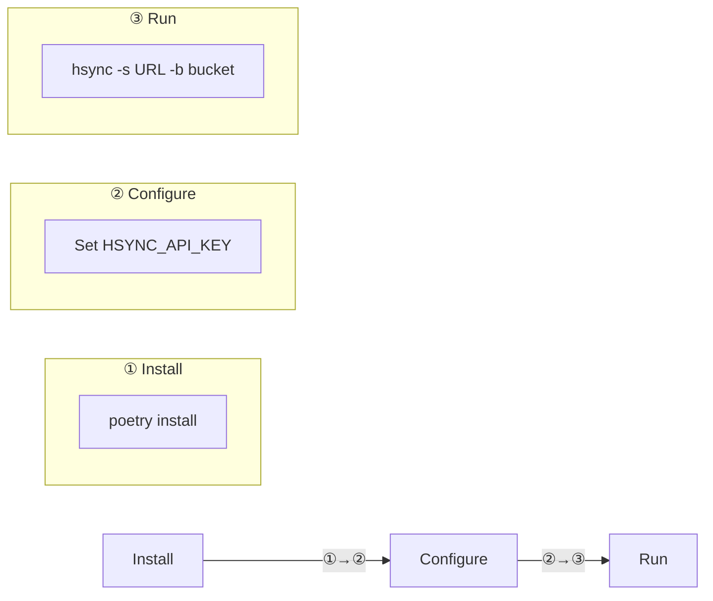
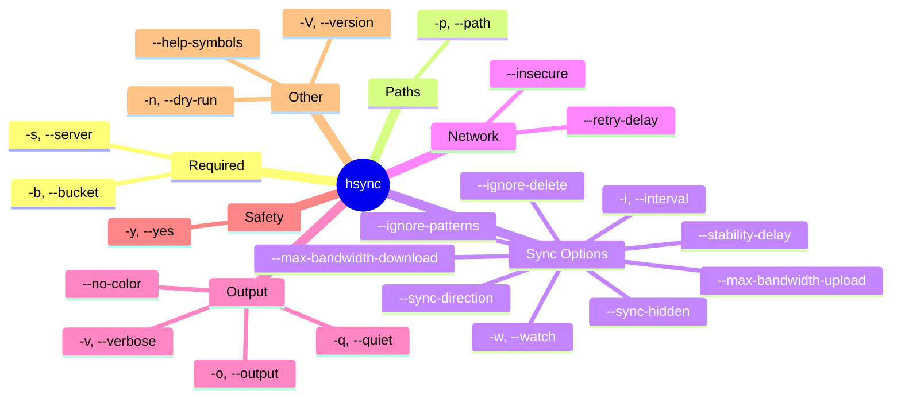
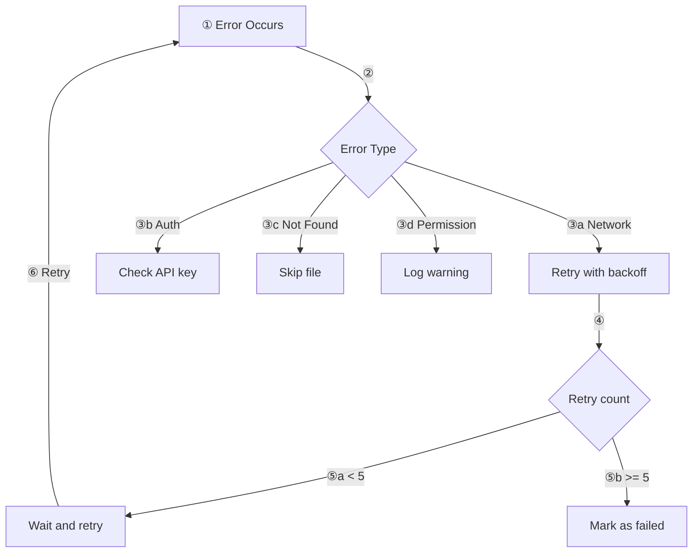

# HSYNC Client Usage Guide

This document provides detailed usage instructions for the HSYNC Client.

## Quick Start



## Command Line Interface

### Basic Syntax

```bash
hsync -s <server_url> -b <bucket_name> [options]
```

### Options Overview



## Usage Scenarios

For end-user oriented examples — sync between two devices, backup, LAN
P2P, read-only mirror, scripted execution and so on — see the dedicated
[Examples](examples.md) document, split between server-based and LAN
deployments.

## Log Labels

Use `--help-symbols` to display this legend in the terminal.

### Sync Operations

| Label | Meaning | Description |
|-------|---------|-------------|
| `[IN SYNC   ]` | In sync | File already in sync (no action required) |
| `[SKIP      ]` | Skip | File skipped |
| `[DOWNLOAD  ]` | Download | Downloading from server / master |
| `[UPLOAD    ]` | Upload | Uploading to server / master |
| `[RESUME    ]` | Resume | Resuming partial upload or download |
| `[MOVE      ]` | Move | Renaming / moving file or directory |
| `[REMOVE    ]` | Remove | Removing file or directory |
| `[CREATE    ]` | Create | Creating directory |
| `[DELETE    ]` | Delete | Deleting local file not present on master (LAN mode) |
| `[PERMISSION]` | Permissions | Setting file / directory permissions |
| `[SYMLINK   ]` | Symlink | Creating symbolic link |
| `[IGNORE DEL]` | Ignore delete | Deletion ignored (backup / ignore-delete mode) |

### LAN Client Operations

| Label | Meaning | Description |
|-------|---------|-------------|
| `[CLIENT UP  ]` | Client upload | Client uploads file to master |
| `[CLIENT DEL ]` | Client delete | Client deletes file on master |
| `[CLIENT REN ]` | Client rename | Client renames file on master |
| `[CLIENT DIR ]` | Client dir | Client creates directory on master |
| `[CLIENT KEEP]` | Client sentinel | Client creates sentinel file (`.hsynckeep`) |
| `[CLIENT IGN ]` | Client ignore | Client ignores deletion (ignore-delete mode) |

Log levels (ERROR, WARNING, INFO, DEBUG) are shown by the logging system.

## Error Handling



## Environment Variables

| Variable | Description | Default |
|----------|-------------|---------|
| `HSYNC_SERVER` | Default server URL | (use `-s`) |
| `HSYNC_API_KEY` | API key for authentication | (required) |
| `HSYNC_MAX_CONCURRENT_TRANSFERS` | Max parallel file transfers | `5` |
| `HSYNC_MAX_FILE_WORKERS` | Max parallel workers for local file scanning | auto (CPU-based) |
| `HSYNC_STABILITY_DELAY` | Seconds to wait before uploading modified files | `5` |
| `HSYNC_SYNC_HIDDEN` | Include hidden/system files in sync | `false` |
| `HSYNC_IGNORE_PATTERNS` | Comma-separated extra gitignore-style patterns | `""` |

### Environment Files

Use the provided environment templates for easy setup:

```bash
# Development (HTTP, localhost)
source dev.env
hsync -b mybucket -w

# Production (HTTPS, remote server)
source prod.env
hsync -b mybucket -w
```

## Examples

End-user oriented examples have moved to a dedicated document:

- [Examples](examples.md) — practical scenarios grouped by deployment
  model (server-based and LAN P2P), including syncing a folder between
  two devices, push-only backups, read-only mirrors, scripted /
  unattended execution, bandwidth tuning and more.

> **Note**: In LAN mode, `--force-master` cannot be combined with `--sync-direction upload-only` or `download-only` (the client will exit with an error). During automatic election, bidirectional peers are preferred as master. See [LAN Mode > Master Election](lan-mode.md#master-election) for the full election algorithm.
