# HSYNC Client Usage Guide

This document provides detailed usage instructions for the HSYNC Client.

> **Note**: Diagrams are written in Mermaid. If they don't render, run `./generate-diagrams.sh` to generate PNG images in the `images/` directory.

## Quick Start

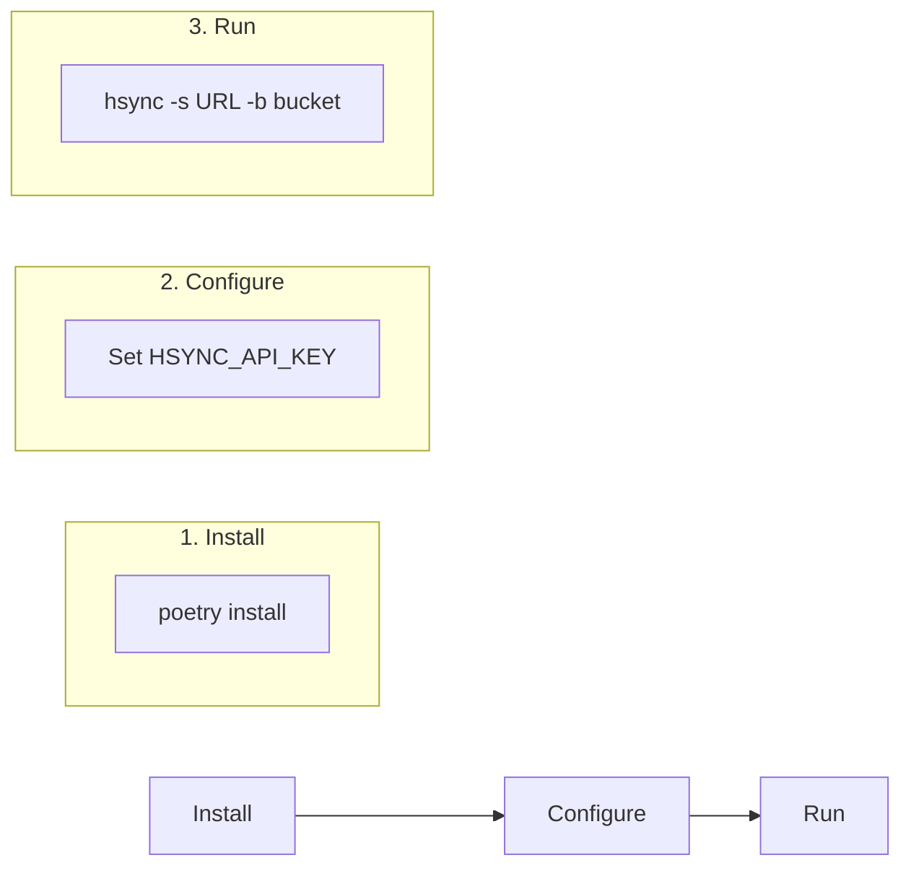

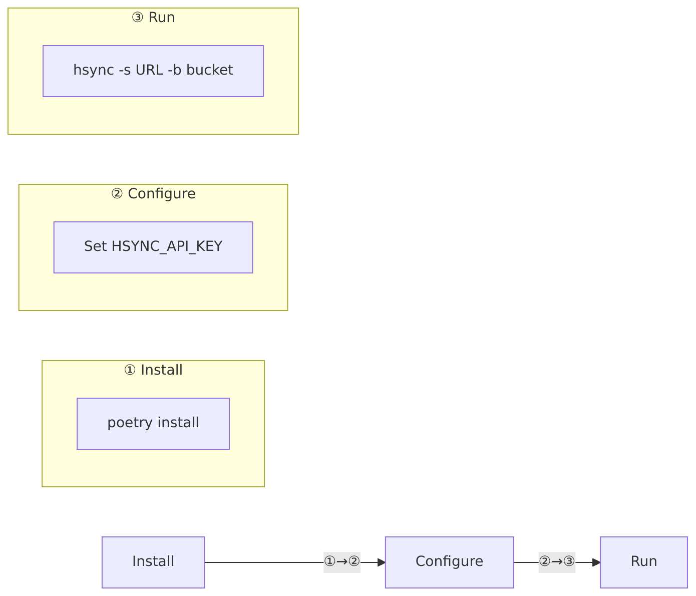

## Command Line Interface

### Basic Syntax

```bash
hsync -s <server_url> -b <bucket_name> [options]
```

### Options Overview

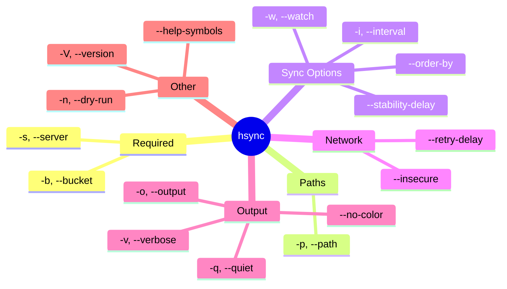

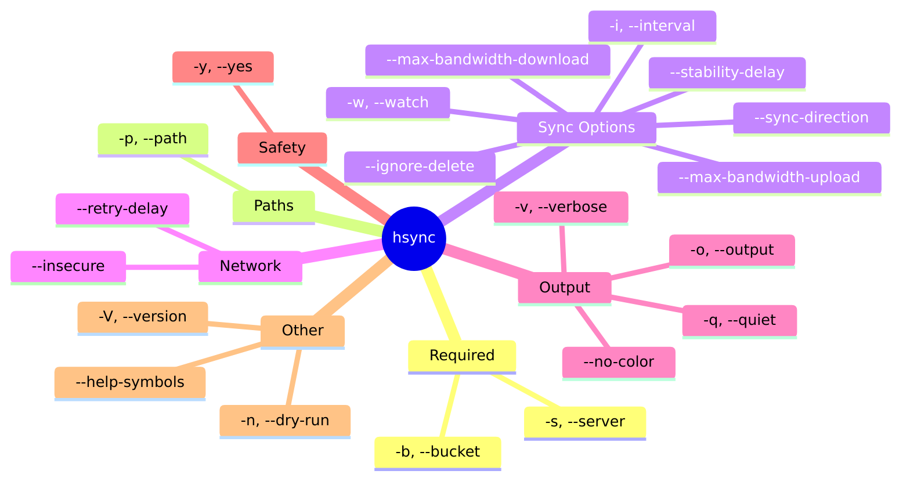

## Usage Scenarios

### Scenario 1: One-Time Sync

Synchronize files once and exit:

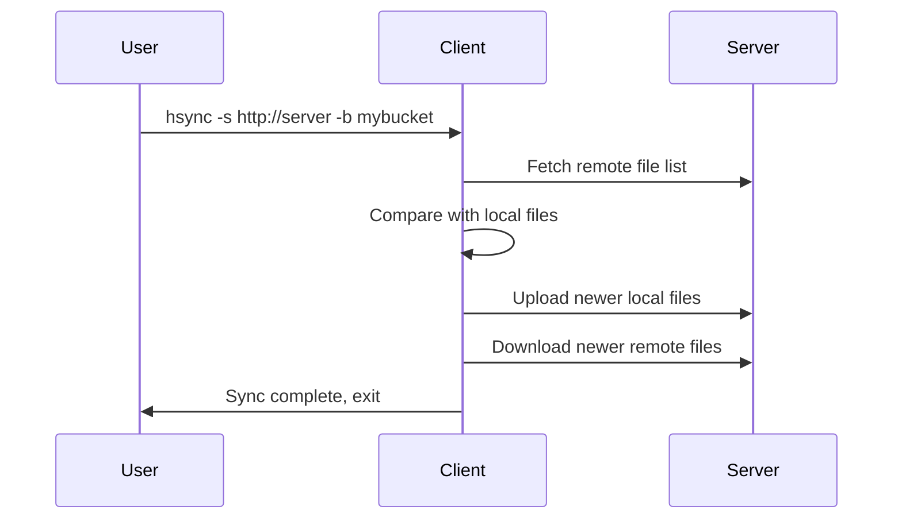

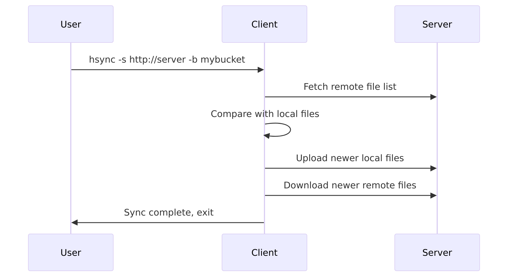

**Command:**
```bash
export HSYNC_API_KEY="your-api-key"
hsync -s http://localhost:8765 -b mybucket -p /path/to/local/dir
```

### Scenario 2: Continuous Sync (Watch Mode)

Keep files synchronized in real-time:

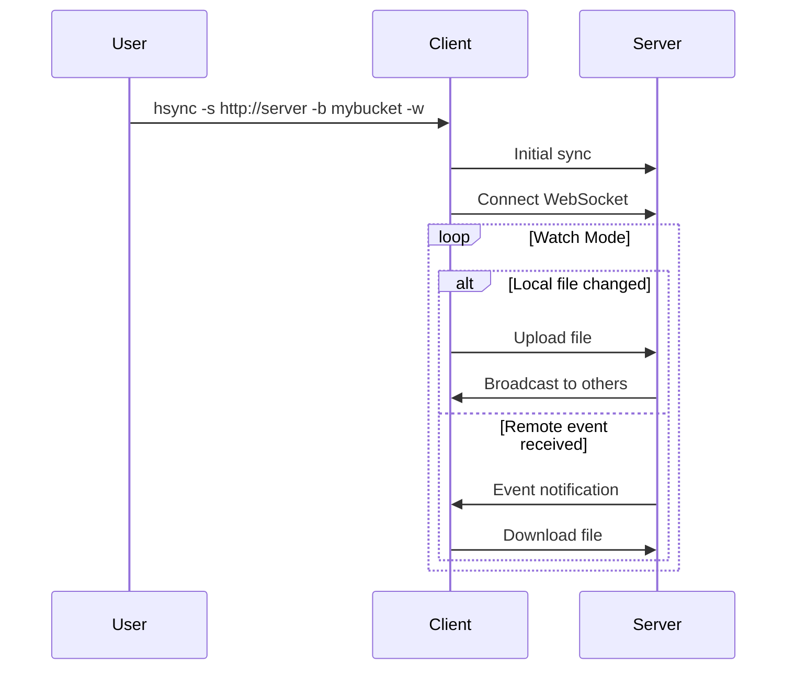

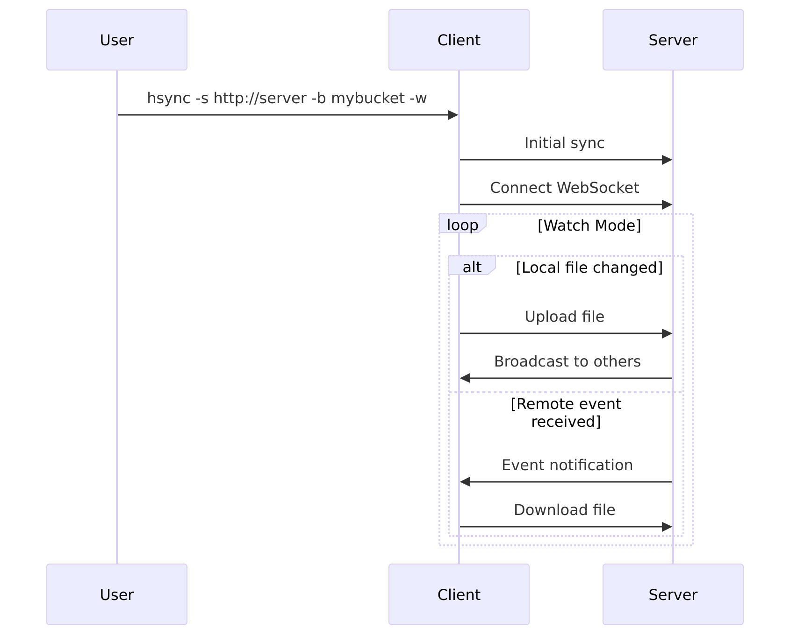

**Command:**
```bash
hsync -s http://localhost:8765 -b mybucket -w
```

### Scenario 3: Periodic Re-sync

Watch mode with periodic full sync:

```mermaid
gantt
    title Sync Timeline
    dateFormat HH:mm
    axisFormat %H:%M
    
    section Initial
    Initial Sync     :done, 00:00, 1m
    
    section Watch
    Real-time events :active, 00:01, 5m
    
    section Periodic
    Full Re-sync     :crit, 00:05, 1m
    Real-time events :active, 00:06, 5m
    Full Re-sync     :crit, 00:10, 1m
```

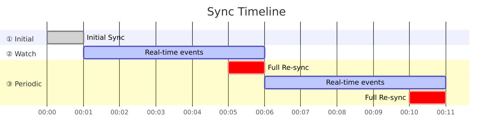

**Command:**
```bash
hsync -s http://localhost:8765 -b mybucket -w -i 300
```

### Scenario 4: Dry Run (Preview)

See what would happen without making changes:

```bash
hsync -s http://localhost:8765 -b mybucket -n
```

**Output example:**
```
[↓] Would download: documents/report.pdf
[↑] Would upload: images/photo.jpg
[✕] Would delete: old/deprecated.txt
```

## Log Symbols

| Symbol | Meaning | Description |
|--------|---------|-------------|
| `·` | Skip | File unchanged |
| `↓` | Download | Downloading from server |
| `↑` | Upload | Uploading to server |
| `→` | Move | Renaming/moving file |
| `✕` | Delete | Removing file |
| `+` | Create | Creating directory |
| `⚙` | Permissions | Setting file permissions |
| `L` | Symlink | Creating symbolic link |

## Error Handling

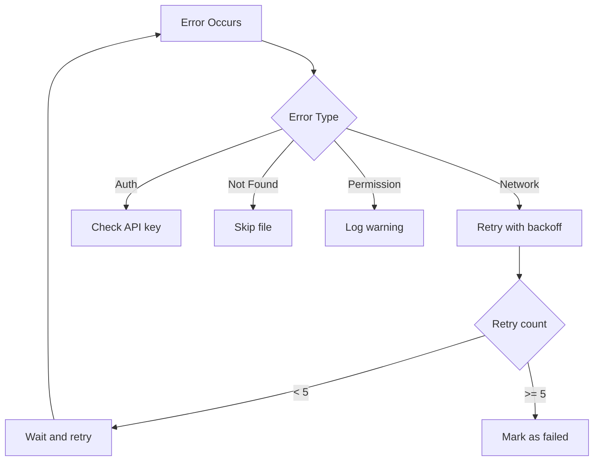

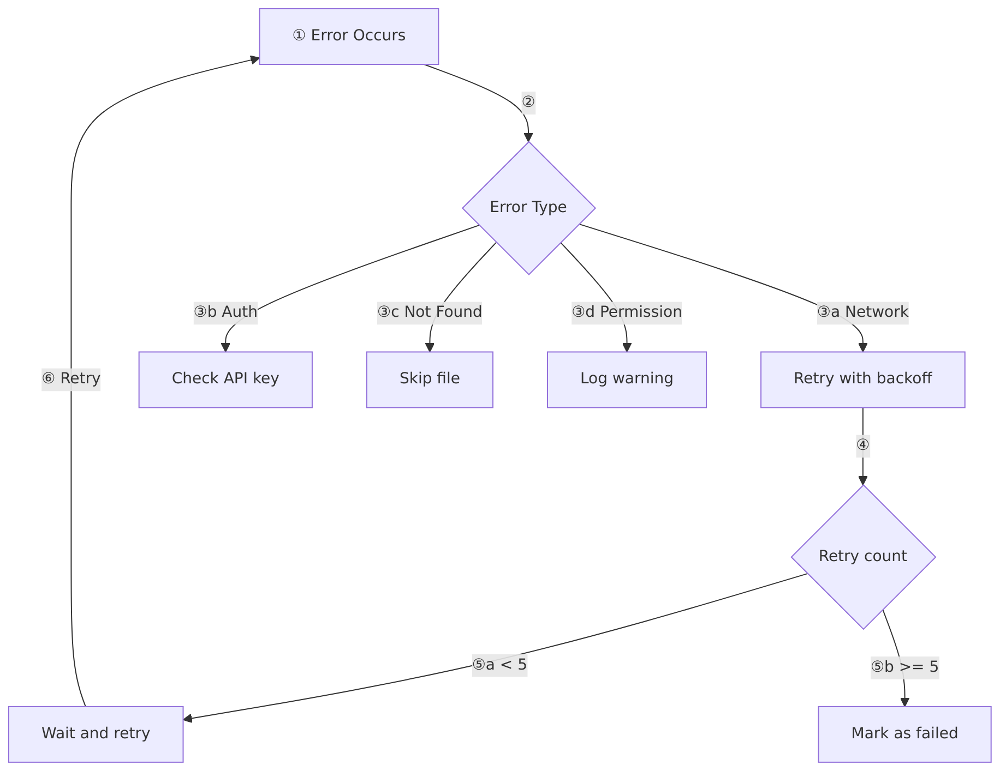

## Environment Variables

| Variable | Description | Default |
|----------|-------------|---------|
| `HSYNC_SERVER` | Default server URL | (use `-s`) |
| `HSYNC_API_KEY` | API key for authentication | (required) |
| `HSYNC_MAX_CONCURRENT_TRANSFERS` | Max parallel file transfers | `5` |
| `HSYNC_STABILITY_DELAY` | Seconds to wait before uploading modified files | `5` |

### Environment Files

Use the provided environment templates for easy setup:

```bash
# Development (HTTP, localhost)
source dev.env
hsync -b mybucket -w

# Production (HTTPS, remote server)
source prod.env
hsync -b mybucket -w
```

## Examples

### Sync with verbose output
```bash
hsync -s http://localhost:8765 -b mybucket -v
```

### Sync with file logging
```bash
hsync -s http://localhost:8765 -b mybucket -w -o /var/log/hsync.log
```

### Sync without SSL verification (development)
```bash
hsync -s https://dev-server:8765 -b mybucket --insecure
```

### Sync with custom retry delay
```bash
hsync -s http://localhost:8765 -b mybucket -w --retry-delay 10
```

### Sync with longer stability delay (for slow storage or large files)
```bash
hsync -s http://localhost:8765 -b mybucket -w --stability-delay 10
```
