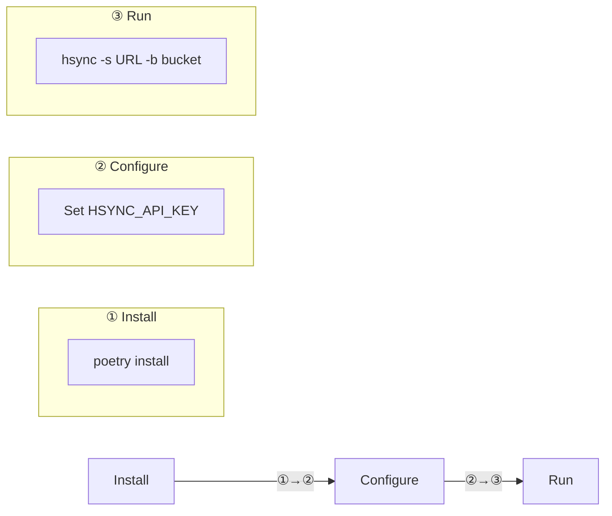
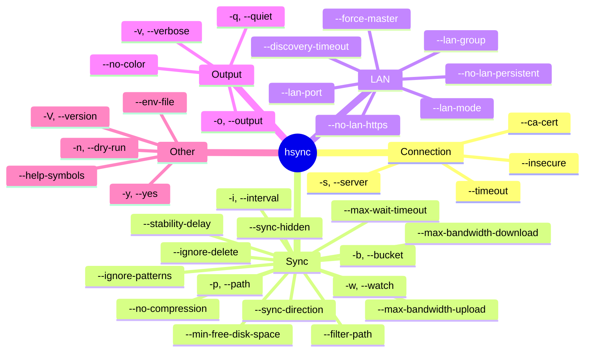
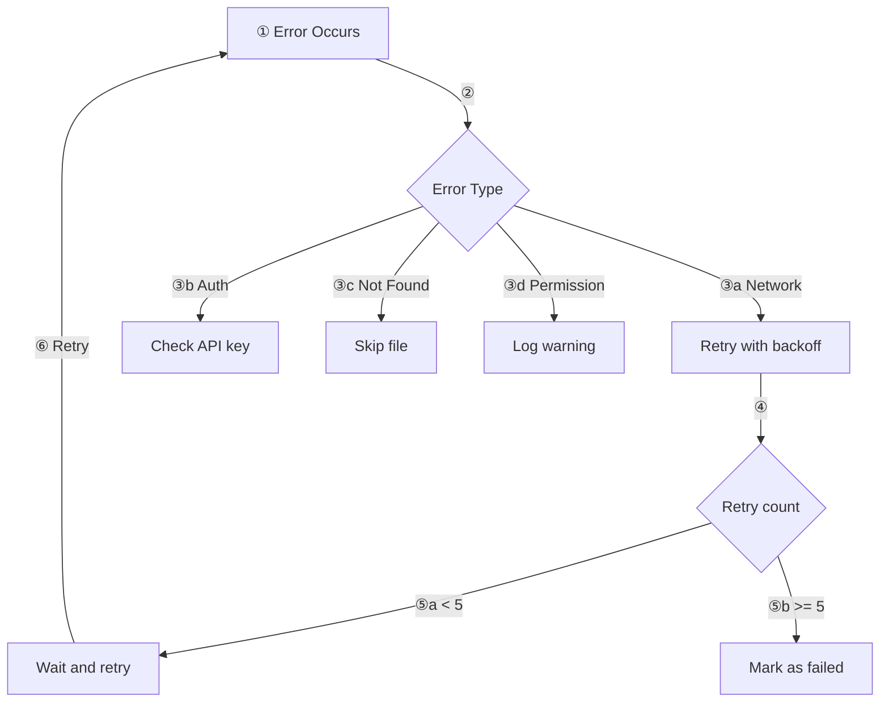

# HSYNC Client Usage Guide

This document provides detailed usage instructions for the HSYNC Client.

## Quick Start



## Command Line Interface

### Basic Syntax

HSYNC runs in one of two mutually exclusive operating modes:

```bash
# Server Mode — connect to a central HSYNC server
hsync -s <server_url> -b <bucket_name> [options]

# LAN Mode — peer-to-peer, no server (mDNS discovery, implicit watch)
hsync --lan-mode -b <bucket_name> [options]
```

See [Sync Modes → Operating Modes](sync-modes.md#operating-modes-server-vs-lan)
for when to use each.

### Options Overview



> For the **complete option reference** (descriptions, defaults and accepted
> values) see [Configuration → CLI Options](configuration.md#cli-options).
> `HSYNC_LAN_KEY` is set via environment variable only.

## Usage Scenarios

For end-user oriented examples — sync between two devices, backup, LAN
P2P, read-only mirror, scripted execution and so on — see the dedicated
[Examples](examples.md) document, split between server-based and LAN
deployments.

## Log Labels

Use `--help-symbols` to display this legend in the terminal.

### Sync Operations

| Label | Meaning | Description |
|-------|---------|-------------|
| `[IN SYNC   ]` | In sync | File already in sync (no action required) |
| `[SKIP      ]` | Skip | File skipped |
| `[DOWNLOAD  ]` | Download | Downloading from server / master |
| `[UPLOAD    ]` | Upload | Uploading to server / master |
| `[RESUME    ]` | Resume | Resuming partial upload or download |
| `[MOVE      ]` | Move | Renaming / moving file or directory |
| `[REMOVE    ]` | Remove | Removing file or directory |
| `[CREATE    ]` | Create | Creating directory |
| `[DELETE    ]` | Delete | Deleting local file not present on master (LAN mode) |
| `[PERMISSION]` | Permissions | Setting file / directory permissions |
| `[SYMLINK   ]` | Symlink | Creating symbolic link |
| `[IGNORE DEL]` | Ignore delete | Deletion ignored (backup / ignore-delete mode) |

### LAN Client Operations

| Label | Meaning | Description |
|-------|---------|-------------|
| `[CLIENT UP  ]` | Client upload | Client uploads file to master |
| `[CLIENT DEL ]` | Client delete | Client deletes file on master |
| `[CLIENT REN ]` | Client rename | Client renames file on master |
| `[CLIENT DIR ]` | Client dir | Client creates directory on master |
| `[CLIENT KEEP]` | Client sentinel | Client creates sentinel file (`.hsynckeep`) |
| `[CLIENT IGN ]` | Client ignore | Client ignores deletion (ignore-delete mode) |

Log levels (ERROR, WARNING, INFO, DEBUG) are shown by the logging system.

## Error Handling



## Environment Variables

Environment variables and the provided `dev.env` / `prod.env` templates are
documented in the single configuration reference:

- [Configuration → Environment Variables](configuration.md#environment-variables)
- [Configuration → Environment Files](configuration.md#environment-files)

## Examples

End-user oriented examples have moved to a dedicated document:

- [Examples](examples.md) — practical scenarios grouped by deployment
  model (server-based and LAN P2P), including syncing a folder between
  two devices, push-only backups, read-only mirrors, scripted /
  unattended execution, bandwidth tuning and more.

> **Note**: In LAN mode, `--force-master` cannot be combined with `--sync-direction upload-only` or `download-only` (the client will exit with an error). During automatic election, bidirectional peers are preferred as master. See [LAN Mode > Master Election](lan-mode.md#master-election) for the full election algorithm.
